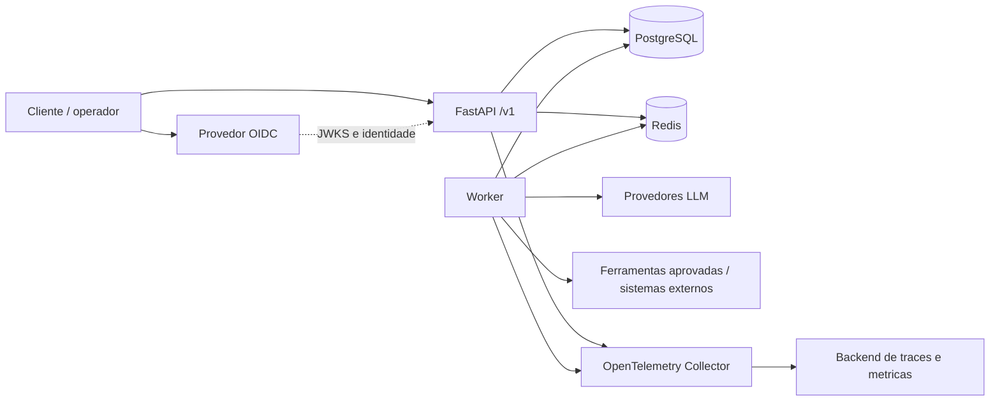
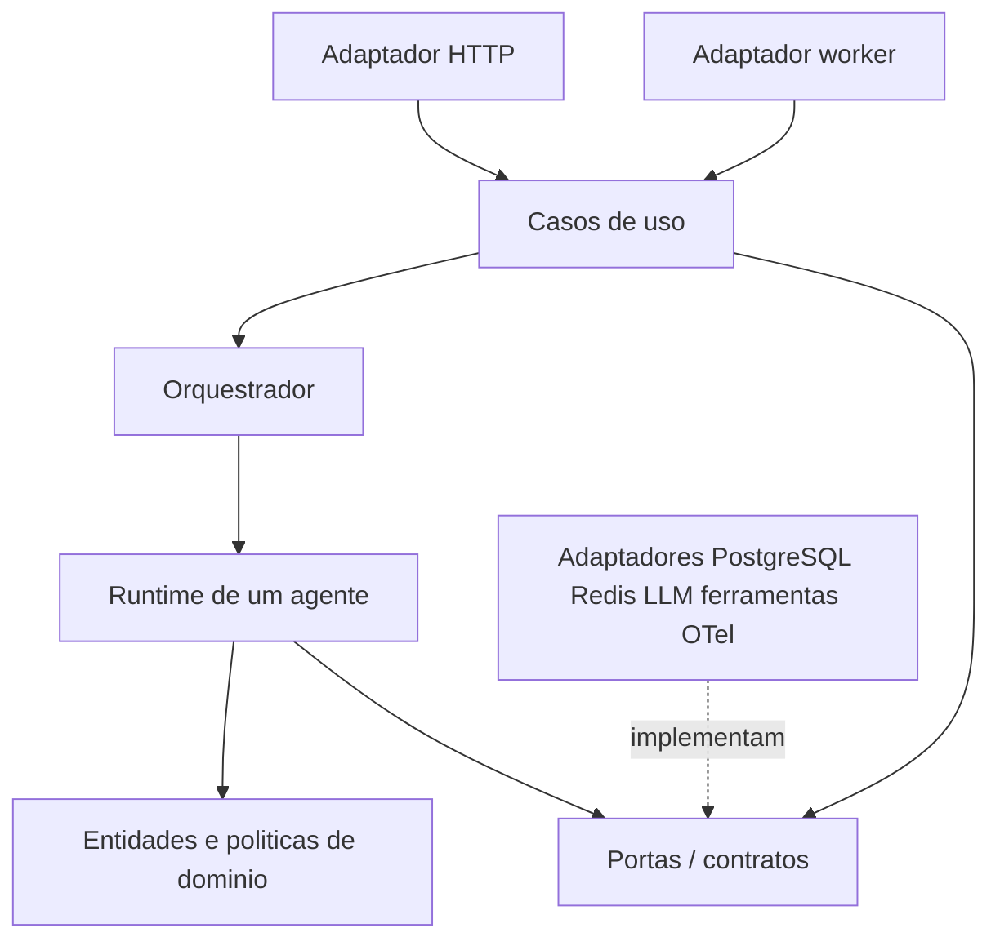
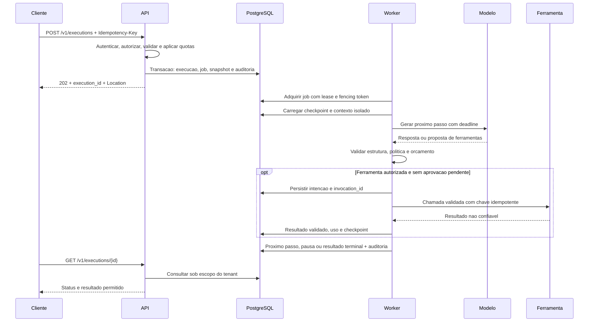

# Fase 1 - Arquitetura

## 1. Objetivo e fronteiras

A plataforma recebe tarefas autenticadas, executa agentes configuraveis,
controla chamadas de modelos e ferramentas e conserva estado suficiente para
auditoria, aprovacao e recuperacao.

Dentro da plataforma:

- Catalogos versionados de agentes, modelos permitidos e ferramentas.
- Runtime de um agente e orquestracao de workflows multiagente.
- Politicas, contexto, memorias, aprovacoes, quotas e avaliacao.
- API de controle, workers, checkpoints, auditoria e telemetria.

Fora da plataforma:

- Emissao de identidades, cobranca financeira e treinamento de modelos.
- Implementacao dos sistemas de negocio chamados por ferramentas.
- Execucao arbitraria de codigo enviado por usuarios ou modelos.
- Garantia de rollback de efeitos externos sem suporte do sistema de destino.

O primeiro deploy sera um monolito modular com dois processos independentes:
API e worker. Isso evita microservicos prematuros sem executar tarefas longas
dentro do processo HTTP.

## 2. Contexto do sistema



PostgreSQL e a fonte de verdade de execucoes, jobs, checkpoints, quotas,
aprovacoes e auditoria. Redis acelera cache, sinalizacao e coordenacao
efemera; perder o Redis nao pode apagar trabalho ou conceder permissoes.

## 3. Camadas e responsabilidades



Estrutura planejada, ainda nao implementada:

```text
src\agent_harness\
  domain\          entidades, estados, politicas e erros tipados
  application\     casos de uso, runtime, orquestracao e portas
  adapters\
    http\          FastAPI, autenticacao e schemas publicos
    persistence\   PostgreSQL, migracoes, repositorios e jobs
    providers\     adaptadores de modelos
    tools\         implementacoes confiaveis de ferramentas
    coordination\  Redis e sinais de cancelamento
    telemetry\     logs, traces e metricas
  bootstrap\       configuracao e composicao de dependencias
tests\
  unit\
  integration\
  evaluation\
  resilience\
```

- **Runtime:** conduz passos de um agente; nao conhece HTTP nem SDKs de LLM.
- **Orquestrador:** agenda nos de workflow, joins, condicoes e handoffs;
  nao duplica o loop interno do runtime.
- **Model gateway:** normaliza mensagens, chamadas, uso, erros e capacidades.
- **Tool registry:** resolve implementacoes confiaveis e descritores
  versionados. O banco guarda configuracao, nao codigo executavel.
- **Context manager:** monta contexto por tenant/sessao, reserva espaco para
  resposta e resume historico sem sobrescrever o registro original.
- **Policy engine:** decide acesso, limites e necessidade de aprovacao.
- **Repositorios e scheduler:** transacoes, concorrencia otimista e retomada.
- **Avaliador:** mede comportamento com datasets versionados fora do caminho
  critico; avaliacao humana fica associada a execucao e versao do agente.

As dependencias apontam para contratos internos. Pydantic valida fronteiras;
o dominio nao importa FastAPI, LangGraph nem SDKs de provedores.

## 4. Ciclo de vida e durabilidade



Estados: `queued`, `running`, `waiting_approval`, `cancel_requested`,
`succeeded`, `failed`, `cancelled`, `expired`. Estados terminais sao imutaveis.
As transicoes e pre-condicoes estao nos [contratos](contracts.md).

Jobs sao adquiridos com `FOR UPDATE SKIP LOCKED`; a transacao nao permanece
aberta durante I/O externo. Heartbeat renova lease. Toda escrita de worker
exige a versao e o fencing token atuais, inclusive na conclusao. Worker
antigo nao pode sobrescrever um worker que recuperou a tarefa.

Entrega de jobs e **at-least-once**, nao exactly-once. Uma intencao de chamada
e persistida antes do efeito externo. Se houver queda depois do efeito e antes
do checkpoint, repetir so e permitido quando o destino suporta idempotencia
ou reconciliacao. Nos demais casos, a execucao falha com
`tool_outcome_unknown` e exige reconciliacao operacional; nunca repete
automaticamente uma acao irreversivel.

Criacao de trabalho, eventos de auditoria e outbox usam a mesma transacao.
Notificacoes Redis sao dicas; polling do PostgreSQL recupera sinais perdidos.
Admissoes, reservas de quota e liberacoes terminais sao atomicas.

## 5. Contexto, memoria e isolamento

- Chaves de armazenamento incluem `tenant_id`; sessoes tambem possuem dono
  e ACL. UUID imprevisivel nao substitui autorizacao.
- Contexto curto contem mensagens da sessao, resumo versionado e resultados
  selecionados da execucao. Memoria persistente e um recurso separado com
  escopo, proveniencia, retencao e permissao de leitura/escrita.
- Uma sessao admite uma execucao mutante por vez; outra recebe `409`.
  Workers usam o mesmo bloqueio duravel. Execucoes de sessoes diferentes
  podem progredir em paralelo.
- Handoffs recebem somente o subconjunto de contexto explicitamente mapeado
  pelo workflow; nao herdam memoria ou ferramentas implicitamente.
- O budget inclui instrucoes, schemas de ferramentas, historico, resultados
  e reserva de resposta. Contadores aproximados sao identificados; o uso
  informado pelo provedor e armazenado separadamente.
- Resumos guardam intervalo de mensagens e versao do sumarizador. O resumo
  e dado nao confiavel, nunca nova instrucao de sistema.
- Estouro de contexto nao e resolvido removendo politicas: resume-se historico
  elegivel ou falha-se explicitamente com `context_budget_exceeded`.

## 6. Workflows e aprovacao humana

Workflows versionados formam um DAG: nos de agente, sequencia, paralelo,
condicao e aprovacao. Ciclos do grafo sao rejeitados; loops do agente continuam
limitados por passos, tempo, tokens e custo. Condicoes usam predicados
declarativos tipados, nunca `eval`.

Cada no possui checkpoint e resultado independente. Um join espera todos os
ramos obrigatorios; falha cancela ramos pendentes, preserva resultados ja
concluidos e nao desfaz efeitos externos. Resultados parciais ficam visiveis,
mas nao sao marcados como sucesso global. Compensacao de negocio so existe
quando explicitamente implementada pela ferramenta.

Uma aprovacao pausa o trabalho e libera o worker. A solicitacao guarda
argumentos imutaveis protegidos, hash, ferramenta e versao, justificativa,
prazo e politica. O aprovador precisa de permissao especifica; a politica
pode proibir autoaprovacao.

Decisao e criacao do job de retomada sao atomicas. Aprovar nao executa a
ferramenta na API. O worker verifica novamente cancelamento, prazo, identidade
da chamada, versao e permissoes atuais. Rejeicao encerra com
`approval_rejected`, sem chamar a ferramenta. Aprovacoes expiradas nao
autorizam acoes. Nao ha reserva de worker ou lease durante a espera.

## 7. Seguranca e governanca

- JWT validado por assinatura com algoritmos permitidos, emissor, audiencia
  e expiracao; JWKS com cache limitado e rotacao. Indisponibilidade sem chave
  valida falha fechada. Claims de tenant sao cruzadas com vinculos ativos
  mantidos pelo servidor; nunca confiar em `tenant_id` do corpo.
- RBAC: `agent:write`, `tool:write`, `execution:create`, `execution:read`,
  `execution:cancel`, `approval:decide`, `audit:read`. Cada permissao opera
  dentro do tenant e da ACL do recurso.
- Ferramentas exigem intersecao entre grant do tenant, grant do principal,
  allowlist do agente e politica atual. Aprovacao nao amplia essa intersecao.
- Registro HTTP habilita apenas implementacoes instaladas por operadores.
  Nao aceita Python, imports, comandos shell ou URLs arbitrarias.
- JSON Schema versionado valida argumentos e resultados. Tamanho, profundidade,
  numero de chamadas e payloads sao limitados antes de processar conteudo caro.
- Conectores externos aplicam allowlist de destino, protecao SSRF, TLS e
  credenciais de minimo privilegio; nao seguem redirects fora da politica.
- Configuracao via ambiente ou secrets montados. Segredos nao entram em
  snapshots, prompts, argumentos publicos ou respostas de erro.
- Quotas por tenant abrangem concorrencia, fila, tokens, custo estimado e
  frequencia. Valores monetarios usam Decimal e moeda explicita.
- Reservar custo conservador antes de cada chamada; reconciliar uso real
  depois. Uso desconhecido mantem reserva para reconciliacao, nao vira zero.
- Deadline total usa tempo persistido; espera humana nao pausa a expiracao.
  Limite de tempo ativo e contabilizado separadamente e persiste na retomada.
- Logs usam campos permitidos e redacao; nao registram prompts, tokens JWT,
  argumentos ou respostas completos por padrao. Auditoria guarda identidade,
  decisao, referencias e hashes, nao cadeia de pensamento.
- PostgreSQL aplica tenant em consultas, chaves compostas e RLS para tabelas
  isoladas; roles de aplicacao nao podem ignorar RLS. Jobs globais carregam
  apenas identificadores antes de entrar em transacao com escopo de tenant.
- Payloads privados ficam em armazenamento protegido com retencao definida.
  TLS, criptografia em repouso, backups e teste de restauracao sao requisitos
  de deploy, nao garantias fornecidas apenas por Docker Compose.

Nao existe protecao absoluta contra prompt injection. O limite de confianca e
implementado fora do modelo, inclusive quando a instrucao maliciosa aparece
em ferramenta, resumo ou memoria.

## 8. Resiliencia e observabilidade

Retries usam backoff exponencial com jitter, limite de tentativas e deadline
restante. Apenas falhas transitorias sao repetidas; `Retry-After` e respeitado.
Falhas de autenticacao, validacao ou politica nao recebem retry.

Circuit breaker por dependencia e credencial logica possui estados closed,
open e half-open; coordenacao Redis usa operacoes atomicas e janela limitada.
Sem Redis, admissao de chamadas externas falha explicitamente como
`coordination_unavailable`, em vez de ignorar o breaker distribuido.
Cancelamento e consultado no banco entre passos; Redis acelera o sinal.
I/O cooperativo recebe cancelamento e timeout. Ferramentas nao cooperativas
nao podem rodar inline no processo do worker: exigem isolamento cancelavel.

Fallback so usa modelos configurados e equivalentes nas capacidades exigidas
(tools, schema, contexto e politica de residencia). Nao repete efeitos de
ferramentas. Cada tentativa tem uso e custo proprios, inclusive falhas quando
o provedor informa consumo.

Spans: requisicao, execucao, passo, chamada LLM, chamada de ferramenta,
checkpoint e retomada. `execution_id` correlaciona tentativas; trace context
propaga-se em jobs. Retomadas usam span links quando houver novo trace.

Metricas incluem duracao, profundidade da fila, leases expirados, tokens,
custo estimado, aprovacoes pendentes, chamadas de ferramentas e falhas por
categoria. IDs de usuario, sessao e execucao nao viram labels de metricas
para evitar cardinalidade ilimitada.

Implementacao atual da Fase 6: spans de admissao, worker/retomada, contexto,
execucao, passo, chamada LLM, invocacao/dispatch de ferramenta, checkpoint e
cancelamento; logs JSON; metricas de tentativas, falhas, latencia, consumo,
custo, circuitos e fila; auditoria transacional append-only. Jobs conservam
W3C traceparent sem baggage, e workers ligam traces por span links.
Spans HTTP e metricas de aprovacao aguardam as respectivas fases. Detalhes
operacionais e limites estao no [guia da Fase 6](phase-06-observability.md).

## 9. Decisoes e trade-offs

| Decisao | Motivo | Custo / limite |
|---|---|---|
| Monolito modular + worker separado | Simplicidade e escala independente | Disciplina de fronteiras e deploys coordenados |
| PostgreSQL como fila inicial | Estado e agendamento atomicos | Polling e contencao; medir antes de adicionar broker |
| Redis sem estado autoritativo | Recuperacao apos perda do cache | Algumas chamadas pausam quando coordenacao falha |
| API assincrona por padrao | Sem tarefas presas ao HTTP | Cliente precisa consultar status |
| Orquestracao separada do runtime | Testes e evolucao independentes | Contratos de handoff e checkpoints explicitos |
| LangGraph adiado | Nao duplicar scheduler/checkpoints | Reavaliar na Fase 4 com prototipo e testes de retomada |
| Snapshot versionado por execucao | Reprodutibilidade e auditoria | Revogacoes atuais sempre prevalecem |
| Sem execucao de plugins enviados pela API | Reduz superficie de ataque | Novos binarios de ferramentas exigem deploy |
| Serializacao por sessao | Historico sem escritas concorrentes ambiguas | Paralelismo acontece entre sessoes ou nos isolados |
| Sem promessa exactly-once externa | Reflete limites reais de redes | Ferramentas precisam idempotencia ou reconciliacao |

## 10. Criterio de encerramento da Fase 1

Fronteiras, entidades, portas, fluxo, transicoes, modelo de persistencia,
seguranca e etapas de entrega estao definidos nestes documentos. Ainda falta
validar as decisoes em codigo e testes. Nao foram executados testes de runtime
porque nenhum runtime foi implementado nesta fase.
