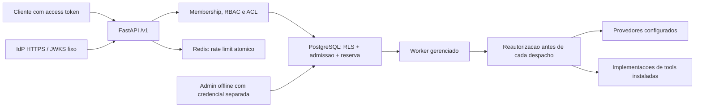

# Fase 7 - Guardrails, identidade e API

Este documento preserva o escopo e as evidencias da Fase 7. Aprovacoes,
migracao 4 e o novo fluxo operacional estao no
[guia da Fase 8](phase-08-approvals.md).

## Desenho e fronteiras

Aprovada depois da Fase 6, mantendo explicitamente o bloqueio de validacao
dos servicos reais. Nao inicia aprovacao humana nem prontidao de producao.



- `security.py`: identidade assinada, permissoes, politica de schemas e
  estimativa conservadora de reserva. Claims de role/grants nao autorizam.
- `api.py`: fronteira HTTP versionada, contratos Pydantic, validacao de
  entradas, erros sanitizados e limites do servidor.
- `security_postgres.py`: memberships, catalogos versionados, reautorizacao
  e ledger de cotas; nao existe fallback em memoria para falha do banco.
- `security.sql`: migracao 3, roles e `ENABLE/FORCE ROW LEVEL SECURITY`.
- `rate_limit.py`: janela fixa de minuto usando TIME e Lua no Redis.
- `secure_worker.py`: host real de provedores/ferramentas, sem aceitar
  identidades livres da CLI como autenticacao de uma execucao gerenciada.
- `admin.py`: migracao e provisionamento offline. Nao e endpoint publico.

Trade-offs: SQL direto e transacoes curtas continuam sem ORM/pool. A API e
stateless, enquanto jobs, configuracao, memberships e cotas ficam no banco.
As CLIs antigas permanecem ferramentas de host confiavel, nao uma API de
autenticacao alternativa. Nao misture workers antigos com a fila gerenciada.
O worker gerenciado filtra jobs/workflows gerenciados.

## Identidade, permissoes e segredos

Configure issuer, audience e URL JWKS fixos. Somente RS256, RSA 2048-4096
bits, issuer/audience exatos e claims `exp`, `iat`, `nbf`, `iss`, `aud`, `sub`
e `tenant_id` obrigatorios. O IdP precisa emitir esses claims no access
token; nao basta apontar para qualquer ID token OIDC.

A chave vem apenas do endpoint configurado, nunca de `jku`, `jwk` ou `x5u`
do token. Redirects e destinos privados/loopback/metadata sao recusados.
O cliente valida DNS publico e fixa o IP da conexao, preservando Host/SNI
original para verificacao TLS. Proxies de ambiente sao desabilitados.
JWKS tem tamanho/quantidade/chaves limitados, TTL de 300 segundos e cooldown
de refresh de 30 segundos, inclusive apos falha. Chaves expiradas nao sao
aceitas durante indisponibilidade. Publique novas chaves antes da rotacao;
uma chave desconhecida pode aguardar esse cooldown.

`tenant_id` assinado seleciona uma membership ativa no banco; nao autoriza
sozinho. Headers livres, corpo, claims de role e texto do prompt nao
concedem permissoes. Permissoes e ACLs sao carregadas server-side:

| Role | Capacidades |
|---|---|
| viewer | Ler agentes/tools visiveis e suas proprias execucoes, sessoes e workflows |
| operator | viewer + criar/cancelar execucoes, criar sessoes/workflows e escrever memoria |
| designer | operator + criar/versionar/desabilitar agentes preconcedidos |
| admin | designer + gerenciar tools instaladas, ler auditoria propria e metricas do tenant |

Mesmo admin nao le execucoes/sessoes de outro usuario pela API. A identidade
do dono permanece obrigatoria nos predicados. Criar um agente exige UUID
preconcedido pelo administrador offline; a API nao pode escrever memberships
nem escalar seus proprios grants. O comando `member` substitui a lista
completa de grants: repita `--agent`/`--tool` para preserva-los.

Ferramentas exigem intersecao de implementacao instalada, grant do tenant,
grant do principal e grant do agente. A API registra/habilita implementacoes
Python confiaveis, nunca codigo, shell, plugins enviados pelo modelo ou URLs
de callbacks arbitrarios. O host atual instala somente `add_integers_v1`.

Membership e agente sao revalidados antes do contexto gerenciado e de cada
tentativa LLM/tool. Grants de tools sao carregados para descoberta e
revalidados antes de cada callback. Uma negativa antes do despacho
fica como consumo/efeito conhecido, nao como efeito externo desconhecido.
Reautorizacao nao torna SELECT e HTTP atomicos: existe uma janela entre
consulta e despacho, e uma chamada ja enviada nao pode ser desfeita.

Segredos ficam no ambiente. Nao coloque senhas, tokens ou chaves no JSON.
As variaveis de provedores continuam `OPENAI_API_KEY` e `ANTHROPIC_API_KEY`,
necessarias apenas no worker que usa esses provedores.

## RLS e roles de banco

A migracao habilita **e forca** RLS nas 14 tabelas de estado/seguranca.
Cada transacao da API recebe `set_config('harness.tenant_id', ..., true)`;
o ultimo argumento torna o escopo local a transacao.

- LOGIN da API: membro somente de `harness_api`, sem superuser, BYPASSRLS,
  ownership das tabelas ou memberships elevadas.
- LOGIN do worker: membro de `harness_worker`, separado da API. A policy
  permite explicitamente processamento cross-tenant a esse host confiavel.
- Migracao/provisionamento: credencial administrativa separada com poder
  de criar roles/tabelas e administrar os tenants; nunca injeta-la na API.

Startup verifica role, memberships (somente a propria role e o grupo
API/worker apropriado), ownership e RLS forcada. Conexoes fixam search_path
em public, sem resolucao de tabelas em schemas arbitrarios do login.
`quota_policy` concede leitura e UPDATE apenas de `tenant_id` para permitir
SELECT FOR UPDATE; os limites nao podem ser editados pelo login de aplicacao.
A auditoria preserva trigger append-only e grants sem UPDATE/DELETE.

RLS protege contra consultas que esqueceram o predicado de tenant. O GUC
e definido pelo servidor autenticado: nao e uma barreira contra quem possui
a credencial de banco ou execucao arbitraria de SQL. SQL e parametrizado.
Essa configuracao tambem nao substitui ACL de dono nem isolamento de rede.

## Cotas e guardrails

Admissao transacional reserva concorrencia, execucoes/dia, tokens e custo
estimado antes de publicar o job. A linha de politica do tenant serializa
reservas/reconciliacoes. Replay idempotente nao cria segunda reserva.
Cada filho de workflow passa pela mesma admissao; recusa por cota/revogacao
persiste falha do workflow, desfaz o filho recusado por savepoint e solicita
cancelamento dos filhos ja enfileirados.

Reserva considera maximo de chamadas fisicas, contexto, saida e a maior
tarifa entre rotas explicitas. Inclui retries e resumos, que consomem o
mesmo teto de chamadas. No terminal, na mesma transacao fenced do checkpoint:

- Uso completo: ajusta para tokens/custo conhecidos.
- Uso incompleto: retem no minimo a reserva; nao libera gasto desconhecido.
- Libera a vaga ativa uma unica vez. Sem worker saudavel, jobs pendentes
  continuam reservados ate processamento/recuperacao; nao expiram por palpite.

O dia e **UTC de admissao**, inclusive para conclusoes em dias posteriores;
concorrencia ativa abrange todos os dias. Precos sao configurados e
versionados, nao consultados em uma fatura. Estimativa de contexto nao e um
tokenizador universal. Overrun informado pelo provedor e contabilizado e
bloqueia novas chamadas naquela execucao; nao promete um teto contratual de
faturamento externo nem estorna uma chamada ja enviada.

Redis aplica limites atomicos por tenant e hash SHA-256 do subject. Janela
fixa permite burst na virada do minuto; nao e token bucket. Falha de Redis
recusa a requisicao, em vez de desativar o limite. Requests sem identidade
valida precisam tambem de protecao de IP/concorrencia no ingress da Fase 10.

Corpos HTTP: 256 KiB e leitura em ate 5 segundos; JSON objeto com rejeicao de
duplicatas, NaN, UTF-8 invalido e profundidade excessiva. Limites solicitados
so podem diminuir limites de agente/servidor na configuracao/admissao.
Snapshots ja admitidos nao sao reescritos quando o servidor muda: desabilite
o agente/revogue o grant para interromper futuros despachos dessa versao.

Schema de resultado: objeto JSON, ate 16 KiB, 128 subschemas e profundidade
8, sem referencias, regex ou combinadores. Politica invalida falha antes
de chamar modelo, inclusive em resumos. Resultado final fora do schema nao
recebe status succeeded. Uma politica do agente nao pode ser substituida
por outra no pedido de execucao.

Resultados externos, memorias, resumos e handoffs continuam dados nao
confiaveis. Testamos bloqueio deterministico de propostas de tools proibidas,
nao uma promessa de eliminar prompt injection com instrucoes textuais.

## API entregue

Todas as rotas abaixo exigem access token; `/docs` e `/openapi.json` expoem
somente documentacao de schemas. Campos extras em comandos sao proibidos.

| Rotas | Semantica |
|---|---|
| POST/GET `/v1/agents` | Criar e listar agentes visiveis; UUID deve estar preconcedido |
| GET/PATCH/DELETE `/v1/agents/{id}` | Ler versao, publicar nova versao ou desabilitar |
| GET `/v1/tool-implementations` | Inventario de implementacoes do host para admin |
| POST/GET `/v1/tools` | Registrar grant de implementacao instalada ou listar grants visiveis |
| GET/PATCH/DELETE `/v1/tools/{name}` | Ler, alterar enable ou revogar grant |
| POST `/v1/sessions` | Criar sessao do chamador, sem corpo |
| GET `/v1/sessions/{id}` | ContextRead: history, summary, memories do dono |
| PUT `/v1/sessions/{id}/memory/{key}` | Conteudo limitado e TTL; 204 |
| POST `/v1/executions` | Idempotency-Key obrigatoria; Accepted com execution_id/status_url; 202 |
| GET `/v1/executions` | Cursor UUID, limite 1-100 e filtro status; somente dono |
| GET `/v1/executions/{id}` | Estado, resultado, categoria de falha e uso contabilizado |
| POST `/v1/executions/{id}/cancel` | Solicita cancelamento, sem corpo; 202 |
| GET `/v1/executions/{id}/traces` | Auditoria sanitizada, cursor sequencial e limite 1-100 |
| GET `/v1/executions/{id}/metrics` | MetricsRead da execucao do dono |
| GET `/v1/metrics` | QuotaRead: executions, tokens, cost e active do tenant |
| POST `/v1/workflows` | Cria workflow assincrono e retorna ID; 202 |
| GET `/v1/workflows/{id}` | WorkflowRead com estado publico por ID |

PATCH/DELETE exigem `If-Match: "versao"`; ausencia retorna 428 e conflito
412. GET de agente/tool e escrita versionada emitem ETag. GET agents e
executions e traces retornam `items`/`next_cursor`. Inventarios de tools
nao sao paginados, pois sao limitados as implementacoes instaladas pelo host.
WorkflowRead nao expoe snapshot de principal nem instrucoes de agentes.

Erros de aplicacao/router usam `application/problem+json`, codigo e
correlation_id gerado pelo servidor. Nao ecoam input, JWT, SQL ou excecoes.
Headers incluem no-store e nosniff. O middleware de Host pode rejeitar antes
do roteamento com seu erro HTTP simples. A CLI usa formatter seguro tambem
nos logs Uvicorn e desabilita access log de URLs; ao embutir a app em outro
host, preserve a mesma politica de logs, limites de ingress e autenticacao.

Nao existem endpoints fake de aprovacao ou avaliacao: entram nas Fases 8/9.
Tools `requires_approval` continuam bloqueadas, sem fingir pausa/retomada.

## Provisionamento e execucao local

1. Instale `.[dev]` e prepare PostgreSQL/Redis reais conforme a Fase 4.
2. Em terminal administrativo isolado, defina `HARNESS_ADMIN_DATABASE_URL`
   por canal seguro. Rode `agent-harness-admin migrate` (migracoes 1-3).
3. Crie logins separados usando senhas aleatorias de pelo menos 24 caracteres
   em `HARNESS_NEW_LOGIN_PASSWORD`; troque a senha entre os dois comandos:

```powershell
& .\.venv\Scripts\agent-harness-admin.exe login --name harness_api_login --role harness_api
# Defina OUTRA HARNESS_NEW_LOGIN_PASSWORD antes de criar o worker.
& .\.venv\Scripts\agent-harness-admin.exe login --name harness_worker_login --role harness_worker
```

4. Provisione tenant/subject reais e UUID reservado para o agente:

```powershell
$tenant = [guid]::NewGuid().ToString()
$agent = [guid]::NewGuid().ToString()
& .\.venv\Scripts\agent-harness-admin.exe quota --tenant $tenant --active 4 --executions 100 --tokens 100000000 --cost 1000
& .\.venv\Scripts\agent-harness-admin.exe member --tenant $tenant --subject 'subject-do-idp' --role admin --agent $agent --tool add_integers_v1
```

`--inactive` revoga membership. Guarde os IDs: o token precisa conter o mesmo
tenant e subject. Provisione usuarios de menor privilegio em uso normal.
Nao compartilhe o terminal/ambiente administrativo com API ou worker.

5. Copie `server.example.json` para configuracao local, substitua issuer,
   audience e JWKS pelo IdP real, revise modelo, capacidades e precos.
   O dominio `.invalid` e deliberadamente um exemplo que nao autentica.
6. API, em outro terminal sem credencial administrativa:
   `HARNESS_SERVER_CONFIG`, `HARNESS_DATABASE_URL` com login API e
   `HARNESS_REDIS_URL`; execute `agent-harness-api`.
7. Worker, em outro terminal sem credencial administrativa:
   `HARNESS_SERVER_CONFIG`, `HARNESS_WORKER_DATABASE_URL`, Redis e chaves
   de provedores necessarias; execute `agent-harness-secure-worker --concurrency 2`.

As CLIs sao instaladas em `.venv\Scripts`. Loop Selector e usado no Windows
para psycopg. A API escuta loopback por padrao; nao a exponha na internet
sem ingress HTTPS e os controles operacionais da Fase 10.

Fluxo HTTP: registre `{"implementation_key":"add_integers_v1"}` em `/v1/tools`,
crie agente com `id` reservado, `instructions`, `model_key: "default"` e
`allowed_tools`, crie sessao e envie ExecutionCreate com Idempotency-Key.
Nenhum endpoint provisiona sua propria membership.

## Verificacao e limitacoes

- Suite completa local: 332 testes passaram; 26 integracoes reais skipped.
- Mypy estrito: 59 arquivos sem erros.
- `pip check`, configuracao de exemplo, entry points `--help` e sintaxe
  PowerShell do runner passaram. A gramatica de 59 arquivos foi conferida
  para Python 3.12; a suite rodou no Python 3.14.5 disponivel, nao em 3.12.
- Testes usam assinaturas RSA reais e FastAPI/ASGI real com adaptadores
  controlados; nenhuma chamada paga a LLM.
- Incluidos testes reais opt-in de logins distintos, RLS sem escopo,
  SELECT/INSERT/UPDATE cross-tenant, quota concorrente, idempotencia,
  reconciliacao, revogacao, workflow recusado e Lua concorrente no Redis.
- Docker Linux continua sem o pipe `dockerDesktopLinuxEngine`. Esses testes
  PostgreSQL/Redis e o Collector oficial **nao foram executados com sucesso**.
  Nao descrevemos mocks como evidencia de RLS/atomicidade reais.
- Integracao com IdP HTTPS real, deploy, TLS/ingress, rotacao operacional,
  carga, backup/retencao, shutdown de producao e analise de performance
  continuam pendentes de ambiente e Fase 10.

Execute `scripts\Test-Integration.ps1` quando Docker/WSL estiver operacional.
O runner cria projeto/volumes/credenciais isolados, inclusive logins de teste;
nao use banco de producao nem execute testes com credenciais de clientes.
Fase 8 depende de nova aprovacao.
