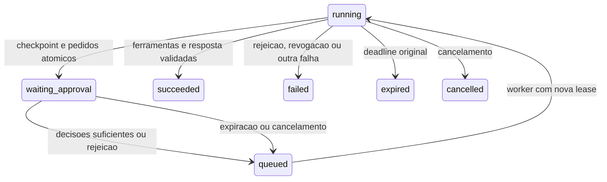

# Fase 8 - aprovacao humana duravel

Este guia preserva a entrega/evidencias da Fase 8. Para avaliacao humana,
migracao 5 e estado atual de validacao, consulte a [Fase 9](phase-09-evaluation.md).

## Desenho e decisoes

O runtime prepara e valida chamadas, mas pausa antes de executar qualquer
efeito do lote se faltar decisao humana. O checkpoint preserva a proposta
original do modelo e as invocacoes preparadas. PostgreSQL armazena os pedidos,
decisoes, auditoria e fila; nao e necessario manter um worker esperando.
Redis continua sendo coordenacao auxiliar, nao a fonte de verdade da aprovacao.

Escolhas confirmadas pelo usuario antes da implementacao:

- Revisor autorizado do mesmo tenant, com subject diferente do solicitante.
  Nem admin aprova a propria execucao. A separacao e de identidades do IdP;
  o harness nao verifica se duas contas pertencem a mesma pessoa fisica.
- A espera **conta no deadline original**, incluindo fila e recuperacao.
  Aprovar nao renova o prazo da execucao nem o prazo do pedido.

`ApprovalAuthorizer` e a porta de autorizacao de despacho. A implementacao
PostgreSQL valida lease/fencing, decisao e permissoes atuais imediatamente
antes da chamada. O dominio e a politica nao dependem de FastAPI/provedores.
Nao foi necessario adicionar LangGraph nem novas dependencias.

## Politica e vinculacao da acao

Exigem aprovacao ferramentas instaladas com `requires_approval`, nomes
incluidos em `agent.approval_policy.required_tools` ou efeitos colaterais
quando `require_side_effects=true`. A politica do agente so acrescenta
restricoes; nao remove exigencia da implementacao instalada.

Cada pedido vincula execucao, solicitante, agente/versao, invocacao/call_id,
ferramenta/versao, argumentos canonicos e respectivos hashes, incluindo
manifesto e schemas da ferramenta. Uma decisao nao autoriza argumentos
alterados, outra implementacao, outra execucao ou chamada arbitraria.

`timeout_seconds` varia de 1 a 3600, padrao 300. O prazo efetivo e o menor
entre TTL e deadline da execucao. O limite de execucao padrao e 120 segundos:
uma politica com TTL de 300 nao concede cinco minutos nesse caso. Para
permitir mais tempo, ajuste os limites do servidor e do agente **antes da
admissao**, ate o maximo de 3600; o pedido so pode reduzir esses limites.

## Estados e transacoes



O pedido passa de `pending` a `approved`, `rejected`, `expired` ou `cancelled`.
Uma autorizacao aprovada passa a `consumed` no despacho. **Consumed nao e
comprovante de que o efeito externo terminou.** Os metadados da decisao
original permanecem preservados.

- Pausa publica pedidos e checkpoint juntos e libera a lease do worker.
- Sessao e vaga de cota continuam reservadas durante a espera. Nao existem
  novas admissoes ilimitadas nem duas execucoes mutantes na mesma sessao.
- Decisao bloqueia job antes do pedido; atualiza versao, checkpoint, eventos,
  auditoria e eventual reenfileiramento na mesma transacao.
- Em lote, aprovar apenas parte dos pedidos mantem a espera; rejeitar um
  acorda a execucao para falhar sem despachar o lote.
- Job aguardando fica elegivel no primeiro prazo; cancelamento o acorda
  imediatamente. E necessario worker saudavel para finalizar e liberar cotas.
- A leitura pode projetar `expired` pelo relogio antes de o worker persistir
  essa transicao. O worker verifica novamente usando o prazo original.
- Retomada usa a proposta salva, sem chamar o LLM de novo para recria-la.
  Chamadas posteriores necessarias para concluir a conversa continuam normais.

## Identidade e permissoes

`approver` acrescenta `approval:decide` aos direitos de leitura. `admin`
tambem decide, sem contornar a proibicao de autoaprovacao. Ambos precisam
dos grants de agente e ferramenta; membership, catalogo e grants correntes
sao verificados na decisao e novamente no despacho.

O dono le seus proprios pedidos. Revisores so leem pedidos com ACL adequada
do mesmo tenant. Um approver nao recebe permissao para iniciar execucoes ou
administrar agentes. Claims de role/grants no JWT continuam ignoradas.

Revogar solicitante, revisor ou ferramenta antes da autorizacao de despacho
impede a chamada. Cancelamento registrado antes do consumo tambem bloqueia.
Nao ha transacao atomica entre PostgreSQL e um servico externo: revogacao ou
cancelamento apos a autorizacao podem nao impedir uma chamada em voo.
Integracoes criticas devem implementar suas proprias garantias transacionais.

Argumentos da caixa de aprovacao sao dados **nao confiaveis**, mesmo quando
parecem instrucoes administrativas. O revisor deve verificar a acao concreta.
Logs e auditoria operacional nao incluem argumentos, resultados nem motivos.
O pedido persistido guarda esses dados para revisao autorizada; proteja o
banco, backups e acesso HTTP como dados sensiveis.

JWT autentica a identidade, PostgreSQL registra ator/horario e a auditoria
e append-only. Nao ha artefato de decisao assinado criptograficamente nem
promessa de nao repudio contra o administrador do banco.

## API

Todas as rotas exigem autenticacao conforme a Fase 7.

| Rota | Contrato |
|---|---|
| GET `/v1/approvals?status=pending&limit=50` | `items`, `next_cursor`; cursor UUID opcional |
| GET `/v1/approvals/{id}` | `ApprovalRequest` e `ETag` com versao |
| POST `/v1/approvals/{id}/decision` | `If-Match: "1"` e `{"decision":"approve","reason":"Acao conferida."}` |

`reject` usa o mesmo corpo. Motivo tem 1-1000 caracteres e nao pode conter
somente espacos. Ator, tenant e horario nao sao aceitos no corpo. A resposta
inclui a nova versao/ETag. `arguments` e uma string JSON canonica, nao objeto.
`ExecutionRead` inclui `waiting_approval` e `pending_approval_ids`.

- `403`: role insuficiente ou tentativa de autoaprovacao.
- `404`: recurso invisivel/fora do tenant ou ACL.
- `409`: decisao conflitante, execucao cancelada/fora de espera ou acao alterada.
- `410`: prazo expirado; expiracao e acordar a fila sao commitados antes do erro.
- `412`: versao desatualizada; `428`: `If-Match` ausente.
- `422`: corpo invalido, campos extras ou motivo em branco.

Repetir exatamente ator, decisao e motivo e idempotente, inclusive com o
If-Match original e depois do consumo. Nao reenfileira nem repete a ferramenta.
Trocar motivo/decisao/ator de um pedido ja decidido produz conflito. Revisor
revogado nao ganha direito de repetir a operacao.

## Migracao e exemplo operacional

Pare API/workers antigos e aplique `agent-harness-admin migrate` com a
credencial administrativa isolada. A migracao 4 adiciona a role `approver`
e a tabela `approvals`, com RLS habilitada **e forcada**. Sao 15 tabelas
verificadas no startup. Atualize API e workers em conjunto: leitores antigos
nao suportam os novos campos/estados de checkpoint. Nao exponha credenciais
administrativas aos processos de aplicacao.

Partindo do [provisionamento da Fase 7](phase-07-security.md#provisionamento-e-execucao-local),
use dois subjects reais distintos do IdP. Reaproveite `$tenant` e `$agent`
previamente provisionados. Em terminal administrativo:

```powershell
& .\.venv\Scripts\agent-harness-admin.exe member --tenant $tenant --subject 'revisor-do-idp' --role approver --agent $agent --tool add_integers_v1
```

O comando `member` substitui a membership/grants daquele subject; repita
todos os grants que deseja manter. O solicitante continua com role e grants
adequados para criar agente/sessao/execucao, e subject diferente do revisor.

Registre `{"implementation_key":"add_integers_v1"}` em `POST /v1/tools`.
Crie o agente em `POST /v1/agents`, substituindo o UUID reservado:

```json
{
  "id": "11111111-1111-4111-8111-111111111111",
  "instructions": "Use add_integers_v1 para efetuar a soma solicitada.",
  "model_key": "default",
  "allowed_tools": ["add_integers_v1"],
  "approval_policy": {
    "required_tools": ["add_integers_v1"],
    "require_side_effects": false,
    "timeout_seconds": 60
  }
}
```

Inicie API e `agent-harness-secure-worker` conforme a Fase 7. Crie sessao e
execucao pedindo a soma; aguarde `waiting_approval`, revise os argumentos com
token do revisor e decida com o ETag recebido. O worker retoma o checkpoint.
A ferramenta de soma instalada e real, sem efeito externo; a chamada ao
provedor LLM tambem e real e pode gerar custo. A decisao humana controla
a ferramenta, nao desfaz o custo da proposta que o modelo ja produziu.

As CLIs efemera e duravel antigas continuam approval-disabled/fail-closed.
O fluxo HTTP usa somente execucoes gerenciadas e worker seguro habilitado.
Ainda nao ha UI de aprovacao, notificacoes, escalonamento, quorum ou delegacao.

## Recuperacao, testes e limites

Um crash apos consumir a autorizacao e antes de registrar o resultado nao
permite repetir efeitos nao idempotentes: resultado incerto exige reconciliacao.
Ferramentas somente leitura e efeitos com idempotencia externa explicita
podem recuperar a mesma invocacao aprovada, dentro do prazo e dos grants.
Nao se promete exactly-once universal de efeitos externos.

Testes incluem pausa/restart, vinculacao exata, lotes, rejeicao, prazo,
cancelamento, revogacao antes do despacho, versoes, duplicatas, API JWT/ETag
e classificacao de falhas. Doubles de banco exercitam o codigo real do
repositorio, mas nao provam locks, RLS ou atomicidade reais.

Verificacao local desta entrega:

- Suite completa pytest: **370 passed, 35 skipped**.
- Mypy estrito: **64 arquivos sem erros**.
- Parser com gramatica Python 3.12: 64 arquivos validos; isso nao substitui
  executar a suite naquele interpretador.
- `pip check`, configuracao de exemplo, help de API/admin/worker e sintaxe
  PowerShell do runner de integracao passaram.

Ha testes opt-in de PostgreSQL para retomada com worker, cotas/sessao,
decisoes concorrentes, lease obsoleta, expiracao e isolamento RLS. Execute
`scripts\Test-Integration.ps1` com engine Docker Linux funcional.
Esse engine segue indisponivel localmente; PostgreSQL/Redis/Collector reais
nao foram validados nesta entrega. Isso impede declarar prontidao de producao.

A Fase 9 (datasets, avaliacao e regressoes sistematicas) depende de nova
aprovacao; os testes desta fase nao a substituem.
