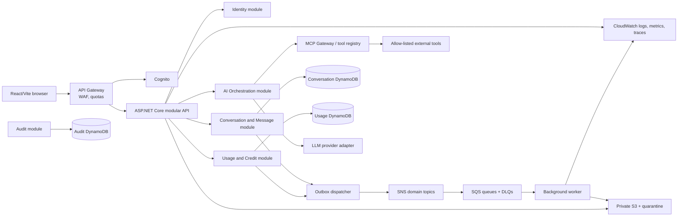

# ai-chatinator architecture

## Status and scope

**Approved direction:** a modular .NET 10 application to begin with, with independently deployable workers and clear data ownership. Build and validate locally first. AWS CDK and application integration code may be authored, but this work must not provision, deploy, or push resources to AWS.

The current C# CDK stack is a code-only foundation for three DynamoDB tables, private/versioned S3, Cognito, encrypted SNS, and an encrypted SQS queue/DLQ. It synthesizes locally, but does not yet include application hosting, least-privilege application roles, or integrations from the running API/worker to AWS services. No AWS resources have been deployed.

The React/Vite client reuses the existing same-origin API and styles. It runs separately through Vite for development, or builds into `wwwroot/client`; the API serves that built client when present and retains the legacy static page as a fallback when it is absent.

The existing local demo is a stepping stone, not the intended production design. It currently uses a single ASP.NET Core process, JSON-file storage, and a deliberately non-AI provider. The local JSON store and process-local rate limiter are not production substitutes for DynamoDB or a distributed limiter.

## Architecture overview

Keep the first deployable application modular rather than splitting every proposed capability into a network service. Each module has its own domain/application boundary and repository interface; modules communicate through application contracts and versioned events, not another module's persistence. Split a module into a separately deployed service only when independent scaling, ownership, compliance, or failure isolation pays for the added operations.



In the local profile, the browser talks to the same-origin API, and local adapters implement persistence, authentication, queues, file processing and model providers. Local fakes must preserve the observable contracts and failure behavior being tested; they must never present fake model output as a real model result. DynamoDB Local and LocalStack are optional integration profiles, not requirements for unit tests.

The current local profile writes `MessageTurnCompleted.v1` to its JSON outbox in the same file-state transaction as a completed chat turn. A hosted dispatcher publishes pending records through a local logging adapter, retries failures with bounded exponential delay, and records the delivery attempt. An optional SNS adapter publishes the versioned prompt-free envelope when explicitly configured; the local default never contacts AWS. The outbox remains in the local JSON store, so the SNS adapter does not provide production-safe transactional outbox persistence or an SQS worker.

The local file path accepts UTF-8 text, Markdown, and PDFs up to a configurable byte limit. It extracts at most 40,000 characters synchronously into owner-scoped JSON metadata and supplies selected file contents to the model as explicitly untrusted context. It does not persist the original binary, perform OCR or malware scanning, or claim asynchronous quarantine/worker processing.

Configured tool-capable providers can request `search_conversation` and
`search_other_conversations` from an allow-listed local catalog. Cross-conversation
search excludes the active conversation and includes only conversations owned by
the caller, including archived chats. It returns up to five recent matches with
conversation/message IDs, titles capped at 100 characters, and excerpts capped at
300 characters around the matching phrase. Current-conversation search remains
useful when older messages have been replaced by a summary in the model context.
The application checks conversation ownership and limits calls, arguments, and
results. The authenticated `/mcp` endpoint exposes instance status, both searches,
`list_conversation_ids`, and `get_conversation_messages`. Enumeration pages expose
all owned conversation IDs (including archived chats) and exact message content
via continuation offsets; long messages are split into explicit fragments.
Chat orchestration uses an MCP HTTP client to discover the four
allow-listed schemas and execute tool requests against the same application.
The client forwards the current authentication and an `X-Conversation-Id` header.
The server derives the user from the authenticated principal and checks
conversation ownership; no caller-supplied user ID is accepted. Both protocol
tools reuse `LocalChatToolCatalog`, avoiding duplicate search logic. Arbitrary
external MCP server registration is not implemented. Internal HTTP MCP requests
also consume the local API rate-limit budget. The MCP connection is scoped to
one chat request. Investigations default to 16 model rounds and 30 tool calls,
with configurable result-size limits and the existing context-token budget.
Budget exhaustion produces an explicit incomplete-investigation error; no
oversized tool JSON is silently sliced. The model is instructed to enumerate
and inspect other chats when looking for unspecified information, but tool
selection and interpretation remain model-driven.

## Service responsibility matrix

| Module / future deployable | Owns | Interfaces and communication |
|---|---|---|
| Identity | External identity subject mapping, local preferences, authorization policy | Cognito JWT validation at the edge/API; no password handling in production application code. Local dev has an isolated authentication adapter. |
| Conversations and Messages | Conversation lifecycle, title, archive, members/permissions, messages, share grants, summary versions | Synchronous authenticated HTTP for chat and history. Publishes `ConversationCreated`, `MessageTurnCompleted`, and sharing events through an outbox. Owns only the conversation store. |
| AI Orchestration | Provider selection, prompt/context assembly, model limits, tool-call loop, streaming, compaction policy | Calls conversation, usage, provider, and MCP application ports. Does not read their storage. |
| MCP Gateway / Tool Registry | Authorized MCP server registrations, tool catalog, execution policy, invocation metadata | MCP protocol boundary to approved servers. Tool authorization is checked server-side for every call; results are treated as untrusted. |
| Tool and File Processing | Upload metadata, quarantine/validation, PDF extraction, image metadata, search/fetch tools | Presigned, short-lived S3 upload/download grants; SQS work items and versioned completion events. External network tools run with strict allow-list and SSRF controls. |
| Usage and Credits | Credit balance, reservations, settlement/refunds, token/model/tool usage history, idempotency | Atomic conditional writes in its own store; synchronous reserve/settle API for an AI turn. Usage events are emitted with an outbox. |
| Audit | Append-only minimized security and business audit records | Versioned audit event ingestion and paginated queries. Never stores credentials, prompt secrets, or unnecessary message bodies. |
| Background worker | Message consumption, file processing, outbox delivery, retries | SQS consumers with bounded concurrency, idempotency, DLQ handling, and graceful shutdown. Does not access another module's table. |

Conversations and messages stay together initially: strict message order, ownership checks, sharing, and turn completion otherwise require unnecessary cross-service coordination. Usage remains its own ownership boundary because balance correctness and usage retention differ from conversation access patterns. Audit and file processing are separate because their write volume, retention, and asynchronous lifecycle differ.

## Main data flows

### Authenticated message turn

1. The browser sends the access token/session and an idempotency key. API Gateway applies coarse per-route throttling; the API applies a distributed per-user fixed-window limit (default 10 requests/minute) and validates the request.
2. The API resolves the caller's identity and checks ownership/permissions before revealing conversation state.
3. Usage creates an idempotent credit reservation using an atomic conditional write. Insufficient balance rejects the turn before model execution.
4. Orchestration loads bounded context from the conversation module, checks token budget, and compacts eligible history before model invocation if necessary. Compaction is versioned and only replaces a summary after successful generation and conditional persistence; source messages remain retained.
5. Orchestration discovers tools through the MCP boundary. The gateway independently authorizes each invocation; untrusted tool output is labeled and bounded before adding it to context.
6. The model response streams to the caller. Provider failure, disconnect, or tool failure follows explicit timeout/retry policy; only safe idempotent calls retry.
7. Conversation persists the user/assistant messages in order, and usage settles actual provider-reported input/output tokens and tool costs. If settlement is interrupted, the reservation is recoverable by a reconciliation worker.
8. Each module commits domain state and an outbox record together in its own transaction/conditional write. A dispatcher publishes versioned SNS events; duplicate publication/consumption is expected and idempotent.
9. Correlation/trace IDs join structured logs, audit metadata, and provider/tool spans without putting secrets or full prompts in logs.

### File upload and processing

1. API authorizes the user and creates a pending file record with a bounded declared size and permitted type.
2. API issues a short-lived upload grant for a private quarantine S3 prefix. The client cannot choose a bucket/key or public ACL.
3. A completion request verifies object key, size, checksum, and detected content type, then emits a versioned processing command through the outbox.
4. A worker consumes at least once, idempotently scans/parses the file, applies resource limits, and stores extracted text/metadata under the owning file service.
5. Success/failure events update file status. Poison messages go to a DLQ; operators can inspect the safe metadata and replay after correction.
6. Conversations attach authorized file references, not raw credentials or unrestricted S3 URLs. Large PDFs are processed by bounded streaming/chunking; only relevant, authorized excerpts enter model context.

### Conversation sharing

The owner creates or revokes a random high-entropy read-only share grant. Persist a hash of the token, not the bearer token. Shared retrieval exposes only explicitly approved title and user/assistant content, and is unauthenticated, rate-limited, non-indexable, and non-cacheable. It cannot access private profile, prompts, tool traces, billing, or attached file URLs. Revocation is immediate at the authoritative conversation store.

## Data ownership and DynamoDB access patterns

Use separate tables per bounded owner rather than a cross-service single table. Choose on-demand capacity first to simplify launch and cost control; add measured capacity settings and alarms later. Use opaque IDs and distribute high-volume keys. Page results with exclusive-start keys; never scan for normal user-facing paths. Use strongly consistent reads only where needed inside a region; cross-service views are eventually consistent.

| Owner/table | Access patterns | Key design / indexes | Consistency, TTL, and limits |
|---|---|---|---|
| Conversation | List a user's conversations newest-first; load metadata; retrieve a message page; update/archive/delete; resolve share token; fetch a specific context summary | `PK=USER#<userId>, SK=CONV#<updatedAt>#<conversationId>` for list; canonical conversation metadata under `PK=CONV#<conversationId>, SK=META`; messages under same conversation PK and `SK=MSG#<sequence>`; summary revisions `SK=SUMMARY#<version>`; share lookup via sparse GSI keyed by token hash | Conditional sequence/version update prevents concurrent reordering. Query with page limits. Keep message bodies below 400 KB item maximum and use S3 references for large attachments. Share grants may have expiry; don't TTL user content by default. |
| Usage | Read balance; reserve by user/request; settle/refund reservation; list usage newest-first; reconcile expired reservations | `PK=USER#<userId>, SK=BALANCE`; idempotency item `PK=USER#<userId>, SK=REQUEST#<requestId>`; ledger `PK=USER#<userId>, SK=USAGE#<timestamp>#<eventId>`; optional GSI for pending reservation state/time | Conditional balance/version checks stop negative balances and duplicate reservations. Settlement is idempotent. Expired reservations require explicit reconciliation/refund; TTL may clean old idempotency items only after policy-safe retention. |
| Audit | Append event; query a resource's recent events; query by principal/time for investigations | `PK=DAY#<yyyyMMdd>#SHARD#<n>, SK=<timestamp>#<eventId>`; separate sparse resource lookup index if requirements justify it | Append-only; sharding avoids hot partitions. Retention/TTL by policy. Audit events exclude raw secrets and default to no message content. |
| Files | Find file status/metadata by owner; idempotently process object; list attachments by conversation | `PK=USER#<userId>, SK=FILE#<createdAt>#<fileId>` plus processing/idempotency key; S3 key is opaque and stored only as private metadata | Conditional status transitions and checksums; short TTL only for abandoned upload grants/quarantine metadata; lifecycle policy for quarantined objects. |

The exact table/index projections and write amplification are validated against concrete access patterns before deployment. No service may query another service's table; cross-service screens use API composition or asynchronous projections with explicitly eventual consistency.

## Versioned event envelope

All domain events use a common envelope and stable, additive schema evolution:

```json
{
  "eventId": "uuid",
  "eventType": "MessageTurnCompleted",
  "eventVersion": 1,
  "occurredAt": "UTC timestamp",
  "producer": "conversation",
  "correlationId": "request correlation id",
  "traceparent": "W3C trace context",
  "tenantId": "tenant id when enabled",
  "aggregateId": "conversation id",
  "idempotencyKey": "stable operation key",
  "data": {}
}
```

Initial contracts:

| Event | Producer → subscribers | Data contract (sensitive content excluded) |
|---|---|---|
| `ConversationCreated.v1` | Conversation → audit, projection | `conversationId`, `ownerId`, `createdAt` |
| `MessageTurnCompleted.v1` | Conversation → audit, analytics | `conversationId`, `ownerId`, `userMessageId`, `assistantMessageId`, `sequence`, `createdAt` |
| `FileProcessingRequested.v1` | File module → worker | `fileId`, opaque `objectKey`, `ownerId`, `contentType`, `checksum`, `eventId` |
| `FileProcessingCompleted.v1` | Worker → file/conversation | `fileId`, `status`, extracted text reference, processor version |
| `CreditReserved.v1` / `CreditSettled.v1` | Usage → audit | `userId`, `reservationId`, bounded amount, model/provider ID, token counts, status |
| `ConversationShareChanged.v1` | Conversation → audit | `conversationId`, `ownerId`, enabled/revoked status; never the bearer token |

Consumers persist handled event IDs (or use an equivalent conditional key) before acknowledging. Retry with bounded exponential backoff and jitter; do not retry permanent validation/authorization errors. Configure a DLQ and alarm for each queue; DLQ replay must preserve the original event ID and be safe. Outbox dispatchers retry publication; duplicate SNS deliveries are normal.

## AI, context, and MCP

- `IChatProvider` is the application port; provider adapters report actual usage, supported context size, streaming chunks, and normalized errors. Provider credentials remain server-side in Secrets Manager.
- Orchestration owns model-specific token budgets and prompts. Before invocation, it estimates input use and leaves output/tool-call budget. If over budget, it summarizes an older contiguous range and conditionally writes a versioned summary; original messages are retained. Failed summarization leaves the previous summary and all source messages intact.
- Summary records track covered sequence range, version, model, input/output usage, timestamp, and source version. Concurrent turns use optimistic conversation versioning; one compaction winner commits, and losers reload/rebuild rather than overwrite newer context.
- MCP is an integration protocol boundary, not the internal domain architecture. Tool catalog entries declare schema, owner, authorization requirements, timeout, idempotency behavior, and maximum output size. The caller's authorization is checked at invocation, not only discovery.
- Tool calls have explicit deadlines and bounded results. Web fetching uses DNS/IP validation on every redirect, rejects loopback/private/link-local/metadata addresses, limits redirects and response size, and does not forward credentials. External content is untrusted and cannot alter system policy.
- Local tool/provider adapters must clearly announce demo behavior and must not silently masquerade as real AI or external search.

## Security, reliability, and operations

- API Gateway/Cognito is the production authentication edge; the API validates issuer, audience, signature, expiry, and required claims. Ownership authorization remains in application use cases.
- Enforce user throttling with a shared distributed store/token strategy in production and route throttles at API Gateway. Configure 10/minute by default; return 429 and `Retry-After`. Give AI/tool endpoints stricter secondary concurrency and spend limits.
- Require TLS, encryption at rest, private S3 buckets, short-lived scoped upload/download grants, least-privilege IAM, secret rotation, malware/content validation, output and payload size caps, and deletion/retention policies.
- Use timeouts, retry budgets, circuit breakers for remote model/tool APIs, bounded worker concurrency, and backpressure. Never retry a non-idempotent external effect unless protected by a stable idempotency key.
- Use structured JSON logs and OpenTelemetry trace context. Scrub credentials, cookies, tokens, prompt secrets, and message bodies. Emit low-cardinality metrics for latency, failure, token/cost, queue age, DLQ depth, throttles, and credit reserve/settle discrepancies.
- Graceful degradation: existing conversations/history remain available if a model/tool is down; do not report success when generation, persistence, or settlement is incomplete.

## Local implementation plan

```text
ai-chatinator/
  src/
    AiChatinator.Api/             # HTTP endpoints, auth, composition root, static SPA
    AiChatinator.Application/     # use cases, provider/MCP/repository ports, validation
    AiChatinator.Domain/          # entities, policies, domain events
    AiChatinator.Infrastructure/  # local/DynamoDB, queues, providers, S3 adapters
    AiChatinator.Worker/          # local/AWS queue consumers and file jobs
  frontend/                       # React/Vite client (local dev proxy to API)
  infra/
    AiChatinator.Infrastructure/  # AWS CDK in C#, code only
  tests/
    AiChatinator.UnitTests/
    AiChatinator.IntegrationTests/
    AiChatinator.ApiTests/
  docs/
    architecture.md
    adrs/
    contracts/
```

Layer direction is inward: API/Infrastructure depend on Application/Domain; Domain does not depend on AWS, ASP.NET, MCP SDK, or provider SDKs. Local adapters and AWS adapters implement the same application ports. Tests use deterministic fakes for unit/API tests and optional local emulators for adapter integration tests.

## Architecture decision records

See [adrs/README.md](adrs/README.md). Decisions are provisional where marked; implementation and load/security tests may motivate a documented revision.

## Risks and open validation

1. A strict per-user 10/minute limit across instances needs a shared atomic limiter and API Gateway stage/method throttles; confirm selected AWS mechanism and operational cost.
2. Long context, PDF extraction, vision, and tools have variable cost. Reservation estimates need conservative ceilings, provider reconciliation, and abuse limits.
3. Sharing can disclose user-authored sensitive content. Add an explicit sharing confirmation and file exclusion; support immediate revocation and no-index cache headers.
4. Cookie sessions require CSRF protections for browser mutations; production Cognito token storage/refresh strategy must be designed, not copied from the local adapter.
5. DynamoDB transactions have item/operation limits. Keep a turn's atomic conversation write bounded; model usage reserve/settle separately and recover through reservation state transitions.
6. SNS/SQS local parity is imperfect. Test critical idempotency, retry, and DLQ semantics in local emulators and run a separately approved AWS validation before production.
7. Search/web retrieval has SSRF and prompt-injection risk. It remains disabled until egress controls, URL validation, and adversarial tests exist.
8. No AWS infrastructure is created, and no public deployment is claimed until the user separately requests it and deploys are authorized.
