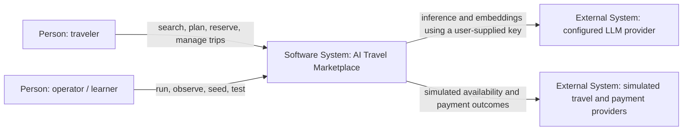
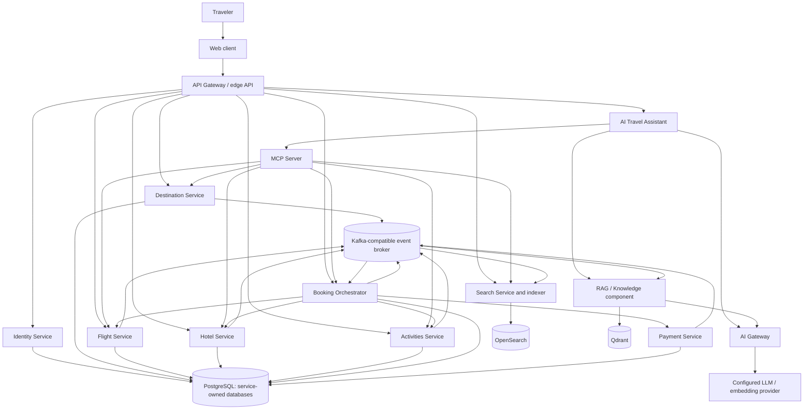

# 1. Architecture proposal

**Status: approved for phased implementation.**

## Problem and scope

The system combines two distinct workloads:

1. A marketplace that searches large catalogs and availability projections.
2. A transactional booking flow that must not oversell inventory or duplicate
   charges, even when requests, messages, or providers fail.

The AI assistant is an additional client of marketplace capabilities. It may
search and prepare an itinerary autonomously, but it is not an authority for
identity, inventory, price, booking, or payment.

### In scope

- Customer-facing destination, flight, hotel, activity, itinerary, and booking
  experiences.
- Hotel and activity capacity enforcement, plus simulated flight inventory.
- Persistent cross-service booking orchestration and compensation.
- Eventual-consistency search projections and knowledge retrieval.
- AI provider abstraction, RAG, MCP tool boundary, and explicit confirmation.
- Local-first execution, focused tests, and reproducible fake data. A dedicated
  observability stack is deferred.

### Not in scope for the initial laboratory

- Real flight/hotel/activity suppliers, payments, or travel-document decisions.
- Real customer data, real charges, or claims of production-grade compliance.
- Cloud deployment, Kubernetes, global active-active writes, or unrestricted
  multi-region booking.
- Autonomous purchase execution without a fresh, explicit user confirmation.

## Proposed architecture principles

- A service owns its write model, business rules, and consistency guarantees.
- A local Compose deployment may share PostgreSQL infrastructure, but each
  service receives a distinct database and credentials; it must not read or
  write another service's tables.
- Search and AI context are projections, not booking authorities.
- Use synchronous APIs where the caller needs an immediate validated answer;
  use events for durable cross-service state propagation and long-running
  workflows.
- Use outbox/inbox and idempotency at delivery boundaries. Expect at-least-once
  delivery; do not promise exactly-once effects across independent systems.
- Human authorization and explicit confirmation gate financially meaningful
  actions. The model cannot grant itself that authority.
- Add infrastructure only in the milestone that demonstrates the problem it
  solves.

## C4 System Context

In the local lab, simulated travel and payment providers are local adapters,
not real external systems. The marketplace remains usable without an AI key,
but interactive AI features use OpenAI first and require the user's key. The
exact model is configuration, not an architectural constant.

## C4 Container diagram

The container view is the **target architecture**, not a claim that every
container exists in the first milestone. A local deployment can start with
fewer processes, while retaining module boundaries and contracts that allow
later extraction.

## Service and component responsibilities

| Service / component | Owns and decides | Must not do |
|---|---|---|
| Web client | User interaction, displaying quotes and booking state | Enforce inventory or payment rules |
| API Gateway | External routing, request limits, API versioning, edge authentication integration | Own domain state or implement booking rules |
| Identity | Accounts, profile, preferences, roles, authenticated subject | Let an LLM infer or assign permissions |
| Destination | Countries, regions, cities, airports references, attractions, destination metadata | Own hotel/flight/activity inventory |
| Flight | Airlines, airports/routes, offers, seat/fare inventory, reservation holds, ticket simulation, cancellation | Trust search availability without an atomic write |
| Hotel | Hotels, room types, date inventory, holds, reservations, cancellation | Permit capacity to be exceeded |
| Activities | Experiences, schedules, capacity, holds, reservations, cancellation | Treat an indexed availability count as reservable inventory |
| Search | Denormalized query models, filtering, sorting, ranking, indexing lag | Confirm reservations or act as source of truth |
| Booking Orchestrator | Booking intent, quote/confirmation snapshot, durable Saga state, retries and compensation decisions | Directly mutate another service's database |
| Payment | Payment authorization/capture/void/refund state and idempotency | Treat timeout as proof of failure |
| AI Travel Assistant | Conversation state, preference extraction, planning and authorized tool selection | Directly access transactional stores or bypass confirmation |
| AI Gateway | Provider adapters, model selection, timeouts, normalized responses | Contain booking business logic or silently change providers |
| RAG / Knowledge | Ingestion, chunk metadata, retrieval and citations | Override transactional price, availability, or policy |
| MCP Server | Typed, authenticated tool schemas and calls to domain APIs | Bypass domain services or serve as a second booking engine |
| Broker and workers | Durable event transport and asynchronous projections/work | Claim global FIFO or exactly-once business effects |

### API Gateway and BFF

The API Gateway is a cross-cutting edge: routing, rate controls, correlation,
versioning, and coarse authentication enforcement. A Backend-for-Frontend
(BFF) shapes APIs for a particular client and may aggregate its calls.

**Proposal:** do not deploy a separate BFF initially. Keep UI-specific
aggregation in a thin client-facing API module behind the gateway. Split it
when the web and assistant clients have demonstrably different payload,
release, or latency requirements. The AI assistant remains a service and calls
MCP/domain APIs, not a UI BFF.

## Communication matrix

| Caller → callee | Synchronous interaction | Asynchronous interaction | Reason / consistency |
|---|---|---|---|
| Web → Gateway | HTTPS/JSON | — | External request/response contract |
| Gateway → Identity | Token/session validation and profile lookup | Identity/profile events | Immediate auth; profile projections may lag |
| Gateway → Destination/Search | Search and detail queries | — | User-facing reads |
| Gateway → Flight/Hotel/Activities | Quote, availability recheck, reservation operations | Domain events | Transactional services revalidate at write time |
| Gateway → Booking | Start/get/cancel booking | Booking status events | Start returns a durable workflow identifier |
| Assistant → AI Gateway | Inference/embedding request | — | Provider boundary; AI calls require the locally configured provider key |
| Assistant → RAG | Retrieve grounded context | Ingestion/index events | Retrieval is advisory, may be stale |
| Assistant → MCP → domain APIs | Typed tool requests | Tool/audit events | Uniform tool contract; domain authority retained |
| Booking → inventory services | Hold/confirm/release commands; milestone-dependent transport | Requests/replies and lifecycle events | Per-service ACID plus Saga; no cross-DB transaction |
| Booking → Payment | Authorize/capture/void/refund commands | Payment outcome events | Durable state, idempotency, timeout reconciliation |
| Domain services → Search | No direct search DB writes | Versioned domain events | CQRS projection; stale search is acceptable |
| Domain services → RAG | No direct vector DB writes | Curated content/catalog events | Knowledge indexing is asynchronous |
| Services ↔ Broker | — | Outbox publication and inbox consumption | At-least-once delivery with deduplication |

Initially, internal HTTP is the simpler option for short request/response
operations. Long-running booking transitions and read-model updates move to
events when the broker milestone is introduced. The Saga must retain a
durable state machine in either transport design.

## Consistency boundaries

- **Strong per-service transaction:** a service validates and reserves its own
  capacity atomically in its database.
- **Eventual projection:** Search and RAG may lag domain commits and must expose
  freshness metadata where useful.
- **Cross-service booking:** the Saga is eventually consistent. A booking can
  be `PENDING`, `COMPENSATING`, or `RECONCILIATION_REQUIRED`; it is not a single
  ACID transaction.
- **Authorization:** identity and server-side booking state decide whether the
  actor may execute an action. Client display and model output are not proof.
- **Payment uncertainty:** unresolved provider state blocks unsafe release or
  re-charge decisions until reconciliation.

## Local resources and operational shape

The proposed local lab uses Docker Compose with isolated service processes as
they are implemented. PostgreSQL may run as one local server hosting
service-owned databases. The broker, search engine, and vector store are
introduced progressively and may be optional profiles. Dedicated logging,
metrics, tracing, and dashboards are deferred. No production topology,
resource sizing, or measured SLO is asserted here.
