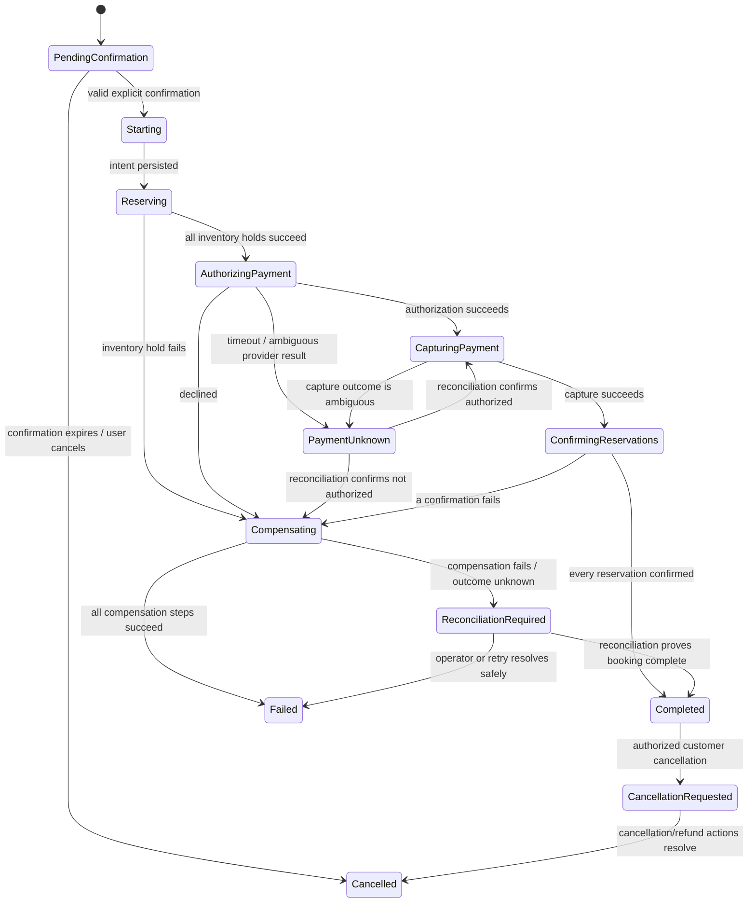
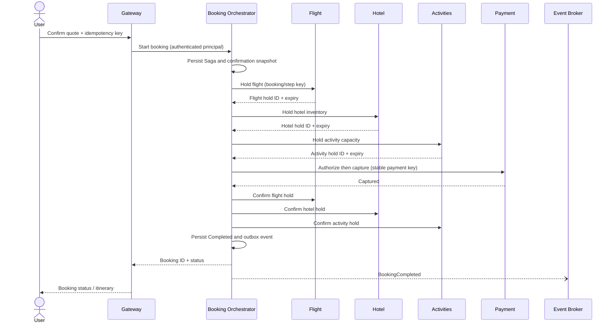
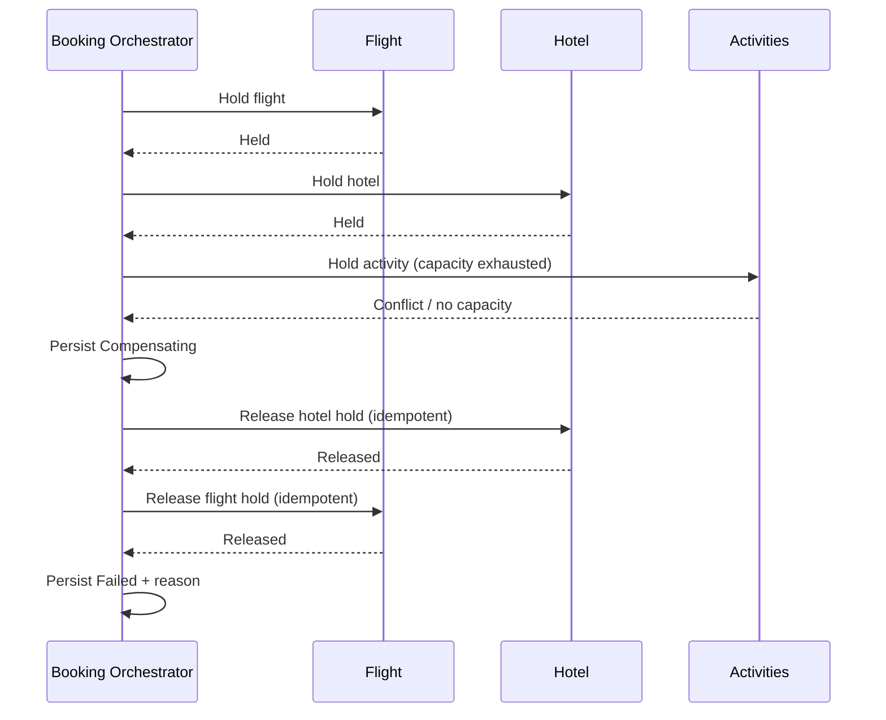

# 3. Booking Saga and transactional guarantees

**Status: approved design. The simulated provider does not represent a real
supplier.**

## Why an orchestrated Saga

A complete trip changes state in multiple independent databases: flight,
hotel, activity capacity, and payment. Holding a distributed ACID transaction
open across those services would couple availability and failure domains and
is not assumed to be available from suppliers. The Booking Orchestrator instead
persists the workflow and issues idempotent commands.

A Saga provides eventual completion or a compensation path, not atomic
rollback. Releasing a reservation or refunding a captured payment is a new
business action and may itself fail. The booking state must expose that reality.

## Booking state model



Transitions are guarded by persisted state, idempotency keys, and expected
versions. Invalid or stale transitions return explicit conflicts. A worker
restarting must resume from the last committed step, not replay untracked side
effects.

## Proposed booking flow

1. Customer searches and selects items. Search results and displayed prices are
   advisory.
2. Server creates a short-lived quote with item IDs, dates, currency, amounts,
   policy versions, and an expiry. Revalidate each item at booking time.
3. Customer reviews the complete quote and explicitly confirms it. Confirmation
   is bound to the authenticated user, quote fingerprint, amount/currency,
   expiry, and operation idempotency key.
4. Orchestrator persists `BookingStarted` and the Saga plan.
5. Orchestrator requests temporary holds from Flight, Hotel, and Activities.
   Each service atomically checks and reserves its own inventory.
6. If any hold fails, orchestrator releases successful holds in reverse order.
7. Once all holds succeed, authorize payment. If authorization is declined,
   release holds. If the result is unknown, stop destructive compensation and
   reconcile payment before retrying or releasing holds.
8. Capture payment after the holds and authorization are valid.
9. Confirm each reservation, then mark the booking completed.
10. If capture or confirmation has an ambiguous/failing result, persist the
    unknown/reconciliation state. Use void for authorized-but-uncaptured
    payment or refund for captured payment if the workflow cannot complete.
11. Publish booking events from the outbox and expose status to the client.

### Success sequence



The orchestration may be asynchronous in the implementation. The API can
return `202 Accepted` with a booking ID rather than holding an HTTP request open
for supplier-like work.

### Failed inventory step and compensation



Compensation is a retryable command, not an assumption. If release fails, the
Saga remains in `ReconciliationRequired`, records the failed step, and alerts
operations; it must not report a clean rollback.

## Inventory guarantees

For hotels and activities, the owning database must enforce capacity under
concurrency. A typical implementation uses one transaction with an atomic
conditional decrement/insert or row-level locking plus a uniqueness/constraint
strategy appropriate to the inventory model. A successful response is emitted
only after commit. The eventual search count is not consulted as the authority.

Flight inventory is simulated and must obey the same service-level rule in the
laboratory. Real supplier guarantees and ticketing semantics vary and are out
of scope.

## Idempotency and duplicate handling

- `start_booking` is idempotent per authenticated customer and idempotency key.
- Each Saga step has a durable command ID derived from booking ID, step name,
  and step attempt/semantic version. Retries reuse the same logical key.
- Reservation services store command identity with reservation result. A
  duplicate command returns the existing result rather than decrementing
  capacity twice.
- Payment operations use distinct stable keys for authorization, capture,
  void, and refund. A retry of capture must not create another charge.
- A key reused with a different payload is rejected.
- Duplicate and out-of-order events are checked against inbox event IDs and
  aggregate versions.

## Payment timeout and reconciliation

A timeout means **unknown**, not declined. The provider may have processed the
request while the response was lost. Persist the operation key and unknown
state; query the provider by that key/reference or consume a provider outcome
event. Do not issue a new charge with a new key and do not release inventory
until policy establishes that the payment cannot succeed. If the simulated
provider cannot resolve an outcome automatically, surface a reconciliation
case for an operator.

```mermaid
sequenceDiagram
    participant BO as Booking Orchestrator
    participant P as Payment Service
    participant Provider as Simulated payment provider

    BO->>P: Capture with stable operation key
    P->>Provider: Capture
    Provider--xP: Response lost / timeout
    P-->>BO: Outcome unknown
    BO->>BO: Persist PaymentUnknown; do not re-charge
    P->>Provider: Query by operation key
    Provider-->>P: Captured / not captured / still unknown
    P-->>BO: Reconciled outcome event
    BO->>BO: Continue confirmation or safe compensation
```

## Guarantees and non-guarantees

**Target guarantees to prove with tests**

- Capacity is not exceeded under concurrent reservation attempts.
- Same idempotency key and same request does not create duplicate bookings or
  payment effects.
- A confirmed booking has successful required reservation and payment steps.
- A known failure triggers the configured compensations and records each
  result.
- Restarting the orchestrator resumes from durable Saga state.
- Stale search availability cannot bypass transactional validation.

**Not guaranteed by a Saga**

- Global ACID atomicity or instant rollback.
- That every compensation always succeeds.
- That a provider timeout is a failure.
- That external travel suppliers honor the simulated contract.
- That an in-memory lock protects multiple processes or hosts.

## Operational recovery

Make Saga state, failed compensation steps, unknown payment outcomes, and
expired holds visible through booking status and a manual reconciliation path.
Use bounded retries with jitter, then move durable work to a visible
reconciliation queue. Operator actions must be idempotent. Dedicated logs,
metrics, traces, and dashboards are intentionally deferred; do not retain
payment secrets.
