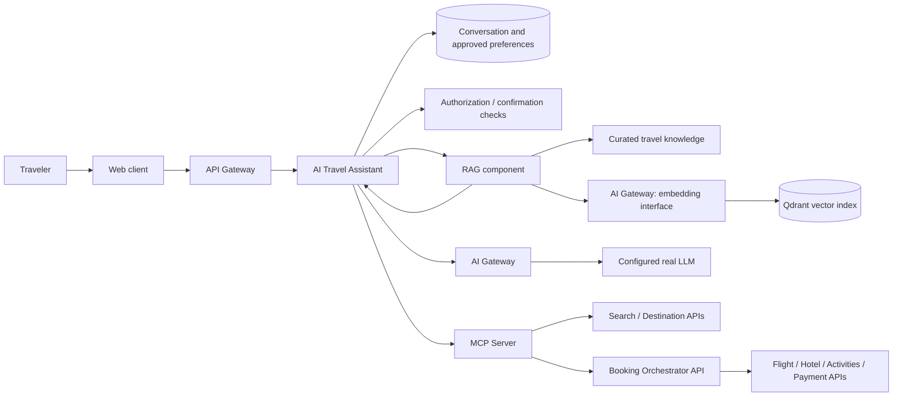

# 4. AI, RAG, and MCP proposal

**Status: approved design; Phases 6–7 are implemented with automated contract
tests. Phase 6 provides the OpenAI adapter, AI Gateway, curated RAG ingestion,
and Qdrant retrieval. Phase 7 adds conversation state and authenticated MCP
tools. AI output is advisory and never an authorization source.**

## AI architecture



The AI Gateway is an **AI provider anti-corruption layer**, not the external
API Gateway. The API Gateway handles client ingress and platform-wide edge
controls. The AI Gateway normalizes model-provider differences, enforces model
and timeout policy, and isolates provider SDKs from business services.

### Provider boundary

Define internal interfaces for chat completion and embedding generation.
Provider adapters own provider-specific request/response formats. The first AI
milestone uses OpenAI for chat and embeddings, with the user supplying a key
through local environment configuration. The initial configurable defaults
are `gpt-4.1-mini` for chat and `text-embedding-3-small` for embeddings. A
deterministic fake adapter may be used for automated tests, but it is not the
normal interactive experience. Never commit keys. Provider fallback should be
explicit: models differ in tool support, output guarantees, latency, and cost,
so a silent fallback can change behavior.

On provider failure, return a clear unavailable/degraded response. The
marketplace's ordinary search and booking APIs remain usable. Retries must be
bounded and avoid retrying non-idempotent tools as though they were model
calls. Token-cost dashboards and provider-usage telemetry are not in the
project's initial scope.

## RAG pipeline

1. Ingest curated destination, attraction, cultural, seasonal, and simulated
   travel-information documents.
2. Keep source ID, source URI/name, revision, language, destination/entity
   metadata, and ingestion timestamp.
3. Split text into bounded chunks with source references. Choose chunking
   empirically; chunk size and overlap are retrieval-quality decisions, not
   universal constants.
4. Generate embeddings through the provider abstraction and store vectors plus
   metadata in Qdrant.
5. Retrieve with semantic similarity and metadata filters. Add lexical/hybrid
   retrieval only when relevance tests show a benefit.
6. Rerank a bounded candidate set if evaluation justifies the latency and cost.
7. Construct a size-limited prompt with citations and distinguish source facts
   from user preferences and model-generated suggestions.
8. Return traceable source references where factual destination guidance is
   presented.

Qdrant is a derived index: curated Markdown files under `knowledge/` are the
Phase 6 source of truth and are re-embedded when their corpus revision changes.
The LLM must not invent real-time prices or capacity; those come from
transactional APIs and fresh quotes.

### RAG risks and controls

- Evaluate retrieval relevance with a small, versioned query/document set.
- Treat retrieved text as untrusted data; defend against prompt injection and
  never interpret document instructions as tool authorization.
- Filter by metadata and user context only where access policy allows it.
- Enforce context and token budgets; do not log full sensitive prompts.
- Make source version and retrieval result visible for diagnosis.
- On vector-store failure, fail the recommendation feature clearly or use a
  separately tested safe fallback; do not silently fabricate citations.

## Assistant behavior and authority

Start with one assistant and a bounded tool set. A multi-agent design is not
proposed until a measurable decomposition benefit exists.

The assistant may:

- Ask clarifying questions, extract preferences, compare destinations, and
  create a draft itinerary.
- Search current catalog and availability through read-only tools.
- Request a fresh quote and prepare a booking for user review.
- Start the booking workflow only after the authenticated user provides
  explicit confirmation for the exact quote.

The assistant may not:

- Access service databases or issue raw SQL.
- Treat model confidence, conversation text, or an MCP tool call as proof of
  user identity or authorization.
- Change amount, currency, inventory, cancellation policy, or user identity
  after confirmation and still reuse that confirmation.
- execute purchases, capture funds, or perform irreversible actions without
  explicit confirmation.

Confirmation should be server-side and bound to the authenticated subject,
quote hash, total amount/currency, items, expiration, and a one-time or
idempotent request key. Any quote change requires renewed confirmation.

## MCP boundary

The MCP Server exposes typed tools and calls authorized platform APIs. It does
not own domain logic. The Booking Orchestrator remains the only component that
coordinates multi-service reservations and payments.

Initial tool set:

| Tool | Class | Required safeguards |
|---|---|---|
| `search_destinations` | Read | Validated query, bounded result count |
| `search_flights` | Read | Dates/route/party validation; results are not guarantees |
| `search_hotels` | Read | Date/guest validation; results are not guarantees |
| `search_activities` | Read | Destination/date/party validation |
| `get_availability` | Read/recheck | Return source and freshness; still not a hold |
| `create_itinerary` | Draft write | Authenticated owner; no inventory or payment side effect |
| `get_itinerary` | Read | Owner/role check |
| `start_booking` | Financial side effect | Explicit confirmation, current quote, authorization, idempotency |
| `get_booking_status` | Read | Owner/role check; redact sensitive fields |
| `cancel_booking` | Side effect | Owner/role check, cancellation policy, idempotency, refund state |

Use a distinct service identity for MCP-to-service calls, propagate the
authenticated user subject and scopes, and authorize both tool and target
resource. Validate inputs and outputs, enforce request/time/size limits, and
return structured errors with retryability. Do not return stack traces,
secrets, provider credentials, or unrestricted database detail.

### MCP and direct function calling

Direct model function calling is a model/API feature that describes tools for
one model integration. MCP is a protocol boundary for discovering and invoking
tools across compatible clients and servers. MCP can standardize integration
and tool schemas, but does not itself provide business authorization, safe
booking semantics, or a Saga. Those remain platform responsibilities.

## AI tool execution sequence

```mermaid
sequenceDiagram
    actor User
    participant Agent as AI Assistant
    participant AI as AI Gateway
    participant MCP as MCP Server
    participant Search as Search API
    participant BO as Booking Orchestrator

    User->>Agent: Plan a 10-day history-focused trip
    Agent->>AI: Request response with allowed read tools
    AI-->>Agent: Tool request: search destinations
    Agent->>MCP: search_destinations (user context)
    MCP->>Search: Validated authorized query
    Search-->>MCP: Candidate results + freshness
    MCP-->>Agent: Structured results
    Agent->>Agent: Retrieve grounded context and draft itinerary
    Agent-->>User: Recommendations and cited sources
    User->>Agent: Book this itinerary
    Agent->>MCP: Request fresh quote / booking preparation
    MCP->>BO: Prepare quote; no charge
    BO-->>Agent: Quote ID, exact items, total, expiry
    Agent-->>User: Show quote and request explicit confirmation
    User->>Agent: Confirm exact quote
    Agent->>MCP: start_booking + confirmation proof
    MCP->>BO: Authenticated idempotent command
    BO-->>MCP: Booking ID + pending status
    MCP-->>Agent: Structured status
    Agent-->>User: Booking progress
```

The model's tool request is an untrusted proposal. The server independently
validates identity, confirmation, quote freshness, authorization, and
idempotency before any side effect.

## AI evaluation and safety tests

The AI milestone should add deterministic evaluation cases for:

- Retrieval relevance and citation attribution.
- Preference extraction and structured itinerary validity.
- Choosing read tools for search rather than inventing availability.
- Refusing to book before confirmation or when the quote changed.
- Enforcing user ownership and authorization on itinerary/booking access.
- Handling tool timeout, duplicate request, and service-unavailable outcomes.
- Avoiding claims that simulated providers represent real booking confirmation.

No model score alone proves authorization correctness. Enforce that invariant
in server code and test it independently of model output.
