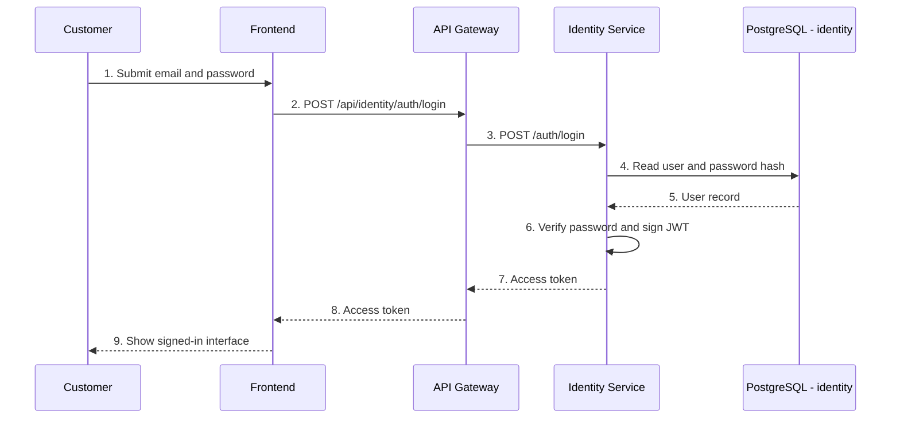
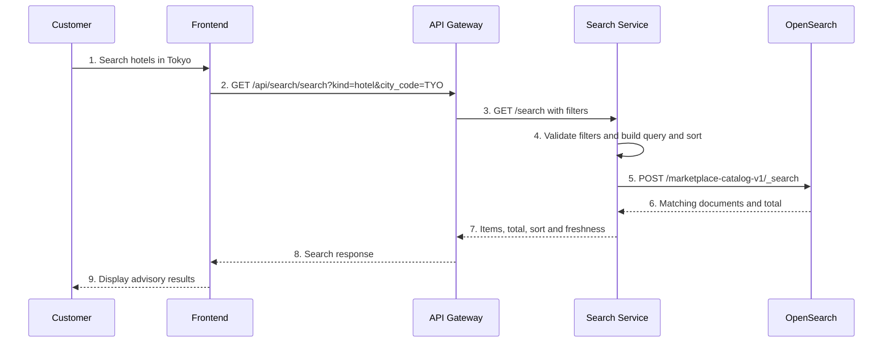
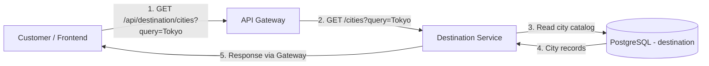
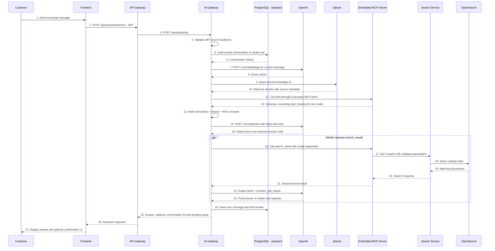
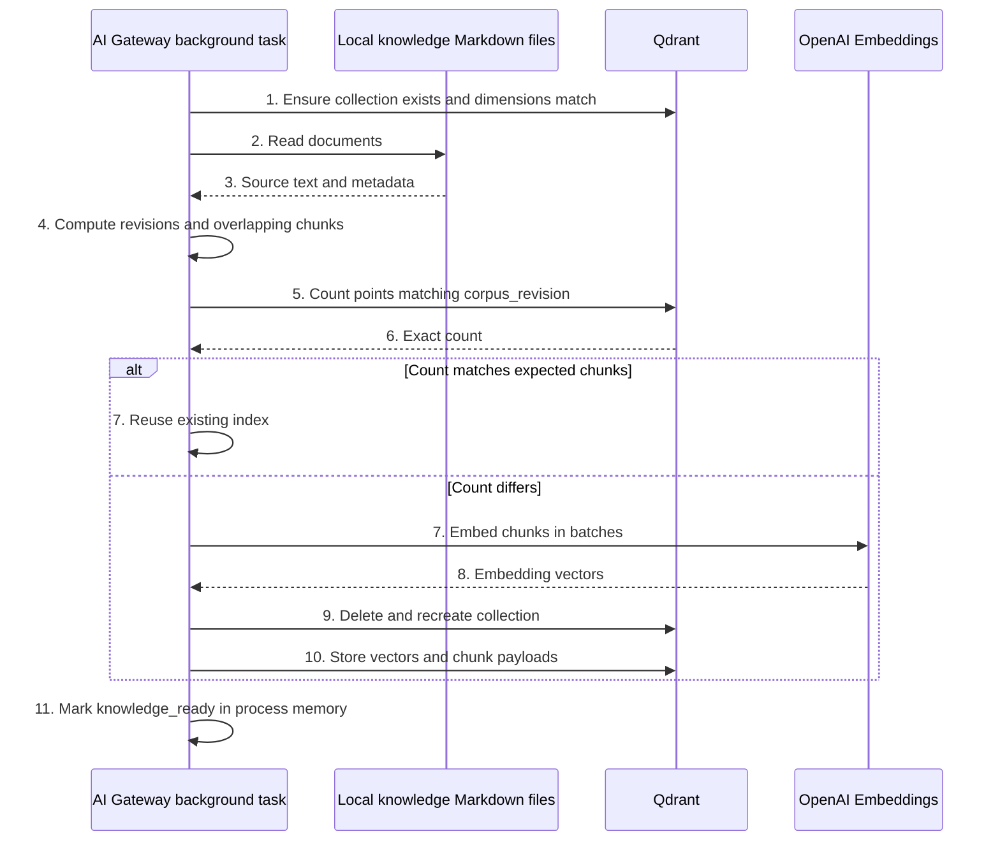
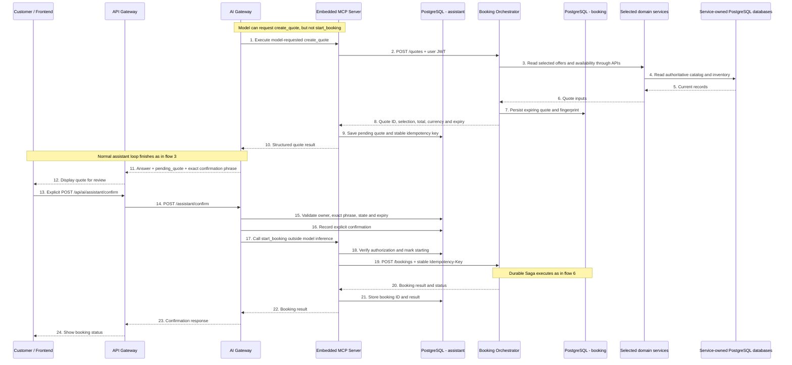
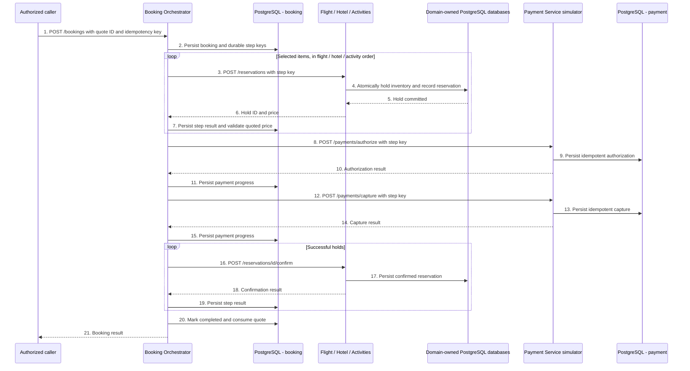
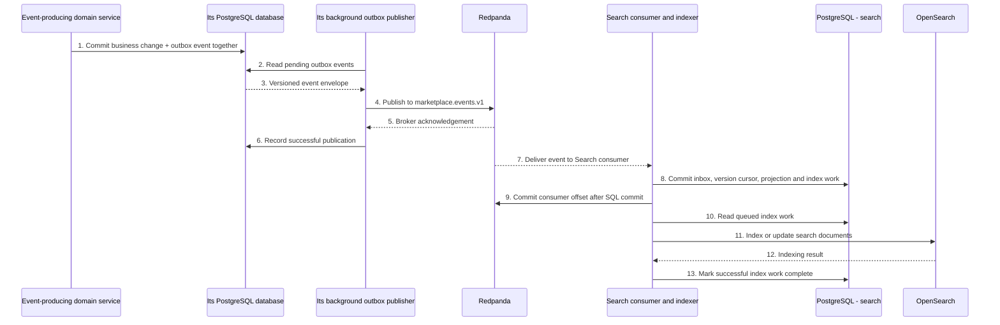

# System Flows

Numbered diagrams of the implemented request and background flows. Mermaid
diagrams render on GitHub and in compatible Markdown previews.

## Reading the diagrams

- Numbers show execution order within each diagram; numbering restarts for
  each flow. A loop repeats its enclosed steps.
- Solid arrows are calls or writes; dashed arrows are responses.
- Each PostgreSQL participant is a separate service-owned database. Compose
  runs these databases in one PostgreSQL container, not one shared schema.
- MCP, the assistant loop, and RAG run inside the AI Gateway process. They
  are shown separately where useful, but are not separate containers.
- Domain APIs validate bearer tokens locally; they do not call Identity for
  every request. Search is public; assistant and booking operations require
  authentication.
- Travel inventory and payments are simulated. Search results and quotes
  are not inventory guarantees.

## 1. Customer sign-in

Registration follows the same routing through
`POST /api/identity/auth/register`, but writes a new account to the Identity
database instead of authenticating an existing one.

## 2. Marketplace search and direct catalog reads

The Search request reads OpenSearch, not the source-service PostgreSQL
databases. Its SQL database supports indexing and recovery, as shown in
flow 7.

`query` matches item text; `city_code` filters by location. To list Tokyo
hotels, use `kind=hotel&city_code=TYO`, without `query=Tokyo` unless that
additional text constraint is intentional. All filters are combined.

Direct catalog endpoints follow a different path, for example:

Flight, Hotel, and Activities also expose domain search APIs backed by their
own databases. These differ from the denormalized Search Service index.

## 3. Concierge message: history, RAG, reasoning, and tools

Important details:

- RAG runs before model inference on every message. Retrieval embeds the
  current message, not a history-based rewrite.
- The model chooses whether tools are necessary. Up to three tool rounds
  are allowed, with at most four calls per round. If all rounds are used,
  a final inference is made without tools.
- City-based searches resolve the catalog city code first:
  `search_travel(kind="destination", query="Tokyo")`, then
  `search_travel(kind="hotel", city_code="TYO", query="")`.
  This can span multiple model/tool rounds.
- Tool calls execute through an in-process MCP client. The internal
  assistant does not call the external `/api/ai/mcp` HTTP route.
- With a supported model, `OPENAI_REASONING_EFFORT=medium` explicitly enables
  reasoning. Responses use `store: false`; encrypted reasoning items, when
  returned, are passed back during tool rounds. They are not stored in the
  conversation database or exposed to the frontend.
- Only user and final assistant messages are persisted, capped at 40
  messages. Intermediate tool results are not saved as conversation history.

### Other tool destinations

| Tool | Execution path and storage |
|---|---|
| `search_travel` | MCP -> Search Service -> OpenSearch |
| `create_itinerary` / `get_itinerary` | MCP -> PostgreSQL `assistant`, scoped to the user |
| `create_quote` | MCP -> Booking Orchestrator -> domain APIs; quote in PostgreSQL `booking`, confirmation record in PostgreSQL `assistant` |
| `get_booking_status` | MCP -> Booking Orchestrator -> PostgreSQL `booking` |
| `start_booking` | Explicit confirmation flow only; see flow 5 |

Tools call domain APIs instead of reading other services' databases. The
assistant's itinerary and confirmation records are the exception only in the
sense that they belong to the AI Gateway itself.

### RAG-only endpoint

`POST /api/ai/chat` uses the same embedding and Qdrant retrieval path, then
calls Responses without tools or conversation history. It uses the read-only
system prompt from `build_grounded_messages`. The concierge instead supplies
its own tool-aware system prompt and reuses the retrieved excerpts.

## 4. Knowledge ingestion at AI Gateway startup

The collection is `travel-knowledge-v1`. This work is separate from embedding
each incoming question. The rebuild is not an atomic collection swap.
Without an API key, AI remains degraded while the marketplace can run.
Ingestion failures are logged and retried; service health alone does not
mean AI readiness. `GET /api/ai/ready` reports AI readiness.

## 5. Concierge quote and explicit customer confirmation

Creating a quote does not hold inventory or charge. Repeating a confirmed
request uses the same idempotency key, rather than intentionally starting a
second booking. The final status must be inspected: a response is not proof
that a booking completed.

## 6. Durable booking Saga: success and failure branches

This flow is shared by concierge confirmation and the conventional
`POST /api/booking/bookings` route. The caller must provide an authenticated,
explicit command and an idempotency key.

The diagram shows the happy path. Each failure can stop or redirect it:

- **Definite failure:** compensate successful holds and void or refund
  payment as applicable. Failed compensation remains
  `reconciliation_required`, not a claimed clean rollback.
- **Unknown payment outcome:** persist `payment_unknown` and keep holds
  pending reconciliation; a timeout is not proof of a declined payment.
- **Interrupted execution:** `/bookings/{id}/resume` resumes durable steps.
- **Payment reconciliation:** `/bookings/{id}/reconcile` queries the Payment
  operation by its stable key and retries safely when appropriate.
- Each service writes its own database. There is no cross-database atomic
  transaction and no direct Booking write into an inventory database.

## 7. Domain events and eventual search indexing

Delivery is at least once. Event IDs support deduplication; aggregate
versions prevent older events from overwriting newer projections. Catalog
bootstrap events also enter this pipeline. Not every event becomes a public
search document: booking and payment state events are retained in the inbox,
while supported catalog data populates the catalog index.

Failures are retried; poison or repeatedly failing events can be directed to
`marketplace.events.dlq.v1`. Indexing and the initiating request are separate
flows: a successful domain write does not imply immediate search visibility.
Redpanda is not on the synchronous RAG retrieval or booking Saga call path.

## Implementation references

- [Frontend API calls](../frontend/src/api.ts)
- [Gateway routing](../services/gateway/app.py)
- [AI endpoints, ingestion, retrieval, and assistant loop](../services/ai_gateway/app.py)
- [Responses and embeddings adapter](../services/ai_gateway/provider.py)
- [MCP tools and domain API forwarding](../services/ai_gateway/assistant_mcp.py)
- [Booking Saga](../services/booking/app.py)
- [Event publication](../packages/common/events.py)
- [Search consumer and endpoints](../services/search/app.py)
- [OpenSearch query and sort construction](../services/search/opensearch.py)
