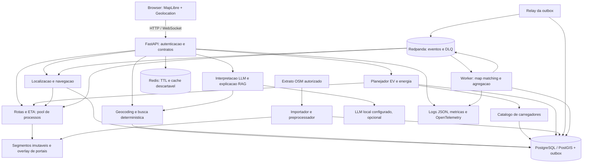

# Mapinator: proposta arquitetural

## 1. Estado, escopo e referencias

Arquitetura aprovada para implementacao incremental. O desenho abaixo inclui
fases futuras, nao apenas componentes existentes. Fases 1 a 6 implementadas;
fase 7 tem ferramentas e benchmark regional, nao escala global validada.
resultados e bloqueios em [phase-01.md](phase-01.md), [phase-02.md](phase-02.md)
e [phase-03.md](phase-03.md).
Continuacao: [phase-04.md](phase-04.md), [phase-05.md](phase-05.md),
[phase-06.md](phase-06.md) e [phase-07.md](phase-07.md).
Nenhuma capacidade global ou meta de latencia foi validada.

A pasta `maps` estava vazia. O inventario da raiz e as documentacoes/manifests
dos laboratorios mostram Python 3.12+, FastAPI, pytest, PostgreSQL, Redis,
Compose, frontend separado e entregas incrementais. Outros projetos usam .NET
e TypeScript. Nao foi feita auditoria de todo o codigo dos outros laboratorios.

Reutilizaremos essas convencoes, nao seus dados simulados nem dependencias
internas: o grafo e os lugares devem ter origem real e rastreavel. O
`ai-agent-harness` serve como referencia para adaptadores de modelos tipados,
timeouts e permissoes; nao precisamos de um runtime de agentes para interpretar
uma busca. Nenhum projeto existente sera modificado.

Objetivo inicial: laboratorio regional funcional; nao um servico mundial nem
uma promessa de suportar bilhoes de arestas em Python. Transporte publico fica
explicitamente futuro ate existirem GTFS e dados de operacao suficientes.

## 2. Arquitetura

Monolito modular Python para HTTP e orquestracao, acompanhado por worker de
trafego e processo de importacao/preprocessamento. O roteamento CPU-bound roda
em processos limitados, fora do event loop. Os limites logicos permitem extrair
servicos apenas quando medições demonstrarem necessidade.



O desenho representa o alvo das fases, nao componentes ja existentes.
O broker entra na fase 3, Redis na fase 4 e o LLM na fase 6. A fase 1
precisa somente de API, PostGIS e importador.

Na entrega da fase 3, o broker recebe GPS com consentimento separado durante
rastreamento em primeiro plano, nao uma sessao de navegacao (fase 4). A API
le snapshots SQL de pesos; nao consome Kafka diretamente. Redis, WebSocket e adaptador LLM local foram adicionados nas fases 4/6;
traces distribuidos e shards persistentes continuam futuros.

## 3. Stack e custos

| Tecnologia | Papel e justificativa | Custo/limite |
|---|---|---|
| Python 3.12+, FastAPI, Pydantic 2 | Contratos tipados, HTTP e WebSocket | CPU-bound exige processos; async nao acelera A* |
| SQLAlchemy 2, psycopg 3, Alembic | Persistencia e migracoes versionadas | Pools e transacoes precisam de limites |
| PostgreSQL + PostGIS | GiST, filtros espaciais, metadados e outbox | Banco unico local nao e HA |
| Artefatos de grafo versionados em disco | Adjacencia compacta por segmento, carregamento sob demanda | Replicacao e armazenamento de objetos sao evolucao |
| Redis | Localizacao atual, sessao e cache com TTL | Nao e fonte de verdade nem lock global |
| Redpanda, aiokafka | Pub-sub Kafka-compatible e replay limitado | Processo e volume adicionais; somente fase 3 |
| MapLibre GL JS, HTML/CSS/JavaScript | Mapa no browser servido pela API | JS necessario para GPS; servicos continuam Python |
| OSM, pyosmium | Dados reais, importacao streaming de PBF/XML | Licenca ODbL, cobertura e atualizacao variaveis |
| httpx + adaptador LLM local | Interpretacao estruturada e RAG sem API paga obrigatoria | Modelo real exige download e recursos locais |
| pytest, mypy, Ruff | Testes, tipos e qualidade | Integracao real separada dos doubles unitarios |
| OpenTelemetry, metricas Prometheus | Trace context, latencias, erros e lag | Coletor e dashboards opcionais no laboratorio |
| Docker Compose | Execucao local reproduzivel | Docker Linux/WSL precisa funcionar |

Sem React/Next.js inicialmente: o mapa nao justifica outro build e o pedido
prioriza Python. OpenSearch fica adiado: PostGIS atende busca regional; a
interface de busca permite shards regionais e indice textual dedicado depois.
Nao chamaremos uma consulta SQL local de busca distribuida.

Nao dependeremos de Nominatim/Overpass publicos por request. Geocoding local
usa nomes, enderecos e POIs importados; sem cobertura, retorna resultado vazio
explicitamente. Tiles externos somente com provedor configurado, atribuicao e
politica de uso; nao baixar tiles em massa. Indisponibilidade de tiles nao pode
impedir consultas e exibicao das geometrias locais.

## 4. Dados e eventos propostos

UUIDs identificam recursos privados; IDs OSM preservam proveniencia. Tempos UTC,
unidades SI, coordenadas WGS84. GeoJSON usa ordem `[longitude, latitude]`.
Distancias usam geography ou projecao metrica adequada, nunca graus como metros.

| Entidade | Campos principais e invariantes |
|---|---|
| users / vehicles | subject autenticado, modelo, capacidade_kwh, curva de consumo, conectores; somente proprietario acessa |
| graph_versions | versao, checksum, origem, licenca, importado_em, estado; publicar somente apos validacao atomica |
| graph_segments | (graph_version, segment_id), bounds, artifact_uri, checksum, neighbors; limites podem conter arestas de passagem |
| road_vertices | (graph_version, osm_node_id), Point; ID compartilhado em fronteiras |
| road_edges | (graph_version, edge_id), source, target, LineString, length_m, mode_permissions, speed_limit, tipo, elevation e tags OSM |
| turn_restrictions | from_edge, via_node/via_way, to_edge, modos; estado de busca considera aresta anterior |
| segment_portals / shortcuts | fronteira, vizinhos, caminho detalhado, custo, modo, preferencia e versao dos pesos |
| places | source_id, Point, nome, categorias, opening_hours, timezone, atributos, origem e atualizado_em; ausente e null |
| charging_stations | Point, conectores, potencia, origem, status nullable, status_observed_at; desconhecido nunca significa livre |
| traffic_estimates | graph_version, edge_id, janela, speed_ema, sample_count, device_count, confidence, freshness |
| traffic_history | edge_id, dia_semana, faixa_horaria, velocidade e contagem agregadas |
| routes | owner_id, geometry, edge_ids, graph_version, traffic_version, distancia, ETA, instrucoes, criado_em e expires_at |
| navigation_sessions | owner_id, route_id, state, consent_version, sequencia e expires_at |
| conversations | owner_id, criterios estruturados, revision, expires_at; sem historico preciso de GPS |
| outbox / inbox / dead_letters | event_id, tipo, payload, tentativas, proxima_tentativa; unique consumer/event_id |
| prediction_outcomes | previsto, observado, unidades, versao do modelo e qualidade da referencia; somente com consentimento |

GiST em geometrias, GIN em busca textual, B-tree em owner/expiry e edge/window.
Eventos e observacoes sao particionados por tempo para facilitar expiracao.
Redis guarda localizacao atual por sessao (TTL inicial 5 minutos), contexto e
caches. Parada ou revogacao apaga localizacao corrente; limpeza periodica remove
rotas e sessoes privadas expiradas (proposta: 24 horas).

Envelope comum:

Proposta para evolucao. O contrato implementado na fase 3 e um `TrafficEvent`
plano e versionado, incluindo `graph_version`; nao envia `traceparent` nem
promete rastreamento distribuido. A DLQ implementada carrega somente metadados,
nunca o payload GPS. Consulte os campos efetivos no [relatorio](phase-03.md).

```json
{
  "event_id": "uuid",
  "schema_version": 1,
  "type": "location.observed",
  "occurred_at": "2026-11-15T23:00:00Z",
  "traceparent": "W3C trace context",
  "partition_key": "pseudonymous-session-id",
  "payload": {
    "session_id": "uuid",
    "sequence": 12,
    "latitude": -23.55,
    "longitude": -46.63,
    "heading_deg": 90,
    "speed_mps": 8.3,
    "accuracy_m": 12,
    "consent_version": 1
  }
}
```

Exemplo de schema, nao dado coletado. Topicos: `location.observed.v1`,
`traffic.updated.v1`, `navigation.updated.v1`, `graph.published.v1`,
`charging.updated.v1`, e DLQs por consumidor. Location particiona por sessao;
trafego por edge_id. Atualizacao de trafego inclui graph_version, janela,
velocidade, confianca, numero de dispositivos e timestamp.

Outbox atomica com aceite; consumidor ACK somente apos commit de inbox e
efeito. Entrega at-least-once, efeito deduplicado, nao exactly-once global.
Retry limitado com backoff/jitter e DLQ observavel. Eventos atrasados nao
sobrescrevem estado recente. Payload GPS bruto: retencao inicial maxima de
1 hora no banco/broker, inclusive DLQ, com limpeza verificavel; agregados por
90 dias, sem identificadores de sessao. Backups privados tambem devem expirar.
Agregacao publicada exige pelo menos 5 dispositivos distintos; nao constitui
prova de anonimato nem impede ataques Sybil.

## 5. Contratos HTTP v1

Schemas detalhados e OpenAPI executavel entram com cada fase. Campos privados
sao derivados do principal autenticado, nunca de um owner_id enviado livremente.

| Endpoint | Entrada | Saida e status |
|---|---|---|
| POST /api/v1/location | event_id, session_id, sequence, timestamp, lat/lon, accuracy, heading, speed, consent | 202 aceito/deduplicado apos persistencia; 403 sem consentimento |
| GET /api/v1/location/current | sessao autorizada | 200 observacao + freshness; 404 ausente/expirada |
| GET /api/v1/geocoding/search | q, bbox opcional, limit, cursor | 200 items com coordenadas, source e next_cursor |
| POST /api/v1/routes | source/destination como coordenadas ou texto, mode, strategy, preferences, alternatives <= 3 | 201 route_id, geometry GeoJSON, distance_m, eta_s, instructions, alternativas, versoes, warnings |
| GET /api/v1/routes/{routeId} | ID privado | 200 rota; 404 ausente/inacessivel/expirada |
| POST /api/v1/navigation/start | route_id, tracking_consent e traffic_consent separados | 201 session_id, ws_url, state |
| POST /api/v1/navigation/location | sessao + observacao | 202 observacao aceita; atualizacoes por stream |
| POST /api/v1/navigation/stop | session_id | 200 stopped; idempotente e revoga tracking |
| WS /api/v1/navigation/{sessionId}/stream | sessao autenticada, resume_sequence | route_updated, instruction, eta_updated, arrived, error; snapshot na reconexao |
| GET /api/v1/traffic/segments/{segmentId} | ID geografico, cursor | 200 estimativas por aresta, janela, confidence, source e freshness; 404 segmento inexistente |
| POST /api/v1/places/search | center, radius_m, categorias, open_at, atributos, min_rating, limit, cursor | 200 items, dados verificados, coordenadas, proveniencia e next_cursor |
| POST /api/v1/places/conversation | message, conversation_id opcional, center, revision | 200 criterios + resultados + explicacao; 409 revision conflitante; 503 LLM ausente |
| POST /api/v1/ev/trips | origem/destino, vehicle, battery_percent, reserve_percent, connectors | 201 itinerary, charging_stops, driving_s, charging_s, ETA, energia e intervalo; fallback explicito para rota comum |

Validar lat [-90,90], lon [-180,180], numeros finitos, bateria [0,100],
reserva menor que bateria inicial, capacidade/consumo positivos, precision e
speed nao negativos, heading [0,360), timestamps e sequencias plausiveis.
Limites iniciais: busca ate 50 resultados/pagina, mensagem ate 2.000 caracteres,
raio ate 50 km; cobertura e snapping maximo explicitamente informados.
Preferences: evitar pedagios/rodovias/balsas; diferenciar restricao hard de
penalidade soft e reportar inviabilidade, sem ignorar silenciosamente.

Erros no formato Problem Details: type, title, status, detail, code, request_id.
400 ambiguidades de geocoding, 401 autenticacao, 403 consentimento, 404 recurso,
409 versao/conflito, 422 validacao ou rota inviavel, 429 limite, 503 dependencia
obrigatoria indisponivel. Servicos opcionais podem degradar somente com warnings
e source/freshness explicitos; ausencia de rota nao vira sucesso com linha reta.

## 6. ADRs propostos e algoritmos

### ADR-001: modularidade antes de microservicos

Separar dominio, aplicacao e adaptadores; dominio nao importa FastAPI, Redis,
SQLAlchemy ou SDK de LLM. Processos separados para trafego e importacao. Menor
custo operacional inicial; isolamento e escala independentes limitados. Extrair
route/search por benchmarks, nao por quantidade de responsabilidades no briefing.

### ADR-002: segmentacao e hierarquia exatas no recorte suportado

Importar direcao, access, one-way por modo, restricoes de conversao e geometrias.
Fail closed para restricoes nao suportadas ou comunicar explicitamente cobertura
limitada; nao declarar rotas seguras para navegacao real sem validacao.

Grade geografica com conectividade por IDs OSM; arestas atravessando celulas
geram portais mesmo sem intersecao na fronteira. Persistir entry/exit points,
neighbors e caminhos entre portais por modo. Fonte/destino conectam ao overlay
por buscas locais; detalhes reconstruidos com IDs de arestas originais.

Dijkstra e oraculo em testes pequenos. A* usa limite admissivel: distancia
geodesica para shortest e distancia/velocidade maxima garantida para fastest.
Comparar tambem bidirectional Dijkstra. Custos nao negativos e restricoes de
conversao exigem estados edge-based. Snap em aresta dirigida preserva posicao
fracionaria, lado e permissao do modo, nao apenas vertice mais proximo.

Expandir regioes quando necessario: chegar a primeira rota nao prova otimalidade.
Parar somente quando lower bounds excluirem alternativas, ou buscar todos os
segmentos do recorte importado. Limite de recursos retorna erro explicito.
Nenhuma garantia fora da cobertura.

Shortcuts estaticos nao podem ser reutilizados como custos exatos apos mudar
trafego: recustomizar segmentos afetados, versionar overlay/traffic e publicar
snapshot consistente. Enquanto indisponivel, A* no recorte regional usando
pesos atuais e lower bounds estaticos. Comparar resultado com grafo completo em
testes, inclusive rotas que saem do bounding box inicial.

Contraction Hierarchies estaticas: consultas rapidas, preprocessamento caro e
atualizacao dinamica dificil. CCH/multi-level customization: candidato posterior,
com implementacao nativa se medido necessario. Python nao promete grafo global.
Alternativas por k-shortest paths limitado, com diversidade de arestas medida.

### ADR-003: trafego como estimativa com qualidade e fallback

Map matching considera projecao em aresta, heading, accuracy e plausibilidade
temporal; perto de vias paralelas, rejeitar baixa confianca. Janela inicial de
5 minutos, EMA, clipping robusto de outliers, dispositivos distintos, cadencia de
30 segundos e histerese. Ignorar GPS duplicado, velho ou fora de ordem.
Fallback mistura baseline e historico por amostra/confianca; decaimento de
freshness para realtime. Pesos consultados num snapshot versionado por request.

Cliente observa GPS localmente, enviando quando deslocamento/tempo/qualidade
justificarem, com heartbeat limitado. Somente consentimento especifico publica
trafego. Navegacao compara distancia ao caminho restante, usa histerese e
cooldown para desvio, recalcula e atualiza ETA; stream tem fila limitada,
coalescing de ETA, heartbeat e reconexao. Nao basta distancia a vertices.

### ADR-004: EV fisicamente explicavel, nunca bateria inventada

Consumo por aresta: distancia, perfil do veiculo, velocidade, relevo, tipo,
trafego e clima quando realmente disponivel. Modelo inicial fisico/parametrico
com intervalo conservador identificado como estimativa nao calibrada.
Sem elevacao/clima, informar limitacao e ampliar incerteza; sem parametros
minimos, retornar rota comum, `ev_planning_available=false` e motivo.

Busca de itinerario em estados (local, faixa de carga), reserva aplicada a
todas as pernas, consumo conservador e carregadores compativeis. Otimizar
direcao + desvio + carga; duracao usa potencia efetiva e curva de taper
conhecida. Sem curva, faixa de tempo estimada explicitamente; disponibilidade
desconhecida nunca vira garantia de vaga. Comparar candidatos e testar multiplas
paradas, destino inviavel e reserva durante toda a viagem.

### ADR-005: RAG, restricoes deterministicas e isolamento de IA

LLM interpreta JSON validado; follow-ups fazem merge explicito com revision.
Busca faz retrieval geoespacial e filtra distancia/horario antes do ranking.
Horarios usam timezone local, travessia de meia-noite e regras OSM; desconhecido
nao satisfaz "aberto agora". "Quieto" e "bom para trabalhar" exigem evidencia:
sem metadados/reviews, explicar que o atributo nao foi verificado.

LLM so pode ordenar IDs recuperados e explicar evidencias existentes; validar
IDs e fatos de saida, usar campos comerciais originais na resposta. Limitar
tokens, concorrencia, prazo e circuit breaker. Nenhum modelo carregado por padrao.
Sem LLM, busca estruturada funciona e conversa retorna 503; sem rating/review
real, esses campos ficam null. Nenhuma chamada externa com localizacao ou
conversa sem configuracao e consentimento especificos.

## 7. Seguranca, confiabilidade e observabilidade

Mesmo localmente: principals e recursos owner-scoped, validacao de origem
WebSocket, cookies seguros quando aplicavel, CSRF para autenticacao por cookie,
rate limit e IDs nao enumeraveis. OIDC em ambiente exposto; identidade local
explicitamente restrita ao laboratorio. Segredos via ambiente, nunca repositorio.
Portas Compose somente loopback; TLS para exposicao externa e criptografia de
volumes/backups configurada na infraestrutura, nao uma propriedade de PostGIS.

Sem GPS/prompt/token em logs ou labels. request_id/traceparent acompanham
API/outbox/worker. Timeouts por adaptador, retries apenas para operacoes
idempotentes, bulkheads para CPU/LLM/provedores e fila limitada. Cache key inclui
grafo, traffic snapshot, modo, preferencias e coordenadas normalizadas sem
misturar rotas privadas; cache miss nao impede roteamento.

Health: liveness, readiness de dependencias obrigatorias e estado degraded de
opcionais. Metricas: request_errors, route/search latency, expanded_edges,
segment_cache_hits/misses, processing_lag_s, outbox_age_s, DLQ size, ws_active,
eta_absolute_error_s, energy_absolute_error_kwh e cobertura de ground truth.
Sem observacoes reais, erros de predicao sao "nao medidos", nunca zero.

SLOs candidatos apos medicao: disponibilidade de rotas 99,9% mensal dentro
da cobertura, p95 route/ETA <= 3 s, busca <= 1 s, conversa <= 5 s quando LLM
disponivel, navegacao servidor <= 1 s do aceite ao evento. Medir latencia
end-to-end separadamente do servidor e rejeicoes/erros no denominador.

## 8. Capacidade: hipoteses, nao benchmarks

Exemplo alvo: 1M DAU x 20 requests/dia / 86.400 = 231,5 RPS medio;
multiplicador de pico 10 = 2.315 RPS. Esses requests excluem GPS abaixo:
nao somar novamente caso a telemetria seja incluida na media por usuario.

50.000 sessoes simultaneas x 1 evento/5 s = 10.000 eventos/s de pico.
Evento de 300 bytes: 3 MB/s de payload e 10,8 GB/h sem compressao,
replicas, indices ou protocolo. Com replicacao 3: 32,4 GB/h apenas payload.
Se sustentado por 24h, 259,2 GB/dia sem replicas; nao inferir media diaria do
pico. Outbox + inbox + agregacao implicam mais de uma escrita por evento;
medir writes/s e WAL antes de dimensionar banco.

RPS de rota depende da fracao de requests que sao rotas. Exemplo de 20%:
463 RPS no pico. Benchmark devera medir throughput por worker com p95 <= 3s.
Instancias = ceil(RPS_pico / (throughput_medido x utilizacao_alvo)).
Reportar CPU/RAM, dataset, warm/cold cache, concorrencia, erros e duracao;
nenhum numero de servidores pode ser calculado honestamente antes disso.

Memoria de grafo = vertices x bytes/vertice medidos + arestas x bytes/aresta
medidos + shortcuts + indices. Objetos Python custam mais que structs nativos.
RAM adicional: segmentos hot, pool de processos, buffers e sessoes WS.
Armazenamento: artefatos + versoes retidas + metadados + indices + WAL/backups.
Cache hit ratio deve vir do workload; nao presumir 90%.

Evolucao: shards regionais com replicas, registry segment-to-server,
artefatos imutaveis em armazenamento de objetos, broker particionado,
PostGIS particionado e busca distribuida por regiao; overlay entre shards
com versoes coerentes. Regioes densas e fronteiras exigem rebalancing.
Compose single-node continua sendo laboratorio, nao arquitetura HA validada.

## 9. Marcos e criterios de aceite

| Marco | Entrega runnable | Evidencia exigida antes do proximo |
|---|---|---|
| 1. Fundacao | API Python, Compose/PostGIS, mapa, consentimento GPS, geocoding e importador OSM de recorte pequeno | Tests de validacao/ownership/importacao; integracao PostGIS real; browser GPS permitido/negado; fonte/licenca registradas |
| 2. Rotas | Grafo dirigido, modos, snapping, segmentacao, portais, A*/Dijkstra, overlay, instrucoes e alternativas | Comparar custo e caminho com oraculo; conversoes proibidas, one-way, fronteiras, sem rota e expansao; benchmark regional |
| 3. Trafego | Redpanda, outbox/inbox, worker, EMA/historico, dynamic weights e DLQ | Broker/banco reais; duplicatas, out-of-order, restart, expiracao, falta de amostras e ETA sem realtime |
| 4. Navegacao | Redis TTL, WS, progresso, desvio, reroute e stop | HTTP/WS integrados; reconnect, isolamento de owners, slow consumer, revogacao e limpeza GPS |
| 5. EV | Perfis, energia com incerteza, carregadores reais e otimizacao de paradas | Reserva em todas as pernas, conectores, taper, multiplas paradas, unknown availability e fallback |
| 6. Descoberta IA | LLM real configurado, RAG, conversa contextual e marcadores | Teste opt-in real, JSON invalido, prompt injection, horarios, follow-up e falha isolada do modelo |
| 7. Escala | Workloads concorrentes, tuning, guia de capacidade e SLIs | Dados pequenos/medios/grandes com origem; CPU/RAM/latencia/erros medidos; testes multi-instance e falhas |

Testes unitarios sem rede podem usar fixtures sinteticas claramente rotuladas;
datasets de demonstracao/importacao devem ser OSM reais, com checksum e tamanho.
Testes de arquitetura validam imports e propriedade dos dados; integracoes nao
podem ser declaradas aprovadas por mocks. Ground truth para ETA/energia requer
viagens observadas consentidas. Execucao Compose e comandos PowerShell serao
documentados por marco com resultados reais e limitacoes.

## 10. Estrutura prevista

A estrutura abaixo e o alvo; modulos regionais das Fases 1 a 6 e ferramentas
da fase 7 foram criados, nao todos os shards/servicos distribuidos mostrados.
O pacote usa modulos de dominio/adaptador nestas fases pequenas, sem pastas vazias.

```text
maps/
  README.md
  pyproject.toml
  compose.yaml
  Dockerfile
  .env.example
  docs/
    architecture.md
    phases/
  src/mapinator/
    domain/       # graph, routing, traffic, navigation, places, ev
    application/  # use cases, ports, authorization
    adapters/     # postgis, osm, redis, kafka, llm
    api/          # schemas, http, websocket
    workers/
    static/       # browser map
  migrations/
  scripts/        # importacao, testes reais, benchmark
  tests/
    unit/
    integration/
    architecture/
    performance/
  data/           # artefatos locais ignorados; manifesto de fontes versionado
```

Nao criar pastas vazias ou dependencias antes de necessarias. Cada fase adiciona
somente seus componentes. Portas/volumes recebem namespace proprio; nao usar ou
apagar recursos dos outros laboratorios.

## 11. Riscos e mitigacoes

| Risco | Mitigacao |
|---|---|
| Recorte sem conectividade ou enderecos suficientes | Manifesto de cobertura, importacao validada, sem fallback ficticio |
| Tiles/modelo/clima/carregadores indisponiveis | Dados opcionais com source/freshness e indisponibilidade explicita |
| Peso dinamico invalida hierarquia | Snapshots, customization por segmento e A* de fallback regional |
| Python ou explosao de portais limita escala | Perfis medidos, adjacencia compacta, limites e engine nativo quando necessario |
| Restricoes OSM complexas | Estado edge-based, testes de via-way e limites de suporte explicitos |
| ETA e consumo sem ground truth | Incerteza e versao expostas, nao declarar acuracia sem observacao |
| LLM inventa locais ou ignora filtros | Retrieval deterministico, schemas, allowlist de IDs e evidencias verificadas |
| Localizacao revela habitos pessoais | Consentimento separado, TTL, logs redigidos e expiracao incluindo DLQ/backups |
| Docker/WSL nao funciona no host | Validar cedo; tests unitarios continuam possiveis, integracao fica explicitamente bloqueada |
| Escopo parecido com Maps global induz overengineering | Marcos regionais aprovados, infraestrutura apenas quando houver necessidade |

Decisao aprovada: iniciar somente o marco 1 com pequeno recorte de Sao Paulo.
O download usa bounds configuraveis, sem baixar uma cidade inteira por padrao.
O marco 2 foi aprovado e implementado; validacao PostGIS continua pendente.
O marco 3 requer nova aprovacao.
