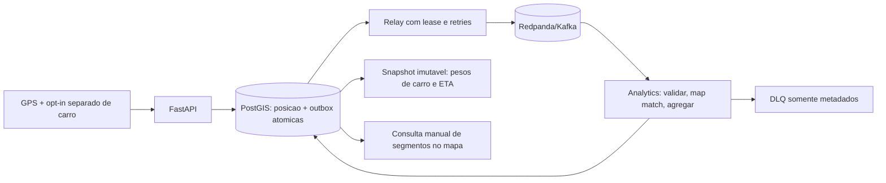

# Fase 3: inteligencia de transito

## Estado

Mapinator 0.3.0 em Python, migration 003 e perfil Compose `traffic` entregues.
Validacao local: 68 testes passaram, quatro integracoes reais skipped,
Ruff/mypy sem erros e sintaxe dos novos modulos/API/CLI verificada por Pylance.
Testes no browser usam mapa, transito e Geolocation explicitamente sinteticos;
nao validam GPS fisico nem permissoes nativas do sistema operacional.
Execucao local com Python 3.14; imagem Python 3.12 ainda nao executada.

PostGIS/Kafka reais, migration 003 e inicializacao dos containers **nao foram
executados com sucesso neste host**: Docker Desktop nao conecta ao pipe
`dockerDesktopLinuxEngine`. Configuracao Compose validada, nao operacao real.
Nao ha medicao de acuracia de transito, erro de ETA, throughput, HA ou SLO.

## Fluxo implementado



Nesta fase, a contribuicao acompanha rastreamento GPS em primeiro plano com
declaracao explicita de estar em um carro. Sessoes de navegacao, atualizacao
automatica de ETA, desvio/recalculo e WebSocket pertencem a fase 4.
Rota salva permanece com a ETA e versao originais ate novo calculo.

- Nao contribuir e o padrao; GPS sozinho nao alimenta o broker.
- Contribuidor: hash SHA-256 do UUID interno do proprietario e data UTC.
  Rotacionar sessao no mesmo dia nao multiplica contribuidores.
  Sao identidades tecnicas, nao pessoas verificadas nem defesa anti-Sybil.
  Na virada UTC, a mesma identidade pode ter duas chaves na janela movel.
- Posicao e evento entram na mesma transacao SQL. O aceite da posicao nao
  garante que exista velocidade/direcao utilizavel nem que gere uma estimativa.
- Outbox usa `FOR UPDATE SKIP LOCKED`, lease UUID de 30s e confirmacao por lease.
  Producer idempotente, timeout de envio 10s, backoff exponencial e ate cinco
  tentativas antes de DLQ. Falha ao publicar DLQ nao cria DLQs recursivas.
- Consumer sem auto-commit: persiste efeito/rejeicao antes de confirmar offset.
  Inbox e sequencia/tempo evitam aplicar duplicatas ou eventos fora de ordem.
  Nao e uma promessa de exactly-once end-to-end.
- Atualizacoes agregadas voltam pela outbox para Kafka; a API consulta SQL.
  O worker agrega/limpa a cada 30s; a API tambem limpa expiracoes periodicamente.

## Qualidade e modelos

Map matching regional considera arestas permitidas para carro e sua direcao.
Rejeita observacoes com idade acima de 15min, mais de 15s no futuro, precisao
pior que 35m, velocidade abaixo de 1m/s ou acima de 1,5x a baseline da via.
Exige direcao a ate 45 graus e distancia ate max(10m, precisao). Candidatos
quase empatados (diferenca ate 3m) sao rejeitados, nao escolhidos arbitrariamente.
GPS sem velocidade/direcao nao recebe valores inventados.

Janela movel de 5min, ultimo ponto por contribuidor/aresta, mediana/MAD para
outliers e minimo de cinco contribuidores retidos. EMA alpha 0,25 aplica
somente com observacao mais nova. Confianca = min(1, contagem/10).
Congestionamento relativo a baseline: pesado abaixo de 0,35; moderado abaixo
de 0,7; livre acima, com histerese de 0,05. `anomaly` sinaliza velocidade abaixo
de 0,25 da baseline; e um indicador heuristico, nao prova de acidente/incidente.

Buckets UTC fechados de 5min sao historizados uma vez, sem IDs de contribuidores.
Referencia historica por dia da semana/hora UTC, confianca limitada por
quantidade de janelas/12. Nao e modelo treinado, calendario local, previsao
certificada ou referencia suficiente para vias sem observacoes.

Pesos misturam **tempo de viagem por metro**, com confianca historica e recente.
Contribuicao recente decai por exp(-idade/120) e deixa de valer apos 300s.
Sem dados suficientes, usa historico ou baseline explicitamente. Afeta apenas
carro; bicicleta/a pe preservam pesos baseline. Snapshot usa versao do grafo
e digest do estado/instante, e e aplicado antes de snapping e busca de rotas.
Alternativas recebem sua propria proveniencia.

## Contratos

Escritas usam sessao autenticada, Origin permitido e CSRF das fases anteriores.

| Endpoint | Contrato |
|---|---|
| `POST /api/v1/traffic/consent` | `session_id`, `enabled`, `mode: car`; sessao ativa do proprio usuario |
| `GET /api/v1/traffic/segments/{x:y}` | grafo/snapshot, arestas de carro, GeoJSON, velocidade baseline/efetiva, fonte e estimativa |
| `GET /health/traffic` | filas, idade do evento mais antigo, DLQ, heartbeat e ultimo lag medido; 503 se degradado |
| `POST /api/v1/routes` | acrescenta `traffic_source`, `traffic_version`, `segment_ids`, tambem nas alternativas |

Segmento = floor(longitude/0,01):floor(latitude/0,01).
Fontes: `baseline`, `historical`, `realtime`, `mixed` (rota com fontes diversas).
Falha SQL opcional de transito em calculo de rota gera log/aviso e baseline,
nao dados ficticios. Falha de consulta de segmento retorna erro explicitamente.
Rotas privadas antigas continuam legiveis, com defaults de metadados baseline.

O botao de mapa consulta os segmentos da rota e colore apenas arestas com
dados recentes/historicos suficientes, segundo velocidade efetiva/baseline.
E uma camada estimada, manual, nao feed continuamente atualizado.
Trocar/recalcular rota limpa a camada; respostas antigas nao a reinstalam.

`TrafficEvent` v1 e JSON plano estrito: `schema_version`, `event_id`,
`session_id`, `contributor`, `graph_version`, `sequence`, `observed_at`,
`latitude`, `longitude`, `speed_mps`, `accuracy_m`, `heading_deg`.
UUIDs validos, data com timezone, valores finitos, WGS84 e unidades SI.
Nao aceita campos extras. Topicos com tres particoes, replicacao 1:

- `mapinator.location.v1`: GPS consentido, chave por sessao.
- `mapinator.traffic.v1`: estimativas agregadas, chave por grafo/aresta.
- `mapinator.dead-letter.v1`: identificador, motivo e tempo, nunca GPS bruto.

## Privacidade e operacao

Retencao nominal: posicao atual 5min; outbox/inbox/offsets/amostras/DLQ SQL 1h;
topicos Kafka 15min, segmentos de log de 1min; historico agregado 90 dias.
Estimativas SQL expiram fisicamente em 1h, mas peso recente vale apenas 5min.
Expiracao logica nao e garantia de exclusao fisica no prazo durante falhas,
nem remove backups automaticamente. Operador precisa definir sua politica
de backups e verificar expurgos. Logs nao incluem payload GPS.

Revogacao/parada remove outbox GPS pendente, amostras recentes e estimativas
afetadas no banco. Consumo verifica consentimento sob lock; revogacao/agregacao
compartilham lock para nao republicar uma estimativa removida.
Envios ja em voo ou publicados nao podem ser recolhidos do broker; consumo
posterior rejeita sessao sem consentimento. Historico sem identidade e rotas
ja salvas nao podem ter a contribuicao individual extraida retroativamente.
Hash diario e limiar de cinco participantes **nao garantem anonimato**.

Health de transito exige relay/analytics com heartbeat menor que 60s,
ultimo lag medido ate 60s, evento pendente mais antigo ate 60s e DLQ vazia.
Isso indica condicao do pipeline, nao cobertura/acuracia de transito.
Readiness principal nao depende de broker/worker opcional.

## Evidencias locais

| Verificacao | Resultado |
|---|---|
| pytest completo | 68 passed, 4 skipped; aviso de depreciacao do TestClient/httpx |
| Ruff/mypy/Pylance | sem erros de lint, tipos ou sintaxe nos modulos verificados |
| Browser: rota/camada sinteticas | fonte recente, uma aresta colorida; baseline apos expirar dados |
| Browser: consentimento antes do GPS e revogacao | autorizacao antes do primeiro envio; revogar mantem GPS sem contribuir |
| Browser: falha de consentimento/exclusao | GPS local parado; exclusao pendente bloqueia reinicio e permite tentar novamente |
| Browser: resposta antiga/falha de camada | resposta atrasada nao reinstala camada; erro explicito sem geometria residual |
| Relay: horario de retry | regressao reproduzida e corrigida: backoff conta da falha, nao do inicio do envio |
| Compose/CLI | perfil e comandos validos; nao prova disponibilidade dos servicos |
| PostGIS/Kafka reais | quatro testes disponiveis, nao executados sem endpoints dedicados |

## Executar e validar

Depois da configuracao de senha/banco/importacao no [README](../README.md):

```powershell
$Docker = "C:\Program Files\Docker\Docker\resources\bin\docker.exe"
& $Docker compose --profile traffic config --quiet
& $Docker compose --profile traffic up --build -d
Invoke-RestMethod http://127.0.0.1:58180/health/traffic
& $Docker compose --profile traffic logs --tail 50 traffic-relay traffic-analytics
```

API 58180, PostGIS 58432 e Kafka 59092, todos publicados apenas em loopback.
Profile inicializa topicos, inclusive retencao de topicos ja existentes.
Fora do container, com banco configurado e broker dedicado em funcionamento:

```powershell
$env:MAPINATOR_KAFKA_BOOTSTRAP_SERVERS = "127.0.0.1:59092"
& .\.venv\Scripts\mapinator.exe init-traffic
& .\.venv\Scripts\mapinator.exe traffic-worker --role relay
# Em outro terminal, com as mesmas variaveis locais:
& .\.venv\Scripts\mapinator.exe traffic-worker --role analytics
```

Testes reais exigem `MAPINATOR_TEST_DATABASE_URL` (banco descartavel com
PostGIS) e/ou `MAPINATOR_TEST_KAFKA_BOOTSTRAP_SERVERS` (broker descartavel).
Nao usar endpoints de producao/compartilhados: os testes importam fixtures,
expurgam registros e alteram topicos/retencao. Teste conjunto exige ambos.

```powershell
& .\.venv\Scripts\python.exe -m pytest -q -m integration
& $Docker compose --profile traffic stop
```

Nao usar `down -v`. Redpanda single-node sem autenticacao, SQL regional e
matcher linear por arestas nao sao uma arquitetura global/HA validada.
Minimo de cinco contribuidores pode deixar muitas vias sem cobertura; carros
parados sao rejeitados pelo matcher atual. Isso limita deteccao de congestionamento
total e exige evolucao com referencia real, nao alteracao arbitraria dos limiares.
