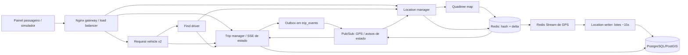

# ride-hailing: servicos locais, quadtree e GPS em tempo real

Laboratorio educacional inspirado no **problema** de Uber/99, nao na arquitetura
interna dessas empresas. TypeScript estrito, Node 24, Redis, PostgreSQL/PostGIS,
Nginx e um painel SVG sem mapas externos. **Nenhum recurso de cloud e criado.**
Todas as alteracoes desta evolucao estao nesta pasta; nenhum outro laboratorio
ou guia na raiz foi modificado.

## Experiencias implementadas

- Abrir o painel e ver motoristas proximos **sem solicitar uma viagem**.
- Publicar GPS de motorista e passageiro a cada ~4s.
- Ingerir a ultima posicao em hash Redis e consultar uma **quadtree real**.
- Atualizar a quadtree em snapshots de ~15s, corrigindo fronteiras com um delta.
- Solicitar uma corrida: request vehicle -> find driver -> trip manager.
- Mostrar o motorista escolhido, distancia, estado e versao.
- Acompanhar motorista e passageiro por SSE sem consultar SQL a cada GPS.
- Chegar, iniciar, concluir ou cancelar respeitando a maquina de estados.
- Salvar posicoes em lote e os pontos intermediarios do trajeto durante a viagem.
- Recuperar lote pendente e deduplicar replay depois de falha.
- Repetir pedidos entre replicas sem duplicar corridas.
- Distribuir requisicoes de viagem entre duas replicas via Nginx.

**Nao e capacidade global demonstrada.** As estimativas de 500M passageiros,
5M motoristas, 20M viagens/dia, pico de 10k pedidos/s e 100M leituras de posicao/s
estao [dimensionadas separadamente](docs/10-estimativa-de-recursos.md).
O laboratorio tem limites pequenos, explicitos, para rodar no seu computador.

## Organizacao do codigo

```text
src/
  shared/                     codigo e adaptadores compartilhados
    domain.ts                 contratos, validacao e regras puras
    http.ts                   infraestrutura HTTP e chamadas internas
    redis.ts                  cache, ingestao GPS, stream e sinais
    store.ts                  persistencia PostgreSQL e transacoes
  services/                   um modulo por servico executavel
    request-vehicle/app.ts    entrada idempotente e orquestracao
    find-driver/app.ts        busca e ranking de candidatos
    trip-manager/app.ts       API e SSE do ciclo da corrida
    location-manager/         GPS, proximidade e writer em lote
    quadtree-map/             indice espacial e consulta por raio
  runtime/server.ts           composition root: monta o papel escolhido
  tools/                      utilitarios executaveis
    simulator.ts
  tests/                      testes de unidade e integracao
```

`SERVICE` ainda escolhe qual servico inicia, mas cada servico tem seu proprio
modulo e suas dependencias explicitas. `shared/` concentra implementacoes
reutilizadas; os adapters SQL/Redis ficam ali por enquanto, pois este laboratorio
usa uma instancia de cada tecnologia compartilhada. Assim evitamos fingir que
cada container tem um banco independente quando nao tem.

## Arquitetura executavel



Separar localizar de reservar e intencional: o indice e eventualmente consistente,
mas somente PostgreSQL autoriza uma atribuicao. Os indices unicos continuam
impedindo duas corridas ativas para motorista ou passageiro.

## Inicio rapido

Requisitos: Docker Desktop com Linux containers, Compose v2 e Node **24+** com npm
para testes/simulador no host. Internet para o primeiro download.
Referencia local: 4 CPUs e 6-8GB de RAM disponiveis ao Docker, sem promessa de RPS.

Na raiz do repositorio:

```powershell
Set-Location .\ride-hailing
npm ci
npm run build
docker compose build trip-manager
docker compose up -d
Invoke-RestMethod http://127.0.0.1:58100/health/ready
npm run simulate
```

Uma imagem compartilhada serve todos os processos; compilar `trip-manager`
construi essa imagem uma vez. `docker compose up -d --build` tambem funciona,
mas pode repetir trabalho de build.

Deixe o simulador em um terminal e abra **http://127.0.0.1:58100**.
Escolha passageiro e categoria; observe oferta antes de chamar.
Ao pedir, o marcador laranja se aproxima do embarque. A chegada habilita
**Iniciar viagem**; o simulador leva o carro ao destino e conclui a corrida.
O marcador turquesa representa o passageiro.
Use **Consultar trajeto salvo** depois de um lote para inspecionar o historico.

O mapa e um diagrama latitude/longitude, sem ruas, trafego ou tiles externos.
Movimento simulado: 120m por tick, com pausa de 4s mais o tempo HTTP.
Preco fixo simulado em BRL; sem cobranca ou aceite humano do motorista.
Use **um simulador por banco** para evitar produtores disputando sequencias.

## Schema limpo

O projeto e um laboratorio de arquitetura, sem compatibilidade com schemas
anteriores. [001-schema.sql](infra/001-schema.sql) cria de uma vez todas as
tabelas atuais, incluindo `driver_location` separada do cadastro `drivers`.
Nao ha migrations. PostgreSQL executa esse script somente ao inicializar um
volume vazio.

Para recriar o ambiente local e apagar os dados atuais **somente deste Compose**
(corridas, trajetos e cache Redis), execute uma vez:

```powershell
docker compose --profile multi-instance down -v
docker compose build trip-manager
docker compose --profile multi-instance up -d
```

O `-v` remove os volumes do projeto `ride-hailing`; nao use se quiser manter
seus dados atuais. Para uma instalacao nova, basta seguir o inicio rapido.
Leia [schema inicial e operacao local](docs/11-migracao-e-operacao.md).

## Testes

```powershell
docker compose up -d postgres redis
npm test
npm run test:integration
```

- Unitarios: contratos, maquina de estados, distancias e quadtree.
- Integracao: PostgreSQL/PostGIS e Redis **reais**, schema e namespace aleatorios,
  servicos HTTP em portas efemeras, duas request APIs e duas trip APIs.
- Testes aplicam o schema inicial no namespace isolado e removem somente seus
  dados ao terminar.
- Bursts podem repetir 503 com a mesma chave e budget finito; o runner imprime
  quantas respostas de sobrecarga recebeu. Nao sao benchmarks globais.
- SQL direto, retry, rollback, GPS antigo, delta, flush/replay, rota apos
  conclusao, falha de mapa, indisponibilidade Redis e SSE sao exercitados.

Veja [resultados da versao atual](docs/12-resultados-servicos.md).

## Processos, portas e persistencia

| Componente | Endereco local / interno | Responsabilidade |
|---|---|---|
| Gateway Nginx | `127.0.0.1:58100` | painel e roteamento; least-connections entre request replicas |
| Gateway 2 opcional | `127.0.0.1:58101` | mesmo backend, perfil multi-instance |
| PostgreSQL/PostGIS | `127.0.0.1:55439` | corridas, idempotencia, outbox, ultimo checkpoint e trajetos |
| Redis | `127.0.0.1:56379` | ultima posicao, delta, fila e pub/sub |
| Trip manager | interno `58110` | unica autoridade logica das corridas |
| Location manager | interno `58120` | GPS, proximidade e streams de posicao |
| Quadtree map | interno `58130` | snapshots espaciais a cada ~15s |
| Find driver | interno `58140` | consulta candidatos e pede claim ao trip manager |
| Request vehicle x2 | interno `58150` | pedido idempotente e orquestracao |
| Location writer | interno `58160` | checkpoint e trajeto em lote, ACK depois do commit |

Somente gateway e ferramentas de dados publicam portas no host, em loopback.
Os endpoints `/internal/` nao sao publicados pelo gateway.
Volumes: `ride-hailing_ride-data` e `ride-hailing_redis-data`.
Redis: AOF everysec, 256MB, noeviction; nao e Kafka nem um cluster HA.

```powershell
docker compose --profile multi-instance up -d
Invoke-RestMethod http://127.0.0.1:58101/health/ready
docker compose --profile multi-instance stop
```

`stop` nao apaga dados. O perfil adiciona gateway, nao outro banco.
As duas replicas request vehicle ja existem na configuracao padrao.

## Configuracao no host

`SERVICE` seleciona um papel de processo; `PORT`, `HOST`, `DATABASE_URL`,
`REDIS_URL`, `REDIS_PREFIX`, `TRIP_URL`, `LOCATION_URL`, `MAP_URL` e `FINDER_URL`
configuram endpoints. `API_URL` aponta o simulador para um gateway.
Defaults dos servicos sao loopback nas portas internas acima.
`npm start` executa o papel escolhido (default trip-manager), **nao toda a stack**.
`npm run dev` sobe a stack Compose. Nao ha watcher.

As credenciais do Compose sao **publicas de laboratorio**, nao segredos reais.
Nao as reutilize nem publique estes endpoints na Internet.

## Contrato HTTP

| Metodo / rota | Entrada / resultado |
|---|---|
| `GET /health/ready` | dependencias do caminho de pedido |
| `GET /api/passengers` | fixtures de passageiros |
| `GET /api/drivers/nearby?lat=-23.5614&lng=-46.6559&category=standard` | ate 20 disponiveis; idade do indice e delta em headers |
| `POST /api/drivers/:id/location` | lat, lng, sequence, observedAt ISO; ACK de ingestao Redis |
| `POST /api/riders/:id/location` | mesmo contrato de GPS |
| `GET /api/drivers/:id/location` ou `/api/riders/:id/location` | ultima posicao e indicador fresh |
| `GET /api/drivers/:id/events` ou `/api/riders/:id/events` | SSE de ultimo valor; nao promete replay de todo GPS |
| `POST /api/trips` | passageiro/categoria/pickup/destination + Idempotency-Key |
| `GET /api/trips/:id` | snapshot autoritativo |
| `POST /api/trips/:id/status` | status e version esperada |
| `GET /api/trips/:id/events` | SSE de estado com Last-Event-ID **por corrida** |
| `GET /api/trips/:id/route?actor=driver&after=0` | ate 500 pontos e nextSequence; actor pode ser rider |
| `GET /api/system/map` | pontos, folhas, builtAt e ageMs da quadtree |
| `GET /api/demo/drivers` e `/api/demo/trips` | inspecao para simulador |

201 = pedido persistido, que pode estar assigned **ou searching**.
200 em retry = mesma corrida no estado atual. Timeout/falha entre criacao
e matching pode devolver 503 depois de persistir: repetir com **a mesma chave**.
409 = conflito de payload, estado, versao ou sequencia.
Nao usar GPS atrasado do PostgreSQL como fallback silencioso se Redis falhar.

## Ordem de estudo

1. [Arquitetura e ADRs](docs/01-arquitetura.md)
2. [Dados e persistencia](docs/02-dados-e-geolocalizacao.md)
3. [Matching e concorrencia](docs/03-matching-e-concorrencia.md)
4. [GPS, eventos e tempo real](docs/04-tempo-real-e-eventos.md)
5. [Falhas e extensoes](docs/05-falhas-e-extensoes.md)
6. [Escala e alternativas cloud, somente conceituais](docs/06-escala-e-cloud.md)
7. [Experimentos](docs/07-experimentos-e-operacao.md)
8. [Resultados historicos da primeira versao](docs/08-resultados-verificados.md)
9. [Quadtree, snapshots, fronteiras e delta](docs/09-quadtree-e-delta.md)
10. [Estimativas com as novas premissas](docs/10-estimativa-de-recursos.md)
11. [Schema inicial e operacao da stack](docs/11-migracao-e-operacao.md)
12. [Resultados atuais](docs/12-resultados-servicos.md)

**Limites:** ainda nao ha autenticacao/autorizacao, TLS, aceite com lease,
roteamento rodoviario/ETA real, pagamento, failover ou sharding global.
Banco e Redis sao pontos unicos de falha locais. Separar servicos torna as
fronteiras observaveis; nao transforma um notebook em plataforma global.
