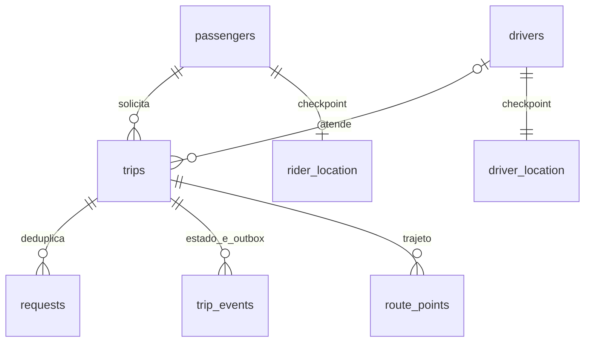

# 2. Dados: cadastro, estado, ultima posicao e trajeto

## PostgreSQL

| Tabela | Conteudo | Consistencia |
|---|---|---|
| passengers | id, nome, email, telefone e photo_url opcionais | cadastro; sem PII real no seed |
| drivers | cadastro, categoria, veiculo, online e busy | disponibilidade autoritativa |
| driver_location | ultimo checkpoint de GPS do motorista | atrasado pelo batch; nao autoriza proximidade |
| rider_location | ultimo checkpoint do passageiro | mesma semantica |
| trips | passageiro/motorista, pontos, preco, status, versao, janelas e event_sequence | transacional |
| requests | chave por passageiro, fingerprint, trip_id | idempotencia duravel |
| trip_events | PK (trip_id,id), payload, tipo e published_at | log por corrida e outbox |
| route_points | PK (trip_id,actor,sequence), lat/lng e timestamps | historico por amostra, deduplicado |

O nome riders do dominio e representado por `passengers`. Campos de contato sao
opcionais: o laboratorio nao envia SMS, emails nem armazena fotos.

Cadastro e localizacao tem responsabilidades separadas: `drivers` nao contem
coordenada, sequencia ou timestamp de GPS. `driver_location` e o checkpoint SQL
mais recente, escrito em lote; a posicao online vem do hash Redis.
O schema inicial completo esta em [001-schema.sql](../infra/001-schema.sql).
O projeto inicia com banco novo e nao inclui migracao ou compatibilidade de schema.

## Redis

Chaves possuem prefixo `REDIS_PREFIX` (default rides):

| Chave | Estrutura | Papel |
|---|---|---|
| latest:driver | Hash: driverId -> JSON | ultima posicao e watermark de sequencia |
| latest:rider | Hash: riderId -> JSON | ultima posicao do passageiro |
| driver-changes | Sorted set: driverId -> receivedAt | delta desde o snapshot da quadtree |
| gps-stream | Redis Stream | amostras nao confirmadas no PostgreSQL |
| location:actor:id | Canal pub/sub | acordar assinantes de GPS |
| trip:id | Canal pub/sub | acordar leitor do log duravel de estado |

Campos: actor, id, lat, lng, sequence, observedAt, observedMs e receivedAt.
Lua usa Redis TIME para receivedAt e compara sequencia/observedAt de forma atomica.
Identidade existente e verificada no primeiro update por hash miss.

Nao ha TTL automatico por membro de Hash. A frescura e **logica**, na leitura:
receivedAt <15s e observedAt <30s. O hash e mantido para nao esquecer watermark
de sequencia. Limite local: 10.000 entidades por actor. Crescimento em producao
exigiria sessao/epoch, particionamento e retencao de watermarks.

## Garantias SQL

UNIQUE parcial de motorista para assigned/arrived/in_progress.
UNIQUE parcial de passageiro tambem inclui searching.
requests tem PK(passenger_id,idempotency_key).
route_points deduplica replay pela identidade da amostra na viagem.
Estado e evento commitam na mesma transacao.

busy e uma denormalizacao transacional: facilita filtro e revalidacao de linha.
O indice de trips e a defesa final. Escritores externos podem desalinhar busy
sem criar atribuicao duplicada; existe consulta de diagnostico no capitulo 7.

## Geografia, distancia e preco

Checkpoints e embarque/destino sao geography(Point,4326).
PostGIS usa longitude primeiro em ST_Point; geography fornece metros nas
funcoes de distancia. A busca quente usa quadtree + Haversine, sem indexar
coordenadas de motorista dentro da tabela de cadastro.

Preco e inteiro em centavos: base R$6 + distancia x fator da categoria,
congelado no pedido. Nao ha moeda multipais, ledger ou gateway de pagamento.
Nao usamos coordenada atual nem preco recalculado para alterar um retry antigo.
Nao ha campo ETA real: sem roteamento, distancia geodesica nao e previsao de chegada.

## Persistencia em lote

O writer coalesce a ultima posicao por actor/ID para upsert de checkpoint,
mas considera **todas** as amostras do lote para route_points.
Correlaciona receivedAt com assigned_at/ended_at, inclusive quando a viagem
terminou antes do flush. Driver lock coordena leitura de janelas com claim/liberacao.

Esse laboratorio assume relogios do Redis e PostgreSQL alinhados no mesmo host.
Uma frota distribuida precisaria budget de clock skew ou identificacao da
viagem/epoch no protocolo de ingestao, com validacao autoritativa. O horario
do celular nao decide a janela do trajeto.

## Retencao e privacidade

gps-stream e apagado somente depois do commit/ACK. Hash mantem ultimo valor;
route_points, requests e trip_events nao possuem job automatico de expurgo.
Nao e retencao ilimitada recomendada: em producao, definir prazo por finalidade,
particionar historico e mover/expurgar dados com auditoria e requisitos LGPD.

Posicao precisa de passageiro/motorista e dado pessoal. No produto real,
autorizar assinaturas por corrida, mostrar oferta aproximada antes do matching
e restringir trajetos por finalidade. Os endpoints de laboratorio nao tem login.
