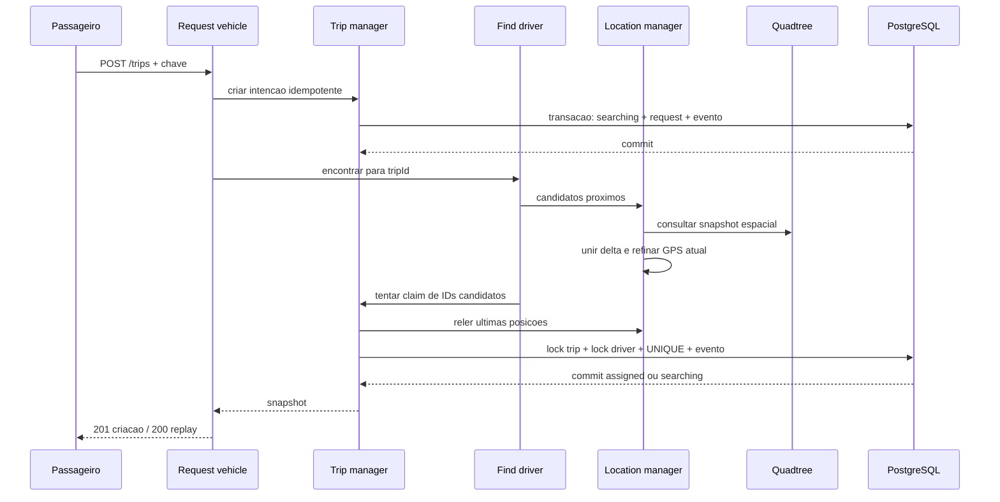
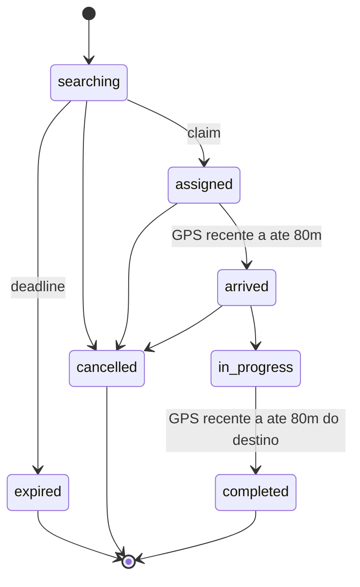

# 3. Pedido, matching e concorrencia entre servicos

## O ponto de decisao

Nao e o hash, quadtree, find driver ou gateway que reserva. E o **commit SQL**
que escreve driver.busy, trip.driver_id, status e evento.
A consulta anterior de proximidade pode ficar desatualizada; o claim revalida
categoria, online, busy, GPS recebido/observado e distancia.
Sem GPS recente, nenhum fallback para checkpoint atrasado.

## Disputa por motorista

1. Bloquear corrida existente FOR UPDATE.
2. Se nao e mais searching, retornar estado atual, sem nova atribuicao.
3. Se o prazo passou, expirar e registrar evento.
4. Ordenar candidatos recentes por distancia e ID.
5. Tentar linha de motorista com FOR NO KEY UPDATE SKIP LOCKED.
6. Revalidar disponibilidade autoritativa e frescura.
7. Atualizar busy, corrida e evento, commitar.

O lock coordena escritores corretos; UNIQUE parcial continua protegendo
SQL direto. Atualizar busy faz o PostgreSQL reavaliar a versao nova da linha
apos disputa. A selecao pode pular o mais perto se estiver bloqueado:
nao prometemos fairness ou minimo global perfeito.

Uma posicao lida imediatamente antes do claim pode mudar durante a transacao.
A garantia e frescura limitada + exclusividade, nao imobilidade fisica do carro.
Chegada tambem usa evidencia recente, nao prova criptografica de embarque.

## Idempotencia da intencao

Criar pedido bloqueia passengers por ID, verifica requests e corrida ativa.
Mesmo passageiro/chave/payload canonico retorna a mesma corrida.
Payload diferente ou outra chave para passageiro ja ativo devolve 409.
Retry depois de concluir/cancelar nao ressuscita estado.

Persistencia e matching agora sao duas etapas. Se matching falha depois do
commit da intencao, o HTTP pode retornar **503 com pedido existente**.
Repetir com outra chave e errado: o cliente conserva a chave original.
O request vehicle nao esconde falha devolvendo "motorista encontrado".
O dispatcher tambem pode recuperar o pedido.

## Maquina de estados

status + version esperada no comando. Repetir estado atual e idempotente:
retorna o snapshot sem incrementar versao/evento. Outra transicao com versao
antiga gera 409. Nao cancelar in_progress nem reabrir estado terminal.

## Sem locks atravessando HTTP

Buscar GPS/candidatos ocorre antes da transacao de claim.
O dispatcher marca uma tentativa, commita e so depois chama find driver.
Nao esperar motor de rotas, Redis ou outro servico segurando lock de entidade.
Excecao operacional pequena: publisher segura locks da **outbox**, nao da
corrida, enquanto confirma uma publicacao com timeout limitado.

## Dispatcher em lotes

A cada ciclo, ate 20 searching elegiveis sob FOR UPDATE SKIP LOCKED.
last_dispatch_at impede a mesma corrida de ser tentada antes de 2s.
O worker chama find driver fora da transacao. Processo pode cair depois da
marcacao: o pedido volta a ser elegivel, sem depender de memoria local.
Workers sobrepostos podem pedir o mesmo claim; o lock da corrida torna seguro.

Expiracao tem prazo de 60s desde criacao, mas e aplicada quando o worker
processa a corrida; nao e um timer de precisao. Backlog aumenta atraso.
Batch de 20 e ciclo de 1s sao escolhas do lab, nao capacidade para 10k/s.

## Protecao de capacidade

10 conexoes SQL por processo que usa banco; espera 2s, statement timeout 4s.
HTTP interno tem timeout de 4s; cada servico limita 64 requests em voo.
SSE tem limites separados. Redis tem command timeout e offline queue desabilitada.
Limites locais nao somam automaticamente budget global.

Em producao, dimensionar pools agregados, concorrencia por particao e fila de
matching; medir p95/p99 e hotspots. Mais replicas sem budget podem derrubar o banco.
