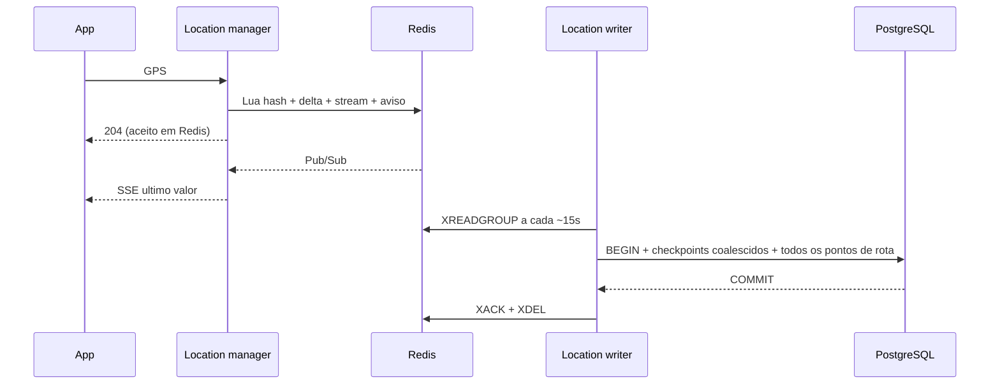

# 4. Dois caminhos: GPS substituivel e estado duravel

## Ingestao de GPS

Motorista e passageiro publicam aproximadamente a cada 4s.
Location manager valida identidade no hash miss, coordenadas, observedAt
a ate 30s do servidor e inteiro seguro positivo para sequence.
Lua compara sequencia e observedAt com o watermark anterior e, atomicamente:

1. Obtem receivedAt de Redis TIME.
2. Adiciona amostra ao Redis Stream.
3. Atualiza o hash de ultima posicao.
4. Atualiza o sorted set de delta do motorista.
5. Publica aviso com o novo valor.

Sequencia repetida/menor ou observedAt regressivo gera 409.
Receber timestamp valido nao prova GPS verdadeiro: fraude e outra superficie.
Hash miss usa checkpoint duravel como baseline; reinicio do produtor deve
continuar da ultima sequencia ou negociar epoch (epoch nao implementado).

## SSE de localizacao

`/api/drivers/:id/events` e `/api/riders/:id/events`:

- Uma conexao subscriber Redis por processo, compartilhada pelos browsers.
- Subscribe antes de ler o hash, evitando buraco entre snapshot e assinatura.
- Cada cliente mantem no maximo um ponto pendente: GPS novo substitui antigo.
- Na conexao/reconexao, ler ultimo valor; reconciliar a cada 10s sem aviso.
- Clientes descartam sequencias antigas. Backpressure fecha stream.
- Nao faz polling SQL por cliente nem cria evento SQL por heartbeat.

**Nao promete replay de todos os pontos por SSE.** Para a tela importa o
ultimo valor; para o historico, o writer usa o stream completo.
O mesmo endpoint permite a tela do motorista acompanhar o passageiro e vice-versa,
mas autorizacao de produto real ainda precisa ser implementada.

## Checkpoint e trajeto

Batch de ate 2000 amostras; ate 8 batches por ciclo no processo local.
Checkpoints fazem upsert apenas se a sequencia aumenta.
route_points usa PK de amostra para deduplicar replay.
Falha antes do commit deixa pending. Falha depois do commit e antes de ACK
repete efeitos SQL idempotentes. O proprio consumidor tenta pending primeiro;
outro consumidor pode recuperar mensagens ociosas com XAUTOCLAIM apos 30s.
Nao truncar stream por MAXLEN antes da persistencia.

Janelas assigned_at/ended_at permitem correlacionar pontos mesmo quando a
viagem acabou antes do flush. Assim, nao consultamos apenas "corridas ativas
agora", o que perderia a cauda do trajeto.

ACK de Redis **nao e ACK de PostgreSQL**. AOF everysec pode perder cerca de 1s
em falha de host conforme condicoes de fsync/OS; perda total do volume Redis
antes do flush pode perder todo o backlog nao persistido. Nao prometemos RPO
zero. Produzir um log replicado duravel e outra etapa de producao.

## SSE de estado da corrida

Estados nao sao GPS substituivel. Trip manager grava evento na mesma
transacao do estado, com cursor crescente **por corrida**.

Publisher le outbox nao publicada com locks SKIP LOCKED, publica aviso Redis
e marca published_at. Crash depois de publicar e antes de marcar gera duplicata.
SSE usa aviso somente para acordar e le o log SQL por cursor.
Reconexao com Last-Event-ID funciona em outra instancia.
Reconciliacao de 10s recupera avisos perdidos mesmo sem reconnect.

Nao precisamos de ordenacao global. event_sequence e incrementado na linha
da corrida sob lock, portanto uma segunda mutacao da mesma corrida nao
obtem cursor antes do commit/rollback anterior. Corridas diferentes progridem
independentemente. BIGSERIAL global nao teria essa garantia de ordem de commit.

O publisher pode avisar fora de ordem: leitores sempre leem ORDER BY id.
Cursores se referem a uma corrida especifica, nunca devem ser reutilizados
para outra. Cursor maior que o atual e registrado e reinicia replay, cobrindo
cursor localStorage invalido ou estado inconsistente do cliente. Cada corrida
comeca com log vazio; nao ha eventos importados de versao anterior.
O tipo do evento continua explicito e nao e reinterpretado como snapshot de corrida.

## Transportes e limites

SSE foi mantido porque comandos sao HTTP e atualizacoes servidor -> cliente.
WebSocket pode substituir o transporte; nao elimina ordenacao, replay,
backpressure, autenticacao ou custo de fan-out.

Pub/Sub nao tem replay, Redis Stream tem pending/ACK, PostgreSQL tem log
transacional: nao confundir as garantias dessas tres estruturas.
Nao existe entrega exatamente uma vez ponta a ponta.

Limite local: 200 streams de estado por processo e 200 por actor de GPS.
Sem expurgo de log de estado/rotas implementado. Se adicionar retencao,
definir cursor expirado + snapshot, em vez de prometer replay infinito.
