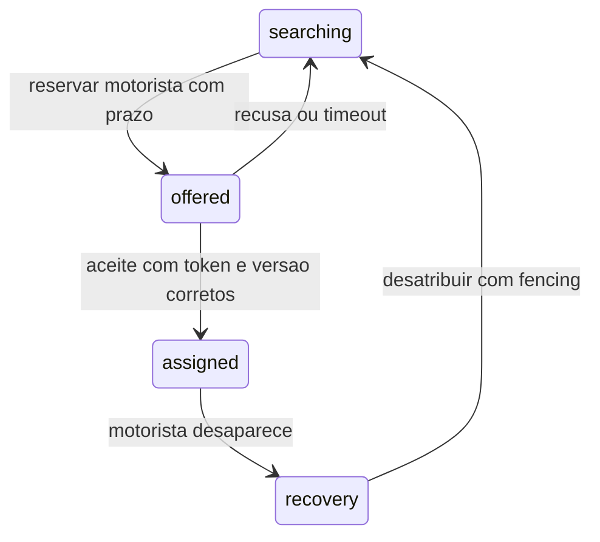

# 5. Falhas e funcionalidades que mudam o desenho

Este capitulo continua descrevendo extensoes **nao implementadas** como aceite,
pagamento e ETA. Na versao de servicos, GPS usa Redis + writer, e somente estado
da corrida usa outbox PostgreSQL. Veja o [protocolo atual](04-tempo-real-e-eventos.md).

## Matriz de comportamento

| Falha / disputa | Comportamento implementado | O que falta em producao |
|---|---|---|
| HTTP cai depois do commit | retry com mesma chave retorna corrida atual | SDK com backoff/jitter e horizonte de deduplicacao |
| Banco cai antes do commit | rollback; nada confirmado | HA, failover e resultado incerto de commit tratado pelo retry |
| Sem motorista elegivel | searching duravel; dispatcher tenta ou expira | SLO de fila e politicas de expansao de raio |
| Motorista sem heartbeat | sai de novas buscas apos TTL | recovery de corrida ja atribuida |
| Pacote GPS atrasado | 409 ou 400; nao sobrescreve | sessao/epoch e verificacoes de fraude |
| Dois passageiros disputam | lock + SKIP LOCKED + UNIQUE | medir fairness e eficiencia de atribuicao |
| Cliente lento no SSE | stream encerrado sob backpressure | gateway com coalescing e limites por identidade |
| SSE cai | reconexao e replay por cursor | retencao, cursor expirado e ressincronizacao |
| Processo reinicia | estado e eventos permanecem no PostgreSQL | restart policy, readiness mais completa e supervisao |
| Redis cai | GPS/busca falham explicitamente; sem fallback SQL atrasado | log replicado, failover e RPO definido |
| Writer cai | stream acumula pending; replay deduplicado | alertas de backlog e horizonte de recuperacao |
| Quadtree atrasa | age >30s gera 503; delta corrige fronteiras recentes | replicas do indice por particao |
| Find driver falha apos criar pedido | 503; mesma chave retoma searching persistido | SDK e fila regional dimensionada |
| Banco/pool saturado | timeouts/limite local; 503 para casos reconhecidos | budget global de conexoes, filas limitadas e metricas |
| Erro inesperado | log + 500, sem sucesso falso | tracing, alerta, sanitizacao e correlacao |

Um motorista atribuido que some **nao** e automaticamente trocado. Uma troca
ingenua pode criar dois motoristas dirigindo para o mesmo passageiro.
O estado atribuido permanece para inspecao e cancelamento explicito.

## Extensao 1: ofertas com aceite e lease

Hoje atribuicao e automatica. Um aplicativo comercial normalmente oferece a
corrida e espera o motorista aceitar:

Nova tabela offers com trip_id, driver_id, token/epoch, expires_at e status.
A reserva da oferta participa da mesma exclusividade que uma viagem ativa.
Aceite precisa comparar prazo **no banco**, status e epoch sob lock.
Worker expira oferta e libera motorista na mesma transacao.
Aceite tardio nao pode autorizar uma oferta ja substituida.

Nao basta TTL no Redis: o motorista antigo precisa ser impedido de efetuar
transicoes com o token anterior (**fencing**). O sistema autoritativo valida
o token em todos os comandos do motorista.

## Extensao 2: matching por lote e ETA

Greedy por menor distancia pode ser pior globalmente:
o primeiro passageiro pega o unico carro bom para o segundo, embora tivesse
outro candidato quase tao bom. Janela de 200-500ms e matching bipartido
permitem minimizar custo conjunto.

Isso troca menor latencia individual por eficiencia da frota.
Gerar candidatos via H3/PostGIS; consultar ETA em motor de rotas como OSRM;
resolver custo por lote; confirmar reservas transacionalmente.
Solucao calculada fora do banco fica obsoleta: revalidar claims e tentar
novamente se candidatos ja foram usados.

Nao chamar distancia em linha reta de ETA. Rios, pontes, retornos e transito
podem inverter completamente o ranking.

## Extensao 3: pagamento e saga

Nao colocar gateway dentro de uma transacao de matching.
Gateway lento seguraria locks e ainda nao compartilharia o commit SQL.

1. Pedido guarda cotacao imutavel e versao da politica.
2. Evento pede pre-autorizacao com chave idempotente propria.
3. Finalizacao grava valor final e comando de captura via outbox.
4. Worker chama gateway; webhook/reconciliacao confirma resultado.
5. Ledger registra lancamentos imutaveis; estorno e outra operacao.

Falha de notificacao nao desfaz viagem concluida.
Timeout do gateway nao significa "nao cobrou": consultar status antes de retry.
Inbox deduplica webhook, mas nao torna API externa idempotente sem uma chave
aceita por ela. Saga e compensacao de negocio, nao rollback distribuido magico.

## Extensao 4: preco dinamico e cotacao

Separar quote_id com validade, moeda, categoria, formula e zona.
Congelar condicoes aceitas; nao recalcular silenciosamente quando o usuario
repete o POST. Eventos de oferta/demanda atualizam uma projecao por celula.

Precos por GPS individual podem oscilar em fronteiras: usar suavizacao,
histerese e janela temporal. Mudanca de preco exige contrato de UX, auditoria
e atencao a discriminacao/regulacao.

## Extensao 5: agendamento, pool e multiplas paradas

- Agendamento: capacidade futura nao e o mesmo que motorista online agora.
  Precisa de janela de despacho, no-show e compensacoes.
- Viagem compartilhada: UNIQUE(driver_id) ativo nao permite varias trips;
  modelar vehicle_journey + stops + seats e compatibilidade de rotas.
- Multiplas paradas: criar itinerario versionado; alteracao muda ETA e preco.

Essas extensoes exigem mudar a unidade da garantia; nao retirar o indice
unico e esperar que a aplicacao lembre de contar passageiros.

## Antes de qualquer exposicao publica

Autenticacao passageiro/motorista, autorizacao por corrida e papel, TLS,
rate limit por identidade, protecao de endpoints de simulacao, validacao
antifraude, secrets manager, consentimento e retencao LGPD.
Nao retornar IDs/posicoes reais de motoristas livres para qualquer visitante:
considerar posicoes aproximadas para exibicao, precisao somente apos matching.
Os endpoints demo deste projeto sao explicitamente inseguros para uso publico.
