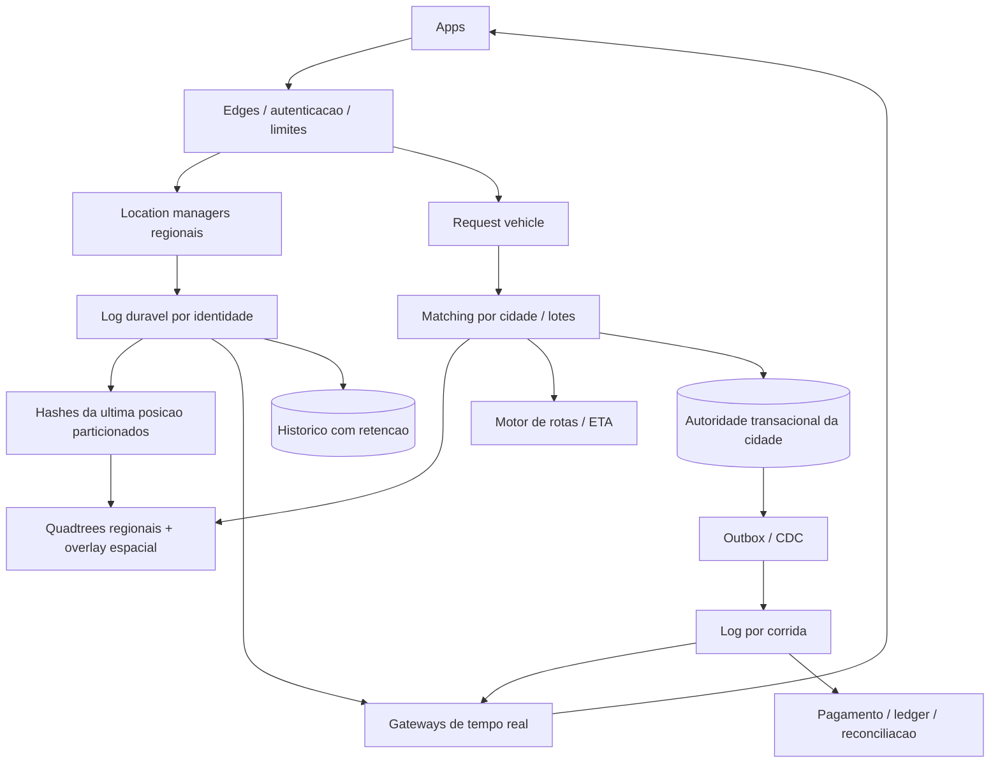

# 6. Do laboratorio a uma plataforma regionalizada

A versao atual separa processos e caminhos de GPS/negocio. Isso nao prova
capacidade global. As [contas com as premissas solicitadas](10-estimativa-de-recursos.md)
mostram que 20M viagens/dia, 10k pedidos/s de pico e 100M leituras/s sao
medidas distintas, nao tres taxas sustentadas automaticamente compativeis.

## O que ja esta implementado versus o que ainda muda

| Superficie | Laboratorio atual | Evolucao global proposta |
|---|---|---|
| Balanceamento | Nginx local, duas request APIs | edges regionais, rate limit por identidade |
| Ultimo GPS | um hash Redis por actor | shards regionais e sessoes com epoch |
| Fila GPS | um Redis Stream local | log replicado particionado por identidade |
| Quadtree | snapshot em memoria de todos os drivers locais | arvores por regiao, rebuild paralelo e replicas |
| Correcao de fronteiras | delta recente escaneado, limite 2000 | overlay espacial particionado, nao scan global |
| Claim | PostgreSQL unico | autoridade por cidade/shard com transferencia controlada |
| SSE | pub/sub + ultimo valor/log de estado | gateways distribuidos, interesse regional, coalescing |
| Historico | route_points no PostgreSQL local | retencao quente/fria e armazenamento analitico |

O delta local correto nao escala por magica: com GPS a cada 4s, quase todos os
motoristas de uma regiao mudam dentro de 15s. Escanear um delta global a cada
busca voltaria ao problema de O(N). O limite local devolve 503 em vez de
omitir candidatos. Em producao, indexar tambem o overlay ou reduzir tamanho
da particao, com fan-out controlado para regioes vizinhas.

## Arquitetura global proposta

## O que significam 100M leituras/s

Uma resposta contendo 20 motoristas pode ser:
1 requisicao HTTP, 20 posicoes entregues e algumas leituras internas agrupadas.
Fan-out pode ler uma posicao e entrega-la a varios assinantes.
Nao dimensionar banco assumindo que essas tres unidades sao iguais.

Para acompanhamento, assinar corrida e transmitir deltas, nao consultar
PostgreSQL a cada tela. Para mapa aberto, assinatura por viewport/celulas,
snapshot compartilhavel quando permitido e updates incrementais.
Coalescing descarta GPS intermediario para cliente lento, nao evento de pagamento.
Frequencia adaptativa, quantizacao e privacidade podem reduzir custo.

## Particionamento e autoridade

Regioes/cidades definem autoridade de corrida/motorista; quadtree e apenas indice.
Consultar quadrantes vizinhos nas fronteiras, inclusive entre shards.
Mover motorista entre autoridades exige protocolo com epoch/fencing.
Nao atribuir o mesmo carro em duas regioes durante handoff.

Se passageiro e motorista estiverem em bancos distintos, UNIQUE local nao
implementa exclusividade de ambos atomicamente. Precisamos co-localizacao ou
claims duraveis, estados intermediarios e recuperacao explicita.
Copiar este schema em varios bancos e apontar um load balancer nao basta.

Hotspot de aeroporto/estadio exige politica de fila, matching por lote e
backpressure da regiao. Redis Cluster nao elimina disputa pelo mesmo carro.
Quadtrees dinamicas precisam limites de profundidade e tratamento de pontos
coincidentes; subdividir indefinidamente nao cria capacidade fisica.

## Consistencia por superficie

| Dado | Garantia | Degradacao tolerada |
|---|---|---|
| Motorista atribuido | forte na autoridade | rejeitar comando sem autoridade acessivel |
| Oferta no mapa | eventual com frescura limitada | candidato pode ter acabado de ser ocupado |
| GPS ao vivo | ultimo valor por sequencia | saltar intermediarios para tela lenta |
| Historico | append/replay deduplicado | atraso de persistencia, nao truncamento silencioso |
| Pagamentos | idempotencia e reconciliacao | atraso, nunca saldo inventado |

## Cloud apenas conceitual

Uma possibilidade seria APIs/workers em ECS/EKS, autoridade PostgreSQL/PostGIS
em RDS, hashes em ElastiCache, log em MSK/Kafka e historico em S3.
Esses nomes sao alternativas arquiteturais, **nao recursos provisionados**.
Nao ha dependencia de credenciais cloud, Terraform ou deploy remoto.
Confirmar versoes, precos, regiao, capacidade e suporte antes de qualquer escolha real.

## Custos que permanecem

Pools agregados, conexoes SSE, memoria por cliente, banda, WAL, indices,
replicacao e armazenamento com retencao precisam de budget.
Replica nao e backup; definir RPO/RTO e medir restore.
Autoscaling de processos nao resolve sozinho draining de conexoes longas.
Nenhum benchmark local abaixo prova que o sistema suporta as metas globais.
