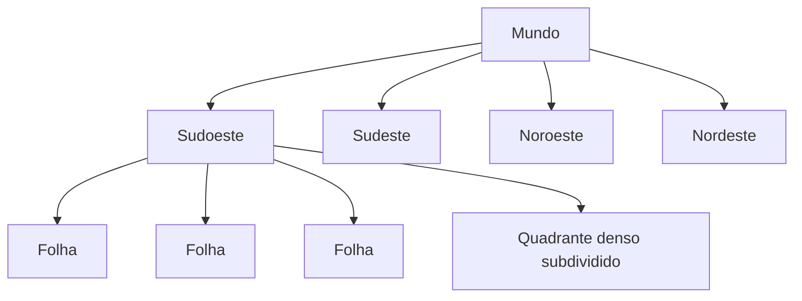

# 9. Quadtree de verdade: ganho, atraso e fronteiras

## Estrutura implementada

A raiz cobre longitude [-180,180] e latitude [-90,90].
Cada no possui um retangulo. Acima de 32 pontos, divide em quatro filhos
ate profundidade maxima 16. Folhas podem ultrapassar capacidade no limite:
100 carros na mesma coordenada nao podem ser separados infinitamente.



Pontos exatamente na divisoria sao encaminhados deterministicamente para
norte/leste; consultas usam intersecao inclusiva para nao ignorar vizinhos.
A busca calcula envelope do circulo na esfera, visita folhas intersectadas
e refina com Haversine. Considera antimeridiano e consultas proximas dos polos.
Quadtree plana em lat/lng nao tem areas iguais: ha distorcao com latitude.

## Snapshots em vez de mutacao por heartbeat

A cada ~15s:

1. Ler tempo do Redis antes de capturar hash.
2. Obter ultimas posicoes de motoristas.
3. Filtrar GPS fresco.
4. Construir uma nova arvore sem alterar a atual.
5. Trocar a referencia apenas quando o build termina.

Se rebuild falha, registrar erro e manter snapshot anterior; apos 30s de idade
a consulta devolve 503, nao finge indice atualizado.
O tempo real continua vindo do hash a cada ~4s, nao desse snapshot.

Para a pequena base local, rebuild completo evita merge/remocao concorrente
e folhas parcialmente atualizadas. Em producao, particionar arvores e construir
fora do event loop de leitura. Full rebuild global seria caro.

## O bug de usar apenas snapshot atrasado

```text
t=0: motorista a 5,2km, fora da busca
t=4: motorista chega a 4,9km; hash foi atualizado
t=5: usuario busca num raio de 5km
```

Refinar somente IDs encontrados na arvore **nao descobre** esse motorista:
ele nem entrou no conjunto de candidatos. O mesmo vale para motorista recem-online.
Apenas atualizar a posicao dos resultados nao resolve falso negativo.

## Delta para fechar o buraco

Cada GPS atualiza atomicamente `driver-changes`, com receivedAt Redis.
A consulta une:

- IDs no raio encontrados pelo snapshot;
- IDs com update desde builtAt do snapshot.

Depois faz HMGET das posicoes **atuais**, filtra frescura e raio, consulta
categoria/online/busy no trip manager e ordena por distancia e ID.
Um motorista que saiu do raio e removido pelo refinamento.
Um que entrou aparece pelo delta. O timestamp vem do mesmo Redis usado pela
ingestao, evitando comparar clocks diferentes para esse watermark.

Nao ha truncamento silencioso: mais de 2000 IDs no delta ou na uniao devolve
503. A resposta traz X-Map-Age-Ms e X-Map-Delta.
A consulta e eventualmente consistente durante updates concorrentes;
nao e snapshot transacional simultaneo do mundo inteiro.

## Complexidade e custo real

Hash: atualizacao esperada O(1), sorted set O(log N).
Rebuild: O(N * profundidade) com profundidade limitada; memoria O(N + nos).
Busca: poda espacial + pontos nas folhas, mas pior caso continua O(N).
Delta: O(D) por consulta antes do refinamento; Nao chamar isso de O(log N) puro.
Pipeline Redis Stream adiciona escrita por amostra, mesmo que a arvore nao mude.

Se todos atualizam a cada 4s, em 15s quase toda a particao esta no delta.
Portanto esta implementacao **nao** suporta 100M buscas/s adicionando replicas.
Para essa escala:

- particionar por regiao/cidade;
- overlay espacial para delta, nao uma lista global por consulta;
- shards adjacentes consultados nas bordas;
- snapshots/assinaturas por viewport e fan-out regional;
- limitar e observar hotspots, nao apenas criar mais folhas.

Atualizar indice menos vezes economiza manutencao do indice; nao elimina o
custo de ingerir GPS, preservar trajetos ou entregar pontos aos assinantes.
Esse e o trade-off que o laboratorio torna visivel.
