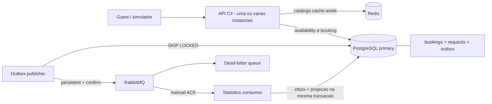

# 1. Arquitetura e decisoes

## Separar capacidade de leitura de integridade da escrita

API e workers estao no mesmo projeto para reduzir o custo de estudo e deploy.
Sao responsabilidades diferentes, nao uma recomendacao de co-localizacao para
10M escritas/s. Em producao, separar processos permite escalar, limitar conexoes
e implantar cada um de forma independente.

## Por que cada ferramenta

| Escolha | Motivo | Custo / limite |
|---|---|---|
| C# / .NET 10 | async/await, tipos, API pequena, boa familiaridade solicitada | async nao cria capacidade infinita no banco |
| PostgreSQL | transacoes e `EXCLUDE` sobre `daterange`; regra expressiva no storage | primary unico limita escrita; exigiria shards e HA |
| Npgsql | SQL explicito para enxergar transacoes e locks, pool integrado | mais SQL manual; nao estamos demonstrando um ORM |
| Redis | leituras de metadados comuns escapam do banco | falha/cache miss pode sobrecarregar o primary |
| RabbitMQ | fila, confirms, ACK e DLQ visiveis para ensinar confiabilidade | broker unico local nao e plataforma de 10M eventos/s |
| Outbox no PostgreSQL | reserva e intencao de emitir evento commitam juntas | polling, WAL e crescimento exigem operacao |
| Inbox no PostgreSQL | efeitos locais idempotentes sob reentrega | historico/deduplicacao consomem espaco |
| Docker Compose | laboratorio repetivel sem cloud | nao oferece cluster, HA, autoscaling ou disaster recovery |

As versoes das dependencias estao nos projetos e as imagens no Compose.
Tags nao sao digests imutaveis; pin por digest, scans e atualizacoes de seguranca
seriam requisitos de uma pipeline de producao.

## Decisoes deliberadas

### ADR-01: integridade no banco, nao em um `lock` C#

Um `lock`/`SemaphoreSlim` so protege um processo. A segunda API nao participa.
A constraint PostgreSQL vale para todas as conexoes, inclusive SQL direto.
Novas reservas pela API tambem usam lock de linha por imovel para controlar
contencao. Nao existe lock global entre imoveis.
O limitador HTTP protege capacidade; ele nao implementa a regra de negocio.

### ADR-02: reserva sincrona; efeitos secundarios assincronos

O cliente recebe confirmacao **depois do commit**. RabbitMQ nao decide quem
fica com o imovel. Eventos servem para notificacoes, estatisticas e integracoes.
Booking assincrono seria outro contrato: 202 + operationId + status posterior,
com duplicacao de comandos, expiracao e UX de "processando".

### ADR-03: uma unidade exclusiva por imovel

Cada `property_id` representa uma unidade fisica que cabe a um unico grupo por
noite. Um hotel com 20 quartos iguais precisa de outra modelagem de inventario;
nao basta usar este mesmo ID para capacidade 20. Veja o documento de dados.

### ADR-04: cache somente de catalogo

Nome/cidade sao imutaveis neste laboratorio. Cache nao autoriza reserva.
Disponibilidade usa o primary para facilitar a observacao da regra.
Uma arquitetura real poderia usar resultados de busca eventualmente
consistentes, mas sempre revalidaria na escrita autoritativa.

### ADR-05: READ COMMITTED com constraint especifica

Nao precisamos serializar o sistema inteiro. Novas reservas do mesmo imovel
passam por `FOR NO KEY UPDATE`; imoveis diferentes continuam independentes.
A constraint resolve overlap inclusive fora da API, e UNIQUE resolve a mesma
chave de idempotencia.
SERIALIZABLE e alternativa valida para regras complexas, mas traz abortos/retries.
Nao usar transacao nenhuma seria incorreto: outbox e reserva poderiam divergir.

### ADR-06: duplicacao de entrega aceita, efeito deduplicado

Nao vendemos "exactly once" ponta a ponta. O broker pode entregar de novo.
A inbox aplica a alteracao da projecao uma vez por `event_id` em uma transacao.
Isso nao torna automaticamente idempotente um email ou gateway de pagamento.

## Alternativas e quando escolher

- **Inventario por noite + UNIQUE(property_id, date):** excelente modelo para
  disponibilidade diaria. Reservar 10 noites precisa inserir 10 linhas
  atomicamente; qualquer noite ocupada aborta tudo. Amplifica escrita por duracao.
- **Somente constraint, sem admissao por imovel:** permite maior paralelismo
  de datas disjuntas, mas INSERTs altamente contenciosos podem gerar
  deadlocks/abortos e tempestade de retries. O teste com duas APIs e 1000
  concorrentes revelou esse custo; escolhemos lock por imovel + constraint.
- **DynamoDB com conditional writes + transacoes:** pode funcionar com
  inventario diario, idempotencia e duracao limitada pelo envelope transacional.
  `ConditionExpression` em apenas uma reserva nao detecta overlaps em outros
  itens. Nao foi escolhido: aqui intervalos SQL tornam a regra mais didatica.
- **Kafka/log particionado:** bom para pipelines grandes, replay e varios
  consumidores independentes. Mesmo assim nao substitui a decisao atomica de
  inventario. Exige dimensionamento diferente de uma fila RabbitMQ.
- **Banco distribuido com transacoes:** pode ajudar no multi-region/sharding,
  mas latencia, quorum e limites precisam ser medidos; nao elimina hot keys.
- **Redis distributed lock:** nao escolhido como fonte da garantia. Lease
  expira, processos pausam e redes particionam; precisaria fencing validado
  pela autoridade. Um cache indisponivel nao deve permitir overbooking.

### ADR-07: admissao pessimista por imovel depois de medir contencao

A primeira implementacao usava somente EXCLUDE para inventario. Com duas APIs
e 1000 pedidos disputando o mesmo intervalo, manteve zero overlaps, mas sofreu
deadlocks e timeouts. A garantia de integridade estava correta; a operabilidade
sob hotspot nao era boa.

A implementacao final adquire `FOR NO KEY UPDATE` na linha de properties antes
de inserir uma nova reserva. Isso serializa escritas **por imovel**, incluindo
datas disjuntas, e reduz a tempestade de disputas no indice de exclusao.
Nao usar `FOR UPDATE` depois de inserir requests: a FK ja pode ter adquirido
`KEY SHARE`, e upgrades concorrentes para um lock incompativel podem criar
outro deadlock. `NO KEY UPDATE` e compativel com `KEY SHARE`, mas conflita
com outros locks `NO KEY UPDATE`.

Mesmo que um escritor SQL ignore essa admissao, EXCLUDE continua sendo a
defesa da integridade. O lock nao substitui a constraint nem garante ausencia
de qualquer deadlock num futuro fluxo mais complexo.

## O que NAO foi implementado

Login/ownership, hosts, precos/moeda/taxas, pagamento, hold com expiracao,
multi-unidade, busca geografica, replicas, particionamento, CDN, HA, TLS,
tracing distribuido e autoscaling. Sao extensoes reais, nao recursos "implicitos".
Nao use este laboratorio publicamente sem projetar essas superficies.
