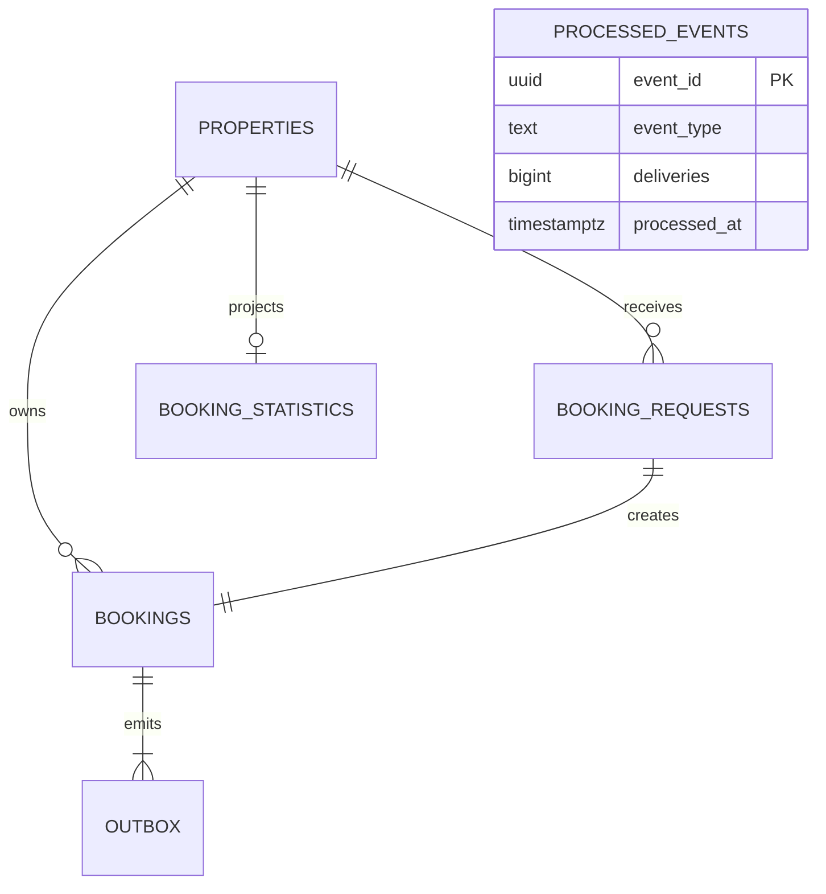

# 2. Modelagem de dados

Schema executavel: [001-schema.sql](../infra/postgres/001-schema.sql).
O PostgreSQL e a fonte de verdade. Redis e a projecao nao guardam inventario
autoritativo.



`processed_events` e uma inbox de mensagens, sem FK para outbox: uma mensagem
nao deveria depender do storage interno do produtor. O envelope carrega os IDs.
O relacionamento requests-bookings e 1:1 no fluxo da aplicacao; as constraints
impedem varias reservas por chave, mas um SQL arbitrario poderia gravar um
request sozinho. Toda a criacao pela API acontece na mesma transacao.

## `properties`: unidade reservavel

| Coluna | Tipo | Papel |
|---|---|---|
| `id` | UUID PK | identidade e futuro candidato a chave de roteamento |
| `name` | text | metadado de catalogo |
| `city` | text | simplificacao de localizacao |

Um ID representa uma **unica unidade exclusiva**. Nao representa um tipo de
quarto com estoque 20. Os 2000 IDs do seed sao deterministas por `md5` convertido
em UUID, somente para fixtures; nao e hash de dados pessoais nem mecanismo de seguranca.

## `booking_requests`: idempotencia

| Coluna | Tipo | Papel |
|---|---|---|
| `idempotency_key` | UUID PK | serializa pedidos repetidos |
| `property_id` | UUID FK | imovel do pedido |
| `guest_id` | UUID | identidade ficticia do guest |
| `check_in`, `check_out` | date | payload relevante |
| `created_at` | timestamptz | auditoria da primeira criacao |

O guest e um UUID fornecido pelo cliente, **nao autenticado**. Em producao, viria
do principal autenticado, com tabela de usuarios/relacao apropriada e controle
de acesso. Nao e permitido confiar num `guestId` para autorizar cancelamentos.

A PK evita duas criacoes para a mesma chave. O corpo original e comparado com
a reserva correspondente; mudar imovel/guest/datas com chave usada retorna 409.

Neste laboratorio a chave e **global no banco unico**, sem expirar.
Somente sucessos persistem a chave. Um conflito de disponibilidade faz rollback
tambem de `booking_requests`; repetir depois que o inventario mudar pode ter
sucesso. Nao ha replay persistente de respostas 400/409/503.

Reter chaves para sempre e uma simplificacao cara. Producao precisaria definir:
janela de retries, identidade/escopo da chave, TTL/arquivamento, resposta para
chave expirada e compatibilidade com auditoria. Apagar chaves cedo demais pode
transformar um retry tardio em nova reserva.

## `bookings`: a reserva autoritativa

| Coluna | Tipo | Papel |
|---|---|---|
| `id` | UUID PK | UUID v7 gerado pela aplicacao |
| `idempotency_key` | UUID UNIQUE + FK | liga a criacao ao pedido |
| `property_id` | UUID FK | unidade fisica reservada |
| `guest_id` | UUID | guest ficticio |
| `check_in`, `check_out` | date | noites reservadas |
| `stay` | daterange gerado | intervalo SQL sem divergencia com as datas |
| `status` | text com CHECK | `confirmed` ou `cancelled` |
| `created_at` | timestamptz | instante UTC de criacao |
| `cancelled_at` | timestamptz nullable | instante do cancelamento |

Novas reservas usam `Guid.CreateVersion7()`: UUID com componente temporal,
que tende a melhorar a localidade das insercoes no B-tree da chave primaria
em comparacao ao UUID v4 aleatorio. Nao garante ordem estrita entre processos
ou IDs gerados no mesmo milissegundo e nao substitui `created_at`.
IDs antigos permanecem inalterados; o tipo PostgreSQL `uuid` aceita ambas
as versoes sem migration. Event IDs e chaves fornecidas pelo cliente nao
foram alterados por essa escolha.

O PostgreSQL tem `fillfactor` para tabelas e indices, com semanticas diferentes.
No B-tree, ele define o preenchimento das paginas folha durante a construcao
e influencia novas paginas na extensao pela direita; deixar espaco pode
ajudar a acomodar insercoes e reduzir splits. UUID v4 nao quebra o fillfactor:
insercoes aleatorias podem provocar mais page splits e pior localidade.
UUID v7 nao elimina splits nem permite prometer ganho sem medir.
Nao alteramos fillfactor neste laboratorio. Essa escolha afeta o B-tree do
bookingId; a regra anti-overbooking continua sendo EXCLUDE apoiada em GiST.

`CHECK` exige fim maior que inicio e duracao ate 365 noites. API replica essas
validacoes para feedback 400, mas o banco tambem impede dados invalidos.
Datas antigas sao permitidas no laboratorio para facilitar fixtures e retries.
Uma politica de "nao reservar no passado" deveria valer para novas criacoes,
sem quebrar replay de uma reserva antiga.

### Intervalo semiaberto `[check_in, check_out)`

Reserva 10 a 15 ocupa as noites **10, 11, 12, 13, 14**.

| Reserva existente | Nova tentativa | Pode? |
|---|---|---|
| `[10,15)` | `[15,20)` | Sim, checkout e checkin no mesmo dia |
| `[10,15)` | `[8,10)` | Sim |
| `[10,15)` | `[14,16)` | Nao, noite 14 compartilhada |
| `[10,15)` | `[11,13)` | Nao, intervalo contido |
| `[10,15)` | `[9,16)` | Nao, intervalo que contem o existente |

`date` modela o calendario do imovel; `timestamptz` modela instantes de auditoria.
Um sistema real precisa guardar timezone IANA do imovel para horarios de
checkin, pagamento e expiracao. Nao converter noites em UTC cegamente.

### A constraint que impede overbooking

```sql
EXCLUDE USING gist (
    property_id WITH =,
    stay WITH &&
) WHERE (status = 'confirmed')
```

Ela proibe um par de linhas confirmadas em que **as duas condicoes** sejam
verdadeiras: mesmo imovel **e** intervalos que se sobrepoem.

`&&` significa overlaps, nao "igual". `btree_gist` fornece a classe de operadores
GiST para igualdade de UUID ao lado dos intervalos. A constraint cria seu proprio
indice GiST parcial. Nao e um SELECT seguido de uma aposta.

Para entender essa estrutura, a extensao e o motivo da escolha, veja
[indice GiST e exclusao](08-indice-gist-e-exclusao.md).

Canceladas ficam no historico, mas deixam o indice parcial que protege o
inventario confirmado. Duas estadias nao sobrepostas podem coexistir.

### Outros indices

- PKs UUID para lookup, e UNIQUE da chave de idempotencia.
- `bookings_property_history(property_id, created_at DESC)` para consultas futuras
  do historico por imovel; nao autoriza disponibilidade.
- `outbox_pending(created_at) WHERE published_at IS NULL` para polling somente
  dos eventos pendentes. Sem esse indice, historico tornaria polling caro.
- Pagina de catalogo ordenada por ID; OFFSET e didatico. Keyset pagination
  seria preferivel para catalogo enorme.

Cada indice custa escrita, WAL e storage. Nao criar indices "por precaucao";
medir plano e acesso real.

## `outbox`: o evento ainda que o broker esteja fora

`event_id` UUID PK, `booking_id` FK, `event_type`, `payload` JSONB,
`created_at` e `published_at`.

Payload minimo: eventId, tipo, bookingId e propertyId. Nao mandamos guest/datas
porque o consumidor de contagem nao precisa deles. Minimizar dados reduz
exposicao e custo; contratos reais precisam de versao do schema.

`published_at IS NULL` indica pendencia. Publicado nao significa consumido.
O timestamp so muda depois do publisher confirm. Registros publicados ficam
retidos neste laboratorio; producao exige politica de arquivamento/limpeza.

## `processed_events` e `booking_statistics`

Inbox: `event_id` PK identifica o evento ja aplicado; `deliveries` conta
entregas processadas, inclusive duplicatas; `processed_at` marca a primeira.

Projecao: uma linha por imovel, `active_bookings` bigint. Confirmacao soma 1,
cancelamento subtrai 1. O total converge para o numero de reservas confirmadas.

Nao e inventario e nao e contagem de noites. Com consumidores concorrentes,
eventos podem chegar fora de ordem: a contagem temporariamente pode ate ser
negativa. Por isso nao ha CHECK `>= 0` aqui. As somas comutam, a inbox deduplica
e, ao terminar o processamento, o total converge. Para estados com transicoes
nao comutativas, usar versao por agregado/ordenacao e detectar gaps.

## Como modelar hotel com capacidade N

Duas opcoes, fora do escopo implementado:

1. Atribuir uma unidade fisica (`room_id`) concreta na transacao. Aplicar a mesma
   regra de intervalos por unidade; evitar alocacao ingenua que fragmenta noites.
2. Estoque por `(property_id, room_type, night)` com `capacity` e `reserved`.
   Atualizar **todas** as noites com condicao `reserved < capacity` e transacao;
   se qualquer noite falhar, rollback de todas. Ordenar locks por noite para
   reduzir deadlocks. Nao executar 10 updates independentes sem transacao.

## Evolucao do schema

O seed e inicializacao, nao ferramenta de migrations. Dados persistem no volume.
Para producao, migrations versionadas, backup, rollout compativel e verificacao
de invariantes antes/depois. Particionar por ano sem pensar em overlaps de
dezembro a janeiro quebraria a garantia global; veja o documento de escala.

Referencias:
[ranges PostgreSQL](https://www.postgresql.org/docs/17/rangetypes.html),
[exclusion constraints](https://www.postgresql.org/docs/17/ddl-constraints.html#DDL-CONSTRAINTS-EXCLUSION),
[btree_gist](https://www.postgresql.org/docs/17/btree-gist.html).
