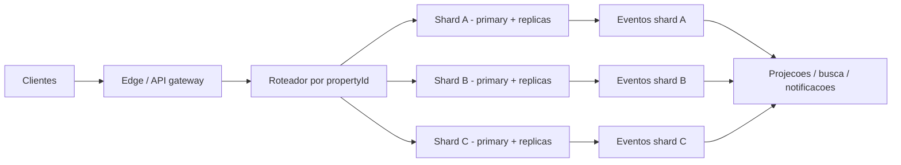

# 5. O que significariam 100M reads/s e 10M bookings/s?

## Antes de escolher ferramentas, definir o numero

"10M requests de escrita/s" pode significar:

1. 10M tentativas/s, a maioria rejeitada ou duplicada.
2. 10M operacoes de inventario/s, incluindo hold, confirmacao e cancelamento.
3. **10M reservas novas confirmadas/s**.

Sao workloads completamente diferentes. O simulador distingue tentativas e
confirmacoes. Fazer 10M conflitos/s contra o mesmo quarto nao e fazer
10M bookings/s com sucesso.

100M reads para 10M writes e proporcao 10:1: cerca de 90,91% das tentativas
seriam leituras. Os exemplos 90/10 sao aproximacoes didaticas; `--read-percent`
aceita inteiros (91 e outra aproximacao), nao uma injecao exata de taxa.

Se fosse sustentado o dia inteiro:

| Taxa | Volume diario |
|---|---|
| 100.000.000 reads/s | 8.640.000.000.000 leituras/dia |
| 10.000.000 reservas/s | 864.000.000.000 reservas/dia |

Com resposta media de 1 KB decimal, so reads implicariam cerca de **100 GB/s**
de payload, sem TLS/headers/retries. Com 600 bytes logicos por reserva,
seriam **518,4 TB/dia** antes de requests, outbox, inbox, indices, WAL, replicas
e backups. Sao estimativas ilustrativas; bytes reais precisam ser medidos.

O inventario fisico tambem precisa sustentar esse volume. Um quarto numa noite
so pode dar uma confirmacao. Hardware nenhum remove essa restricao de negocio.

## Separar classes de leitura

| Classe | Onde atender em uma arquitetura maior | Consistencia |
|---|---|---|
| fotos/assets | CDN/object storage | cacheavel |
| catalogo publico | edge/cache distribuido | atraso aceitavel conforme contrato |
| busca por local/data | search index + projecoes | eventual; candidatos, nao posse |
| disponibilidade final | autoridade do inventario | snapshot fresco; ainda nao reserva |
| minha reserva apos escrever | primary/rota com session consistency | read-your-writes |

Nem toda leitura pode virar CDN: autenticacao, privacidade e cardinalidade de
datas/filtros afetam a chave. Uma taxa de cache hit alta em catalogo nao prova
a mesma taxa em disponibilidade personalizada.

Neste repo so existe Redis para metadados e primary para disponibilidade.
Nao ha CDN, search index, replica ou edge.

## Particionar a autoridade de escrita



**Todas as datas de um mesmo imovel devem ir para uma unica autoridade.**
Assim a decisao de overlap e local ao shard e nao exige transacao global.
Muitos imoveis independentes podem ser processados em paralelo.

Nao apenas fragmentar reservas por ID aleatorio: duas reservas do mesmo imovel
poderiam cair em bancos diferentes, ambos acharem livre e confirmarem.
Tambem nao fragmentar por mes/ano sem um protocolo para estadias cruzando
fronteiras; uma constraint local nao ve outro shard/particao.

Migrar um imovel entre shards precisa de cutover seguro: versao de roteamento,
fencing/autoridade unica, drenagem/reconciliacao e retries.
"Copiar e ativar os dois" pode criar split brain.

O schema deste repo e **um banco unico nao particionado**. Exclusion constraints
nao devem ser presumidas globais entre bancos ou qualquer layout de particoes.

## Idempotencia e sharding

Hoje a chave UUID e unica globalmente no banco unico. Essa propriedade nao se
torna global automaticamente ao copiar o schema para varios bancos.

Uma evolucao razoavel e um contrato com escopo
`(tenant autenticado, propertyId, idempotencyKey)`, roteado sempre ao mesmo shard.
Mudar propertyId muda escopo: isso e **mudanca explicita de contrato**, nao a
mesma semantica global da API local. Se exigir rejeitar chave reutilizada em
qualquer imovel/shard, precisara de registro global/protocolo adicional e seu custo.

## Multi-region e CAP

Catalogo pode ser replicado e servido localmente em varias regioes.
Para inventario exclusivo, e preciso escolher onde esta a autoridade e como
transferi-la sem duas regioes gravando independentemente a mesma noite.

Opcoes: home region por imovel + replicacao, ou storage distribuido com quorum
e transacoes adequadas. Ambas possuem custo de latencia/operacao.

Durante uma particao de rede, se uma regiao nao alcanca autoridade/quorum,
**recusar ou esperar a confirmacao** e preferivel a confirmar duas reservas.
Disponibilidade da escrita pode ser sacrificada para preservar exclusividade.
CAP trata particoes, nao a frase generica "sempre escolher duas letras".

Failover precisa de fencing e politica de durabilidade: promover uma replica
assincrona que perdeu o ultimo commit pode esquecer uma reserva ja confirmada.
Backups nao corrigem automaticamente essa janela.

## Hot keys: o limite que horizontal scaling nao resolve

Milhoes de guests tentando a mesma casa na mesma semana formam um hotspot.
A decisao continua serializada no recurso disputado. A resposta util pode ser
rejeicao barata, fila de admissao ou hold, nao maior paralelismo de commits.

Otimizar:

- rate limit por identidade/recurso e protecao contra bots;
- coalescing de leituras, cache de candidatos e respostas negativas com TTL curto;
- fila de admissao/fairness se esse for o contrato do produto;
- isolamento de shards/tenants quentes;
- deadlines, retries limitados, jitter e circuit breakers;
- nao aumentar conexoes sem medir: muitas conexoes aumentam disputa.

Rejeicao antecipada por cache pode estar obsoleta; defina o contrato. O caminho
de confirmacao sempre termina na autoridade.

## Dimensionamento por evidencia

Para shards independentes, um primeiro modelo e:

```text
shards >= ceil(taxa_de_confirmacoes_alvo /
               (confirmacoes_sustentaveis_por_shard * fator_de_utilizacao))
```

Se, **hipoteticamente**, um shard medido sustentasse 20k confirmacoes/s no SLO,
e voce limitasse uso planejado a 50%, 10M/s exigiriam ao menos 1000 shards.
**20k nao e resultado deste repo**. A conta ignora hotspots, transacoes por
reserva, replicacao, eventos, manutencao e falhas. Nao e um dimensionamento final.

Medir: hardware, duracao da estadia, mistura de requests, dataset/indices,
WAL/fsync, latencia p99, replicas, cache hit/miss, tempo de pool, contencao,
outbox backlog, throughput confirmado e custo. Nao extrapolar linearmente um
teste de 20s no notebook para mil shards.

Cada confirmacao deste repo gera pelo menos uma linha de request, uma reserva,
uma outbox, publicacao no broker, inbox e update de projecao. Cancelamento gera
mais escrita/evento. A plataforma de eventos tambem precisa ser dimensionada.

## Por que nao "RabbitMQ para tudo"?

Fila absorve picos temporarios, nao resolve taxa de chegada permanentemente
maior que consumo. Little's Law: requests em voo = taxa * latencia media.
Com 10M/s e 100 ms, sao cerca de 1M requests em voo, nao 128 tasks.

Para eventos massivos, avaliar logs particionados/streaming, batching, compressao,
particoes por agregado e consumidores independentes. Broker unico deste Compose
e ferramenta didatica, nao recomendacao de capacidade global.

## Roadmap de um sistema real

1. Especificar SLO, durabilidade, definicao de confirmacao e pico/sustentado.
2. Autenticacao, ownership, privacidade, precos e idempotencia por identidade.
3. Holds transacionais com expiracao e pagamentos idempotentes/reconciliados.
4. Separar catalogo/busca da autoridade de inventario.
5. Medir uma unidade de capacidade com dados realistas.
6. Sharding por imovel, HA, replicas e fencing de failover/migracao.
7. Pipeline de eventos e retencao dimensionados.
8. Testes open-loop distribuidos, saturacao, chaos e disaster recovery.

Este laboratorio entrega a base de raciocinio e uma invariavel concreta,
nao esses oito sistemas prontos.
