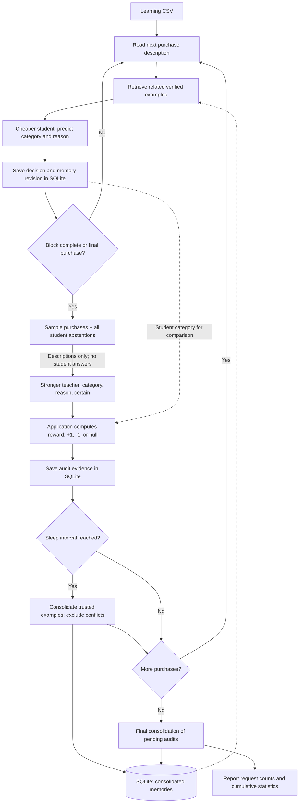
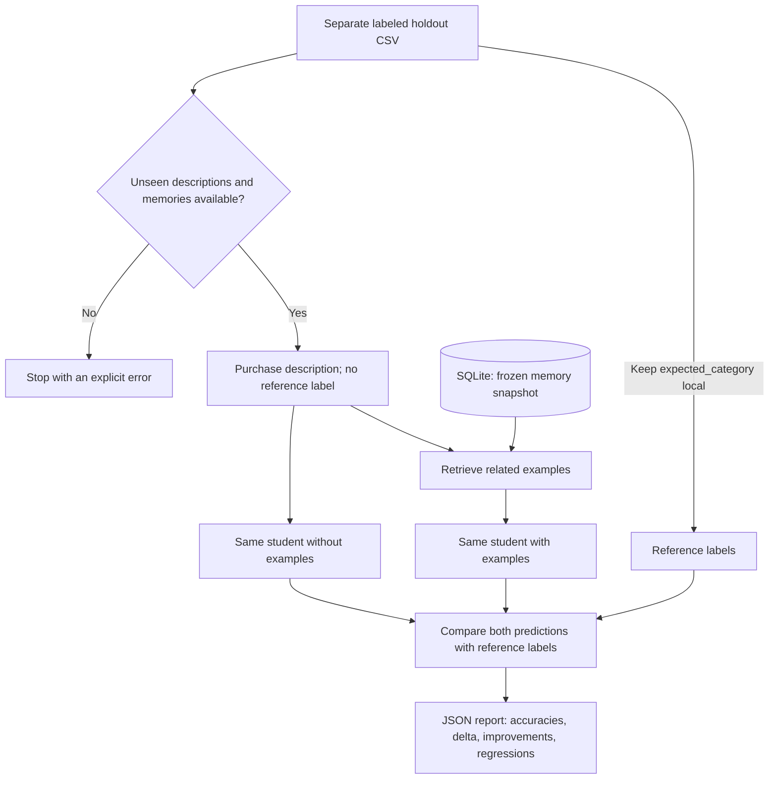
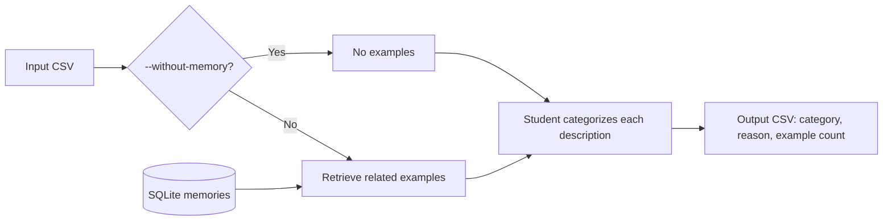

# Purchase categorization: a student, a teacher, and sleep

A working Python CLI demonstrating a cheap LLM categorizing CSV purchases, a
stronger LLM independently auditing samples, and periodic consolidation into
persistent example memory.

**This is memory-based improvement, not PPO, RL training, or fine-tuning.**
Rewards are recorded feedback. Corrected examples, not the numeric reward alone,
change the context of subsequent student requests. Neither model's weights change.
There are no random purchases, gradients, rewards, or invented improvement scores.
Randomness is used only to sample audits; actual LLM generations can also vary.

## Requirements and privacy

- Python 3.10+; no third-party packages.
- An OpenAI-compatible **Chat Completions** endpoint supporting JSON object mode
  (`response_format: {"type": "json_object"}`), with access to two model names.
  This does not implement the Responses API or Azure-specific authentication.
- Start with the fictional, fixed CSVs in [samples](samples). They contain no
  personal transactions. Do not send sensitive financial data to an external
  provider. Use only approved, non-sensitive descriptions; removing a person's
  name alone does not necessarily anonymize a financial record.
- Only `description`, category definitions, and retrieved examples go to the
  student. The teacher gets only `description` and category definitions. IDs,
  unused CSV columns, and `expected_category` are not sent.
- SQLite, output CSVs, and evaluation reports store descriptions and explanations
  in plain text. The local `.gitignore` excludes `.env`, `state`, and `reports`;
  protect any files you place elsewhere yourself. Console audit events include
  teacher explanations, so avoid sensitive inputs and logs.

## Quick start (PowerShell)

Run these commands from this directory:

```powershell
Copy-Item .env.example .env
```

Edit `.env` locally, never commit it:

```dotenv
OPENAI_BASE_URL=https://YOUR-COMPATIBLE-ENDPOINT/v1
OPENAI_API_KEY=YOUR-KEY
STUDENT_MODEL=YOUR-CHEAPER-MODEL
TEACHER_MODEL=YOUR-STRONGER-MODEL
```

Replace the placeholders with actual provider configuration. No model is assumed
or downloaded. A more expensive model is not automatically more accurate; select
and check the teacher for this task. Both models use the same endpoint and key.
For a loopback-compatible local server, HTTP and an empty key are allowed.
Remote endpoints require HTTPS and a key. HTTP redirects are not followed.

The optional `.env` next to `app.py` is read automatically. Existing environment
variables take precedence. Supported file syntax is one `KEY=value` per line,
optional matching quotes, blank lines, and whole-line `#` comments; no expansion,
`export`, multiline values, or inline comments. You can also use PowerShell:

```powershell
$env:OPENAI_BASE_URL = "https://YOUR-COMPATIBLE-ENDPOINT/v1"
$env:OPENAI_API_KEY = "YOUR-KEY"
$env:STUDENT_MODEL = "YOUR-CHEAPER-MODEL"
$env:TEACHER_MODEL = "YOUR-STRONGER-MODEL"
```

Learn from the fixed examples:

```powershell
python app.py learn --csv samples\learning.csv --audit-every 6 --audit-size 2 --sleep-every 2
python app.py status
```

For each block of six purchases, two are sampled uniformly for teacher auditing.
Every student `indeterminado` in that block is additionally audited, without
duplicate requests. Partial final blocks are audited too. Consequently,
`--audit-size` is **not a hard spending cap**. At most every purchase is audited.
Sleep happens every two audit rounds, plus a final consolidation at the end.
Later blocks can already use earlier consolidated memories.

Evaluate the same student with and without memory:

```powershell
python app.py evaluate --csv samples\holdout.csv --output reports\evaluation.json
```

Categorize another CSV without paying for teacher calls:

```powershell
python app.py categorize --csv samples\holdout.csv --output reports\categorized.csv
python app.py categorize --csv samples\holdout.csv --output reports\baseline.csv --without-memory
```

`categorize` never updates the learning database. `evaluate` also leaves decisions,
audits, and memories unchanged. `status` and `sleep` make no API calls.

Global options go **before** the command. Use a separate database for a separate
experiment or a changed taxonomy:

```powershell
python app.py --db state\experiment2.sqlite3 learn --csv samples\learning.csv
python app.py --db state\experiment2.sqlite3 status
python app.py --db state\experiment2.sqlite3 sleep
python app.py --help
```

## CSV contract

UTF-8, optionally with a BOM. Comma, semicolon, and tab delimiters are detected.
Column names are case-sensitive:

```csv
id,description
purchase-1,UBER *TRIP CENTRO
purchase-2,UBER EATS RESTAURANTE JARDIM
```

IDs must be non-empty and unique within the CSV. Descriptions must be non-empty,
at most 2,000 characters, and contain letters or digits after normalization.
Quote descriptions containing delimiters. Additional columns are ignored, except
`expected_category`, which is validated if present and required for evaluation.

The category names and definitions live in [categories.json](categories.json).
`indeterminado` is required: descriptions such as a generic transfer or a
multi-product store do not establish what was purchased.

### Larger example: 100 purchases

[samples/purchases_100.csv](samples/purchases_100.csv) contains exactly 100 fixed,
fictional purchases across all eight categories, including ambiguous descriptions.
It includes `expected_category` as a reference label and shares no normalized
description with the smaller learning or holdout CSVs.

After learning from `samples\learning.csv`, use it as a larger evaluation set:

```powershell
python app.py evaluate --csv samples\purchases_100.csv --output reports\evaluation_100.json
```

Or just generate a categorized CSV with one student request per purchase:

```powershell
python app.py categorize --csv samples\purchases_100.csv --output reports\categorized_100.csv
```

The reference labels stay local and are not sent to either model. Evaluation
makes 200 student requests, while categorization makes 100; neither calls the
teacher. Keep this CSV out of `learn` if you intend to use it for evaluation.
These designed labels are a demonstration reference, not a financial benchmark.

## Flow diagrams

These Mermaid diagrams render on GitHub and in Markdown viewers with Mermaid
support. Arrows into a model represent request data, not updates to model weights.

### 1. Learning, periodic audits, and sleep: `learn`



- **Awake:** every purchase gets a student prediction. Before the first sleep in
  a new database, there are no memories to retrieve.
- **Audit:** `--audit-every` controls block size. `--audit-size` controls the random
  sample, with extra audits for `indeterminado`. Unsampled predictions receive
  neither a reward nor a teacher-derived memory.
- **Blind teacher:** the teacher sees the description and fixed taxonomy, not the
  student's prediction. The application compares their categories afterward.

| Teacher assessment | Category comparison | Reward | Eligible for memory? |
|---|---|---|---|
| `certain=true` | Same category | `+1` | Yes |
| `certain=true` | Different categories | `-1` | Yes, using the teacher's correction |
| `certain=false` | Any result | `null` | No |

- **Sleep:** `--sleep-every` counts audit rounds, not elapsed time. Consolidation
  uses trusted audit history, groups normalized descriptions, and excludes any
  description with conflicting trusted labels. Existing conflicting memories are
  removed. No additional LLM request occurs during consolidation.
- **Next cycle:** later purchases can retrieve the new examples. A final sleep
  handles remaining audits; it is a no-op if none are pending. Nothing runs in
  the background after the command exits.

The numeric reward is an audit record, **not a gradient or a message that trains
the student by itself**. The effective feedback is the corrected example supplied
in a later prompt. Teacher certainty remains a fallible, self-reported judgment.

### 2. Measuring the effect of memory: `evaluate`



Each purchase causes two student requests; their order alternates. Reference
labels never enter a model prompt. There are no teacher calls, rewards, or memory
updates in this flow. A negative accuracy delta is a valid result, not an error
to hide. Exact normalized training overlap is rejected; related new descriptions
are allowed.

### 3. Using what was consolidated: `categorize`



This is the usage-only path: one student request per purchase, no teacher calls,
and no new decisions, audits, or memories saved to the database.

The remaining commands operate locally:

| Command | Flow | LLM calls |
|---|---|---|
| `sleep` | Pending audits + trusted history -> consolidated SQLite memories | None |
| `status` | SQLite counts and recorded rewards -> coverage and teacher-agreement summary | None |

`sleep` cannot invent missing teacher assessments or resume unaudited purchases.
`status` reports agreement with the teacher, not accuracy against reference labels.

## What actually happens

1. **Awake:** the student categorizes each purchase using the taxonomy and up to
   three lexically related memories. Retrieval uses token overlap, no embeddings.
2. **Audit:** the teacher independently categorizes selected descriptions without
   seeing the student's answer or memories.
3. **Reward:** a teacher marked `certain=true` yields `+1` for category agreement
   or `-1` for disagreement. `certain=false` yields `null`, not a penalty.
4. **Sleep:** trusted teacher examples, including corrections of student errors,
   become persistent memories. Uncertain assessments are excluded. Both successful
   and failed student experiences can therefore produce useful memories.
5. **Next block/run:** related examples are supplied to the student as reference
   data, not universal merchant rules. A ride example must not imply that food
   delivery from the same company is transport.

For example:

```text
Student: UBER *TRIP CENTRO -> alimentacao
Teacher: UBER *TRIP CENTRO -> transporte, certain=true
Reward: -1
Sleep memory: this description is transporte, with the teacher's explanation
Next purchase: UBER *TRIP RODOVIARIA -> retrieve the corrected example
```

This sequence is illustrative, **not an assertion that your chosen student will
make that mistake or improve**.

Memories are keyed by normalized full descriptions. Repeated agreeing evidence
updates support rather than duplicating memory. If trusted teacher assessments
disagree for the same normalized description, the memory is removed and the
conflict is reported. Full audit evidence stays in SQLite. A taxonomy fingerprint
prevents accidentally reusing a database after changing category definitions.
Changing models does not clear old examples; use a new `--db` for clean comparisons.

Teacher certainty is self-reported, **not a calibrated probability or proof**.
Systematic teacher errors remain possible. Support counts may include repeated
audits of the same purchase and are not independent confirmations. Teacher
agreement in `status` is **not accuracy**; the sample also overrepresents abstentions.
Use human review to establish reference labels and check the teacher.

## Honest before/after measurement

[samples/holdout.csv](samples/holdout.csv) contains separate, manually specified
reference labels. Do not use this CSV in `learn`. Evaluation rejects normalized
descriptions already present among learning decisions, even under a different ID.
Closely related merchant variations are intentional: this small demo measures
nearby generalization, not performance on an unseen merchant distribution.

The report contains:

- Accuracy against the supplied labels, without and with memory.
- The difference in **percentage points**, including negative results.
- Improved cases, regressions, each prediction, and retrieved examples.
- Student model name, memory revision, and actual request count.

Labels are never sent to either model. Evaluation makes two student calls per
purchase, alternates condition order, and performs no teacher calls or updates.
The model and request settings are the same in both conditions except for
memories. Sampling temperature is omitted for endpoint/model compatibility;
outputs can be stochastic. `--seed` controls audit selection only.

The sample is deliberately small. A strong student may already get everything
right, memories may hurt, and repeated evaluations vary. Do not select lessons
based on holdout failures or tune repeatedly against it and still call it unseen.
Create a new untouched, human-reviewed test set for subsequent experiments.

## Persistence, errors, and cost

The default database is `state\learning.sqlite3`, relative to the application.
Decisions record run ID, student model, and memory revision; audits record teacher
model, explanation, certainty, and reward. Each completed decision/audit is committed.
Sleep consolidates pending audits transactionally. Re-running `sleep` without new
audits does nothing.

Missing configuration, malformed CSVs, unknown categories, invalid model JSON,
HTTP failures, and database errors stop with a non-zero exit code. There are no
fake predictions, silent category fallbacks, or automatic request retries.
Provider error bodies are not printed because they can echo sensitive data.
Timeout is 60 seconds per request.

After an interrupted run, completed records remain. Run `sleep` to consolidate
completed pending audits. Incomplete/unaudited decisions are not automatically
resumed or treated as correct. Starting `learn` again creates a new run and may
repeat calls for the same inputs.

Each `learn` makes one student call per purchase, plus sampled teacher calls.
Each `evaluate` makes two student calls per test purchase. Request counts are
reported; monetary prices are not guessed. Start small and inspect provider usage.

## Tests

```powershell
python -m unittest -v test_demo
```

The standard-library tests cover CSV validation, persistence, rewards, uncertain
teachers, contradictory evidence, sampling, retrieval, taxonomy changes, leakage
checks, HTTP failures, and a complete CLI workflow across separate processes.

Integration tests run a **local deterministic HTTP fixture**, never a real
provider. Their controlled accuracy change tests wiring, not LLM learning.
Real-model accuracy and provider compatibility must be measured after configuring
your endpoint.
